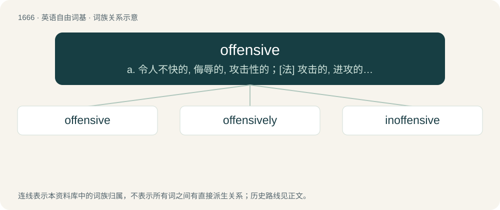

# 1767 · offensive — a. 令人不快的, 侮辱的, 攻击性的；\[法\] 攻击的, 进攻的, 冒犯的

[总目录](../00_总目录_按常用程度.md)

**类型**：英语自由词基　｜　**来源语言**：见词源记录

## 核心含义与来源

- 核心含义：a. 令人不快的, 侮辱的, 攻击性的；\[法\] 攻击的, 进攻的, 冒犯的
- 英文含义：Causing offense; arousing a visceral reaction of disgust, anger, hatred, sadness, or indignation.
- 词形：offensive

**来源记录 1**（形容词；Causing offense; arousing a visceral reaction of disgust, anger, hatred, sadness, or indignation.）

From Middle French offensif, from offendre + -if by analogy with défensif. Offendre is from Latin offendere (“to offend”); see offend.

## 词族图

## 单词速览（常用到不常用）

| 单词 | 音标 | 释义 |
|---|---|---|
| [offensive](#w-1) | 美 /ˈɔˌfɛnsɪv/；/əˈfɛnsɪv/ | a. 令人不快的, 侮辱的, 攻击性的；\[法\] 攻击的, 进攻的, 冒犯的 |
| [offensively](#w-2) | 美 /əˈfɛnsɪvli/ | adv. 冒犯地；讨厌地 |
| [inoffensive](#w-3) | /.inəˈfensiv/ | a. 无害的, 不触犯人的, 不讨厌的 |

## 逐词详解

### 1. offensive

**词性**：形容词　｜　**音标**：美 /ˈɔˌfɛnsɪv/；/əˈfɛnsɪv/

**中文释义**：a. 令人不快的, 侮辱的, 攻击性的；\[法\] 攻击的, 进攻的, 冒犯的

**英文义项**：Causing offense; arousing a visceral reaction of disgust, anger, hatred, sadness, or indignation. / Socially disrespectful; insensitive.

**词源与演化**：

From Middle French offensif, from offendre + -if by analogy with défensif. Offendre is from Latin offendere (“to offend”); see offend.

**例句**：

> The offensive coordinator is responsible for ordering all rushing plays.

该用例对应义项：Having to do with play directed at scoring.

### 2. offensively

**词性**：副词　｜　**音标**：美 /əˈfɛnsɪvli/

**中文释义**：adv. 冒犯地；讨厌地

**英文义项**：In an offensive manner.

**构词拆分**：offensive + -ly

**词源与演化**：

From offensive + -ly.

**例句**：

> He smelled offensively unwashed.

该用例对应义项：in an unpleasantly offensive manner

### 3. inoffensive

**词性**：形容词　｜　**音标**：/.inəˈfensiv/

**中文释义**：a. 无害的, 不触犯人的, 不讨厌的

**英文义项**：not offensive / harmless

**构词拆分**：in- + offensive

**词源与演化**：

From in- + offensive.

**用法示例／搭配（非完整句）**：

> an inoffensive plant

该用例对应义项：harmless
