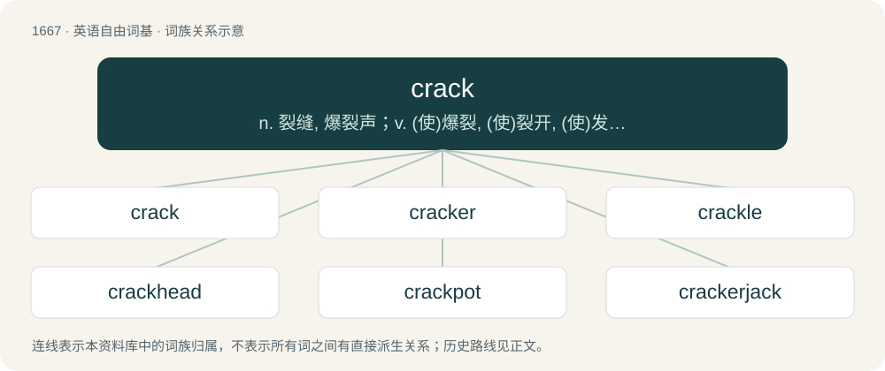

# 1768 · crack — n. 裂缝, 爆裂声；v. (使)爆裂, (使)裂开, (使)发出爆裂声；a. 第一流的

[总目录](../00_总目录_按常用程度.md)

**类型**：英语自由词基　｜　**来源语言**：见词源记录

## 核心含义与来源

- 核心含义：n. 裂缝, 爆裂声；v. (使)爆裂, (使)裂开, (使)发出爆裂声；a. 第一流的
- 英文含义：To form cracks.
- 词形：crack

**多个词源／构词路径**：同一拼写可能有不同来源；以下按词性和含义分别列出。

**来源记录 1**（动词；To form cracks.）

From Middle English crakken, craken, from Old English cracian (“to resound, crack”), from Proto-West Germanic \*krakōn (“to crack, crackle, shriek”), ultimately from Proto-Indo-European \*gerh₂- (“to resound, cry hoarsely”). Cognate with Scots crak (“to crack”), West Frisian kreakje (“to crack”), Dutch kraken (“to crunch, creak, squeak”), Low German kraken (“to crack”), German krachen (“to crash, crack, creak”), Lithuanian gi̇̀rgžděti (“to creak, squeak”), Old Armenian կարկաչ (karkačʻ), Sanskrit गर्जति (gárjati, “to roar, hum”). Compare typologically English crevice (&lt;&lt; Latin crepō), Bulgarian пукнатина (puknatina) (akin to пу́кам (púkam)), Russian тре́щина (tréščina) (akin to треск (tresk)), щель (ščelʹ) (akin to щёлкать (ščólkatʹ)).

**来源记录 2**（形容词；Highly trained and competent.）

Slang first attested 1793, perhaps from the verb in the sense of doing something quickly or with intelligence, or in the sense of "speaking boastingly" and having something to be proud of.

## 词族图

## 单词速览（常用到不常用）

| 单词 | 音标 | 释义 |
|---|---|---|
| [crack](#w-1) | 英 /kɹæk/ | n. 裂缝, 爆裂声；v. (使)爆裂, (使)裂开, (使)发出爆裂声；a. 第一流的 |
| [cracker](#w-2) | /ˈkɹækə(ɹ)/ | n. 饼干, 爆竹；\[计\] 破袭者 |
| [crackle](#w-3) | /ˈkɹækəl/ | n. 劈啪响, 裂纹；vi. (使)发劈啪声 |
| [crackhead](#w-4) | /ˈkɹæk.hɛd/ | 强效可卡因瘾君子 |
| [crackpot](#w-5) | /ˈkɹæk.pɒt/ | a. 想入非非的, 不切实的；n. 疯子, 怪人, 狂想家 |
| [crackerjack](#w-6) | 美 /ˈkɹækɚd͡ʒæk/ | n. &lt;俚&gt;能力极强之人, 极佳之物 |

## 逐词详解

### 1. crack

**词性**：动词　｜　**音标**：英 /kɹæk/

**中文释义**：n. 裂缝, 爆裂声；v. (使)爆裂, (使)裂开, (使)发出爆裂声；a. 第一流的

**英文义项**：To form cracks. / To break apart under force, stress, or pressure.

**词源与演化**：

From Middle English crakken, craken, from Old English cracian (“to resound, crack”), from Proto-West Germanic \*krakōn (“to crack, crackle, shriek”), ultimately from Proto-Indo-European \*gerh₂- (“to resound, cry hoarsely”). Cognate with Scots crak (“to crack”), West Frisian kreakje (“to crack”), Dutch kraken (“to crunch, creak, squeak”), Low German kraken (“to crack”), German krachen (“to crash, crack, creak”), Lithuanian gi̇̀rgžděti (“to creak, squeak”), Old Armenian կարկաչ (karkačʻ), Sanskrit गर्जति (gárjati, “to roar, hum”). Compare typologically English crevice (&lt;&lt; Latin crepō), Bulgarian пукнатина (puknatina) (akin to пу́кам (púkam)), Russian тре́щина (tréščina) (akin to треск (tresk)), щель (ščelʹ) (akin to щёлкать (ščólkatʹ)).

**例句**：

> She cracked at age 22 and came out to her friends and family over the next few months.

该用例对应义项：To realize that one is transgender.

### 2. cracker

**词性**：名词　｜　**音标**：/ˈkɹækə(ɹ)/

**中文释义**：n. 饼干, 爆竹；\[计\] 破袭者

**英文义项**：A dry, thin, crispy baked bread (usually salty or savoury, but sometimes sweet, as in the case of graham crackers and animal crackers). / A prawn cracker.

**构词拆分**：crack (“to break, snap, utter, make a sound”) + -er

**词源与演化**：

From Middle English craker (“a boaster”), equivalent to crack (“to break, snap, utter, make a sound”) + -er. From crack (verb), the sound made when one is broken. The hard "bread" and "biscuit" sense is first attested in 1739. The computing senses of cracker, crack, and cracking were promoted in the 1980s as an alternative to hacker, by programmers concerned about negative public associations of hack, hacking (“creative computer coding”). See Citations:cracker. Various theories exist regarding the term's application to poor white Southerners. One theory holds that it originated with disadvantaged corn and wheat farmers (corncrackers), who cracked their crops rather than taking them to the mill. Another theory asserts that it was applied due to Georgia and Florida settlers (Florida crackers) who cracked loud whips to drive herds of cattle, or, alternatively, from the whip cracking of plantation slave drivers. Yet another theory maintains that the term cracker was in use in Elizabethan times to describe braggarts (see crack (“to boast”)); a letter from 1766 supports this theory.

**例句**：

> She's an absolute cracker!

该用例对应义项：A fine, great thing or person (crackerjack).

### 3. crackle

**词性**：名词　｜　**音标**：/ˈkɹækəl/

**中文释义**：n. 劈啪响, 裂纹；vi. (使)发劈啪声

**英文义项**：A prolonged, frequent cracking sound; a fizzing, popping sound. / A style of glaze giving the impression of many small cracks.

**构词拆分**：crack + -le (frequentative suffix)

**词源与演化**：

From Middle English crakelen, equivalent to crack + -le (frequentative suffix). The physics sense is part of a facetious sequence "snap, crackle, pop", after the mascots of Rice Krispies cereal.

**例句**：

> There was an annoying crackle during the phone call, due to poor connection.

该用例对应义项：A prolonged, frequent cracking sound; a fizzing, popping sound.

### 4. crackhead

**词性**：名词　｜　**音标**：/ˈkɹæk.hɛd/

**中文释义**：强效可卡因瘾君子

**英文义项**：A person who is addicted to or regularly uses crack cocaine. / Someone whose thinking makes no sense; a fool or an idiot; broadly, any contemptible person.

**构词拆分**：crack + -head

**词源与演化**：

From crack + -head. First sense appears c. 1978. Second sense appears c. 1977 in Best Canadian Stories.

**例句**：

> Sami pretended to be a crackhead.

### 5. crackpot

**词性**：名词　｜　**音标**：/ˈkɹæk.pɒt/

**中文释义**：a. 想入非非的, 不切实的；n. 疯子, 怪人, 狂想家

**英文义项**：An eccentric, crazy or foolish person. / Someone addicted to crack cocaine (i.e. a drug addict).

**构词拆分**：crack + pot；crack + pate

**词源与演化**：

Mostly likely a back-etymology of pot, to form crack + pot. Originally, from crack + pate. Compare typologically Russian чо́кнутый (čóknutyj) (&lt; чо́каться (čókatʹsja), onomatopoeic), see crack for the further typology.

**例句**：

> Time will tell whether he is a crackpot or a genius for promoting that sort of idea.

该用例对应义项：An eccentric, crazy or foolish person.

### 6. crackerjack

**词性**：形容词　｜　**音标**：美 /ˈkɹækɚd͡ʒæk/

**中文释义**：n. &lt;俚&gt;能力极强之人, 极佳之物

**英文义项**：Exceptionally fine or excellent; top-notch; high quality. / Expert, top-rated or high-performing.

**构词拆分**：From crack (“highly skilled, excellent”) + -er + jack (“man”).

**词源与演化**：

From crack (“highly skilled, excellent”) + -er + jack (“man”).

**例句**：

> It's going to take crackerjack timing, but if we can work the play, we'll win the game.
