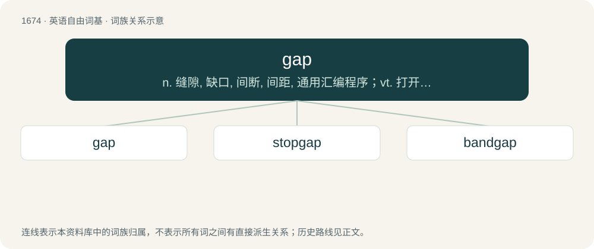

# 1771 · gap — n. 缝隙, 缺口, 间断, 间距, 通用汇编程序；vt. 打开缺口, 造成缝隙；vi. 豁开

[总目录](../00_总目录_按常用程度.md)

**类型**：英语自由词基　｜　**来源语言**：见词源记录

## 核心含义与来源

- 核心含义：n. 缝隙, 缺口, 间断, 间距, 通用汇编程序；vt. 打开缺口, 造成缝隙；vi. 豁开
- 英文含义：An opening in anything, made by breaking or parting.
- 词形：gap

**多个词源／构词路径**：同一拼写可能有不同来源；以下按词性和含义分别列出。

**来源记录 1**（名词；An opening in anything, made by breaking or parting.）

Inherited from Middle English gap /gappe, from Old Norse gap (“an empty space, gap, chasm”), from gapa (“to gape, scream”), from Proto-Germanic \*gapōną, from Proto-Indo-European \*ǵʰeh₂- (“to open wide, gape”). Related to Danish gab (“an expanse, space, gap”), Old English ġeap (“open space, expanse”). Doublet of gape.

**来源记录 2**（动词；To stare or gape.）

A variant of gape.

## 词族图

## 单词速览（常用到不常用）

| 单词 | 音标 | 释义 |
|---|---|---|
| [gap](#w-1) | 英 /ɡæp/ | n. 缝隙, 缺口, 间断, 间距, 通用汇编程序；vt. 打开缺口, 造成缝隙；vi. 豁开 |
| [stopgap](#w-2) | 英 /ˈstɒpɡæp/；美 /ˈstɑpˌɡæp/ | n. 权宜之计, 补缺者；a. 暂时的, 权宜的 |
| [bandgap](#w-3) | /ˈbændgæp/ | n. \[物\]能带隙 |

## 逐词详解

### 1. gap

**词性**：名词　｜　**音标**：英 /ɡæp/

**中文释义**：n. 缝隙, 缺口, 间断, 间距, 通用汇编程序；vt. 打开缺口, 造成缝隙；vi. 豁开

**英文义项**：An opening in anything, made by breaking or parting. / An opening allowing passage or entrance.

**词源与演化**：

Inherited from Middle English gap /gappe, from Old Norse gap (“an empty space, gap, chasm”), from gapa (“to gape, scream”), from Proto-Germanic \*gapōną, from Proto-Indo-European \*ǵʰeh₂- (“to open wide, gape”). Related to Danish gab (“an expanse, space, gap”), Old English ġeap (“open space, expanse”). Doublet of gape.

**例句**：

> You must wait for a gap in the traffic before crossing the road.

该用例对应义项：A hiatus, a pause in something which is otherwise continuous.

### 2. stopgap

**词性**：名词　｜　**音标**：英 /ˈstɒpɡæp/；美 /ˈstɑpˌɡæp/

**中文释义**：n. 权宜之计, 补缺者；a. 暂时的, 权宜的

**英文义项**：That which stops up or fills a gap or hole. / Something spoken to fill up an uncomfortable pause in speech; a filled pause or filler.

**构词拆分**：stop (“to close or block (an opening)”) + gap

**词源与演化**：

The noun is derived from stop (“to close or block (an opening)”) + gap, from the phrase to stop a gap. The adjective is from an attributive use of the noun, and the verb is derived from the noun.

**例句**：

> The small company used their old product with a few kludged enhancements as a stopgap until they could develop a new product.

该用例对应义项：A short-term fix or temporary measure used until something better can be obtained; that which serves as an expedient in an emergency; a band-aid solution.

### 3. bandgap

**词性**：名词　｜　**音标**：/ˈbændgæp/

**中文释义**：n. \[物\]能带隙

**英文义项**：The energy difference between two allowed ranges of electron energy in a solid; especially the difference between the energies of the valence band and the conduction band. / A gap in a frequency range in which waves cannot propagate.

**构词拆分**：band + gap

**词源与演化**：

From band + gap.

**例句**：

> The propagation of an acoustic wave inside a phononic crystal is forbidden in the bandgap frequency range due to Bragg scattering.

该用例对应义项：A gap in a frequency range in which waves cannot propagate.
