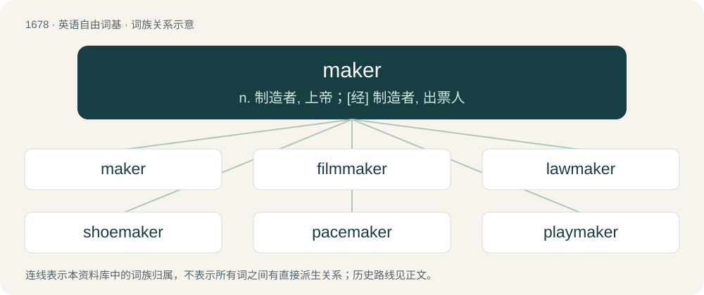

# 1775 · maker — n. 制造者, 上帝；\[经\] 制造者, 出票人

[总目录](../00_总目录_按常用程度.md)

**类型**：英语自由词基　｜　**来源语言**：见词源记录

## 核心含义与来源

- 核心含义：n. 制造者, 上帝；\[经\] 制造者, 出票人
- 英文含义：Someone who makes; a person or thing that makes or produces something.
- 词形：maker

**来源记录 1**（名词；Someone who makes; a person or thing that makes or produces something.）

From Middle English maker, makere, equivalent to make + -er. Compare Scots makar, Saterland Frisian Moaker, West Frisian makker, Dutch maker, German Macher, Danish mager, Swedish makare. Doublet of makar.

## 词族图

## 单词速览（常用到不常用）

| 单词 | 音标 | 释义 |
|---|---|---|
| [maker](#w-1) | 英 /ˈmeɪk.ə/；美 /ˈmeɪk.ɚ/ | n. 制造者, 上帝；\[经\] 制造者, 出票人 |
| [filmmaker](#w-2) | /ˈfilm,meikə(r)/ | n. 电影制作人 |
| [lawmaker](#w-3) | /lɒːˈmeikə/ | n. 立法者 |
| [shoemaker](#w-4) | 美 /ˈʃuˌmeɪkɚ/ | n. 鞋店营业员, 皮鞋匠 |
| [pacemaker](#w-5) | /ˈpeɪsˌmeɪkəɹ/ | n. 带步人, 标兵, 起搏器；\[医\] 起搏点, 起搏器 |
| [playmaker](#w-6) | /ˈplei,meikə(r)/ | n. (篮球、 曲棍球等 ) 场上组织进攻的队员 |
| [homemaker](#w-7) | /ˈhəummeikə/ | n. 主妇 |
| [matchmaker](#w-8) | 美 /ˈmæt͡ʃˌmeɪkɚ/ | n. 火柴制造者, 媒人, 安排比赛的人 |
| [winemaker](#w-9) | 英 /ˈwaɪnˌmeɪkə/；美 /ˈwaɪnˌmeɪkɚ/ | 葡萄酒酿造者；葡萄酒生产者 |
| [automaker](#w-10) | /ˈɔːtəu,meikə/ | n. &lt;美&gt;汽车制造商 |
| [bookmaker](#w-11) | 英 /ˈbʊkmeɪkə/；美 /ˈbʊkmeɪkɚ/ | n. 著作家, 编辑者, 赌注登记经营人；\[法\] 以赌为业者, 赌本, 编书谋利者 |
| [watchmaker](#w-12) | 英 /ˈwɔtʃˌmeɪkə/ | n. 钟表匠 |
| [dressmaker](#w-13) | 美 /ˈdɹɛsˌmeɪkɚ/ | n. 裁缝 |
| [rainmaker](#w-14) | 英 /ˈɹeɪnmeɪkə/；美 /ˈɹeɪnˌmeɪkɚ/ | n. 唤雨巫师, 人工雨工作者 |
| [kingmaker](#w-15) | 英 /ˈkɪŋmeɪkə/；美 /ˈkɪŋˌmeɪkɚ/ | n. 拥立国王者, 有权支配要职的任命者 |
| [moneymaker](#w-16) | 英 /ˈmʌniˌmeɪkə/；美 /ˈmʌniˌmeɪkɚ/ | n. 很会赚钱的人 |
| [carmaker](#w-17) | /ˈkɑː,meikə(r)/ | n. 汽车制造商 |
| [coffeemaker](#w-18) | 美 /ˈkɑ.fiˌmeɪk.ɚ/ | n. &lt;美&gt;煮咖啡器,咖啡壶 |
| [printmaker](#w-19) | /ˈprint,meikə(r)/ | n. 版画复制匠 |
| [hitmaker](#w-20) |  | 【英文】A musician who frequently produces hits; a star. |
| [makerspace](#w-21) |  | 【英文】A hackerspace where people develop electronic hardware or other physical objects. |
| [toymaker](#w-22) | /ˈtɔɪmeɪkə/ | 玩具制造者 |
| [boilermaker](#w-23) | /ˈbɔɪləɹmeɪkɚ/ | 锅炉制造\[装配、修理\]工 |

## 逐词详解

### 1. maker

**词性**：名词　｜　**音标**：英 /ˈmeɪk.ə/；美 /ˈmeɪk.ɚ/

**中文释义**：n. 制造者, 上帝；\[经\] 制造者, 出票人

**英文义项**：Someone who makes; a person or thing that makes or produces something. / God, the Creator.

**构词拆分**：make + -er

**词源与演化**：

From Middle English maker, makere, equivalent to make + -er. Compare Scots makar, Saterland Frisian Moaker, West Frisian makker, Dutch maker, German Macher, Danish mager, Swedish makare. Doublet of makar.

**例句**：

> Did Yanni deserve to meet his Maker at such an early age?

### 2. filmmaker

**词性**：名词　｜　**音标**：/ˈfilm,meikə(r)/

**中文释义**：n. 电影制作人

**英文义项**：A producer or director of films/movies.

**构词拆分**：film + maker

**词源与演化**：

From film + maker.

**例句**：

> The filmmaker's goal is to entertain, while also making her audience think.

### 3. lawmaker

**词性**：名词　｜　**音标**：/lɒːˈmeikə/

**中文释义**：n. 立法者

**英文义项**：One who makes or enacts laws.

**构词拆分**：law + maker

**词源与演化**：

From Middle English lawemaker, lawe maker, equivalent to law + maker.

**例句**：

> Ricks, 54, is now a lawmaker in the Colorado General Assembly, elected in November 2020.

### 4. shoemaker

**词性**：名词　｜　**音标**：美 /ˈʃuˌmeɪkɚ/

**中文释义**：n. 鞋店营业员, 皮鞋匠

**英文义项**：A person who makes shoes. / The threadfish.

**构词拆分**：shoe + maker

**词源与演化**：

From Middle English shomaker, equivalent to shoe + maker. Compare Dutch schoenmaker, German Schuhmacher, Danish skomager.

**例句**：

> The shoemaker ran after him straight way, shouting, Stop thief, Stop thief!

### 5. pacemaker

**词性**：名词　｜　**音标**：/ˈpeɪsˌmeɪkəɹ/

**中文释义**：n. 带步人, 标兵, 起搏器；\[医\] 起搏点, 起搏器

**英文义项**：Specialized cells which stimulate the heart to beat. / A medical implement that is used to stimulate a heart to beat by simulating the action of the natural pacemaker.

**构词拆分**：pace + maker

**词源与演化**：

From pace + maker.

**用法示例／搭配（非完整句）**：

> artificial pacemaker

该用例对应义项：A medical implement that is used to stimulate a heart to beat by simulating the action of the natural pacemaker.

### 6. playmaker

**词性**：名词　｜　**音标**：/ˈplei,meikə(r)/

**中文释义**：n. (篮球、 曲棍球等 ) 场上组织进攻的队员

**英文义项**：A playwright. / A sportsman who leads attacks for his team and creates chances to score.

**构词拆分**：play + maker

**词源与演化**：

From play + maker.

### 7. homemaker

**词性**：名词　｜　**音标**：/ˈhəummeikə/

**中文释义**：n. 主妇

**英文义项**：A person who maintains the administration and upkeep of his or her residence, especially one who is not employed outside the home; one who runs the household.

**构词拆分**：home + maker

**词源与演化**：

From home + maker.

### 8. matchmaker

**词性**：名词　｜　**音标**：美 /ˈmæt͡ʃˌmeɪkɚ/

**中文释义**：n. 火柴制造者, 媒人, 安排比赛的人

**英文义项**：Someone who finds suitable dates or marriage partners for other people. / Someone who arranges professional boxing matches.

**构词拆分**：match + maker

**词源与演化**：

From match + maker.

### 9. winemaker

**词性**：名词　｜　**音标**：英 /ˈwaɪnˌmeɪkə/；美 /ˈwaɪnˌmeɪkɚ/

**中文释义**：葡萄酒酿造者；葡萄酒生产者

**英文义项**：A person who makes wine. / A company that makes wine.

**构词拆分**：wine + maker

**词源与演化**：

From Middle English wynmaker; equivalent to wine + maker.

**例句**：

> The winemaker says sustainable viticulture is more than a set of farming practices.

### 10. automaker

**词性**：名词　｜　**音标**：/ˈɔːtəu,meikə/

**中文释义**：n. &lt;美&gt;汽车制造商

**英文义项**：A person or company that manufactures automobiles; usually used to refer to a large corporation such as General Motors, Toyota, and so on.

**构词拆分**：auto + maker

**词源与演化**：

From auto + maker.

**例句**：

> The automaker will unveil its new line of sports cars tomorrow.

### 11. bookmaker

**词性**：名词　｜　**音标**：英 /ˈbʊkmeɪkə/；美 /ˈbʊkmeɪkɚ/

**中文释义**：n. 著作家, 编辑者, 赌注登记经营人；\[法\] 以赌为业者, 赌本, 编书谋利者

**英文义项**：A person who prints or binds books. / A person who compiles books from the writings of others.

**构词拆分**：book + maker

**词源与演化**：

From Middle English bokmakere, boke maker, equivalent to book + maker. The gambling term came from the archaic phrase make book or make a book, used in 19th century England.

### 12. watchmaker

**词性**：名词　｜　**音标**：英 /ˈwɔtʃˌmeɪkə/

**中文释义**：n. 钟表匠

**英文义项**：A craftsperson or company who makes and/or maintains watches. / God in His role as the creator according to the watchmaker analogy.

**构词拆分**：watch + maker

**词源与演化**：

From watch + maker. Compare clockmaker.

**例句**：

> We have the great watchmaker to thank for these glorious sunrises and sunsets.

该用例对应义项：God in His role as the creator according to the watchmaker analogy.

### 13. dressmaker

**词性**：名词　｜　**音标**：美 /ˈdɹɛsˌmeɪkɚ/

**中文释义**：n. 裁缝

**英文义项**：A person who makes tailor-made women's clothes.

**构词拆分**：dress + maker

**词源与演化**：

From dress + maker.

**例句**：

> The dressmaker forgot to sew a pocket on my jeans.

### 14. rainmaker

**词性**：名词　｜　**音标**：英 /ˈɹeɪnmeɪkə/；美 /ˈɹeɪnˌmeɪkɚ/

**中文释义**：n. 唤雨巫师, 人工雨工作者

**英文义项**：Someone or something that causes or attempts to cause rain to fall. / A medicine man, shaman, or the like, who seeks to induce rain through performing rituals, as in African or Native American cultures.

**构词拆分**：rain + maker

**词源与演化**：

From rain + maker.

**例句**：

> The law firm relied heavily on Charlotte as its main rainmaker to bring in new clients.

该用例对应义项：A person having the ability to generate business, raise funds, or otherwise engineer success for a company, organization, etc.

### 15. kingmaker

**词性**：名词　｜　**音标**：英 /ˈkɪŋmeɪkə/；美 /ˈkɪŋˌmeɪkɚ/

**中文释义**：n. 拥立国王者, 有权支配要职的任命者

**英文义项**：Someone who has strong influence over the choice of a leader. / A player who is unable to win but powerful enough to decide which of the other viable players will eventually win.

**构词拆分**：king + maker

**词源与演化**：

From king + maker, originally used in the 16th century in “Warwick the Kingmaker”, an epithet of Richard Neville, 16th Earl of Warwick (1428–1471), a key figure in the Wars of the Roses whose actions led to King Henry VI being deposed in 1461 and Edward IV appointed in his place, then Edward IV being replaced by Henry VI again in 1470.

**例句**：

> The Earl of Warwick was the first kingmaker.

该用例对应义项：an important person who can bring leaders to power through the exercise of political influence

### 16. moneymaker

**词性**：名词　｜　**音标**：英 /ˈmʌniˌmeɪkə/；美 /ˈmʌniˌmeɪkɚ/

**中文释义**：n. 很会赚钱的人

**英文义项**：Someone or something that earns or makes money; anything lucrative or profitable. / (usually a woman's) butt, ass, rear end

**构词拆分**：money + maker

**词源与演化**：

From Middle English monymaker; equivalent to money + maker.

**例句**：

> With careful management, she hoped to grow her small business into a real moneymaker.

该用例对应义项：Someone or something that earns or makes money; anything lucrative or profitable.

### 17. carmaker

**词性**：名词　｜　**音标**：/ˈkɑː,meikə(r)/

**中文释义**：n. 汽车制造商

**英文义项**：A manufacturer of automobiles.

**构词拆分**：car + maker

**词源与演化**：

From car + maker.

### 18. coffeemaker

**词性**：名词　｜　**音标**：美 /ˈkɑ.fiˌmeɪk.ɚ/

**中文释义**：n. &lt;美&gt;煮咖啡器,咖啡壶

**英文义项**：A person who makes coffee. / Any of several different types of kitchen apparatus used to brew and filter coffee.

**构词拆分**：coffee + maker

**词源与演化**：

From coffee + maker.

**例句**：

> She bought a toaster, a coffeemaker, an egg cooker and a hand mixer.

### 19. printmaker

**词性**：名词　｜　**音标**：/ˈprint,meikə(r)/

**中文释义**：n. 版画复制匠

**英文义项**：A person who makes prints of works of art, (particularly) a self-employed craftsman.

**构词拆分**：print + maker

**词源与演化**：

From print + maker.

### 20. hitmaker

**词性**：名词

**英文义项**：A musician who frequently produces hits; a star.

**构词拆分**：hit + maker

**词源与演化**：

From hit + maker.

### 21. makerspace

**词性**：名词

**英文义项**：A hackerspace where people develop electronic hardware or other physical objects.

**构词拆分**：maker + space

**词源与演化**：

From maker + space.

### 22. toymaker

**词性**：名词　｜　**音标**：/ˈtɔɪmeɪkə/

**中文释义**：玩具制造者

**英文义项**：A craftsman who makes toys.

**构词拆分**：toy + maker

**词源与演化**：

From toy + maker.

### 23. boilermaker

**词性**：名词　｜　**音标**：/ˈbɔɪləɹmeɪkɚ/

**中文释义**：锅炉制造\[装配、修理\]工

**英文义项**：A person qualified to make or repair boilers. / A whiskey with a beer chaser.

**构词拆分**：boiler + maker

**词源与演化**：

From boiler + maker.
