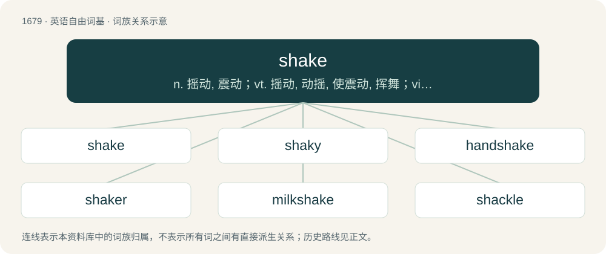

# 1776 · shake — n. 摇动, 震动；vt. 摇动, 动摇, 使震动, 挥舞；vi. 震动, 发抖, 动摇

[总目录](../00_总目录_按常用程度.md)

**类型**：英语自由词基　｜　**来源语言**：见词源记录

## 核心含义与来源

- 核心含义：n. 摇动, 震动；vt. 摇动, 动摇, 使震动, 挥舞；vi. 震动, 发抖, 动摇
- 英文含义：To cause (something) to move rapidly in opposite directions alternatingly.
- 词形：shake

**来源记录 1**（动词；To cause (something) to move rapidly in opposite directions alternatingly.）

From Middle English schaken, from Old English sċeacan, sċacan (“to shake”), from Proto-West Germanic \*skakan, from Proto-Germanic \*skakaną (“to shake, swing, escape”), from Proto-Indo-European \*(s)keg-, \*(s)kek- (“to jump, move”). Cognate with Scots schake, schack (“to shake”), West Frisian schaekje (“to shake”), Dutch schaken (“to elope, make clean, shake”), Low German schaken (“to move, shift, push, shake”) and schacken (“to shake, shock”), Old Norse skaka (“to shake”), Norwegian Nynorsk skaka (“to shake”), Swedish skaka (“to shake”), Danish skage (“to shake”), Dutch schokken (“to shake, shock”), Russian скака́ть (skakátʹ, “to jump”). More at shock.

## 词族图

## 单词速览（常用到不常用）

| 单词 | 音标 | 释义 |
|---|---|---|
| [shake](#w-1) | /ˈʃeɪk/ | n. 摇动, 震动；vt. 摇动, 动摇, 使震动, 挥舞；vi. 震动, 发抖, 动摇 |
| [shaky](#w-2) | /ˈʃeɪki/ | a. 震动的, 摇晃的, 动摇的 |
| [handshake](#w-3) | 美 /ˈhæn(d)ˌʃeɪk/ | n. 握手 |
| [shaker](#w-4) | 美 /ˈʃeɪkɚ/ | n. 摇动者, 摇动器, 混和器；\[计\] 筛选 |
| [milkshake](#w-5) | 英 /ˈmɪlk.ʃeɪk/ | n. 奶昔 |
| [shackle](#w-6) | 英 /ˈʃækl̩/；美 /ˈʃæk(ə)l/ | 【英文】A person who is idle or lazy; an idler. |

## 逐词详解

### 1. shake

**词性**：动词　｜　**音标**：/ˈʃeɪk/

**中文释义**：n. 摇动, 震动；vt. 摇动, 动摇, 使震动, 挥舞；vi. 震动, 发抖, 动摇

**英文义项**：To cause (something) to move rapidly in opposite directions alternatingly. / To move (one's head) from side to side, especially to indicate refusal, reluctance, or disapproval.

**词源与演化**：

From Middle English schaken, from Old English sċeacan, sċacan (“to shake”), from Proto-West Germanic \*skakan, from Proto-Germanic \*skakaną (“to shake, swing, escape”), from Proto-Indo-European \*(s)keg-, \*(s)kek- (“to jump, move”). Cognate with Scots schake, schack (“to shake”), West Frisian schaekje (“to shake”), Dutch schaken (“to elope, make clean, shake”), Low German schaken (“to move, shift, push, shake”) and schacken (“to shake, shock”), Old Norse skaka (“to shake”), Norwegian Nynorsk skaka (“to shake”), Swedish skaka (“to shake”), Danish skage (“to shake”), Dutch schokken (“to shake, shock”), Russian скака́ть (skakátʹ, “to jump”). More at shock.

**例句**：

> I can’t shake the feeling that I forgot something.

该用例对应义项：To lose, evade, or get rid of (something).

### 2. shaky

**词性**：形容词　｜　**音标**：/ˈʃeɪki/

**中文释义**：a. 震动的, 摇晃的, 动摇的

**英文义项**：Shaking or trembling. / Nervous, anxious.

**构词拆分**：shake + -y

**词源与演化**：

From shake + -y.

**例句**：

> He’s a nice guy but when he talks to me, he acts shaky.

该用例对应义项：Nervous, anxious.

### 3. handshake

**词性**：名词　｜　**音标**：美 /ˈhæn(d)ˌʃeɪk/

**中文释义**：n. 握手

**英文义项**：The grasping of hands by two people when greeting, leave-taking, or making an agreement. / An exchange of signals between two devices when communications begin in order to ensure synchronization.

**构词拆分**：hand + shake

**词源与演化**：

From hand + shake. See the appendix for the history of the gesture itself.

**例句**：

> He came in and greeted all those present with a handshake.

### 4. shaker

**词性**：名词　｜　**音标**：美 /ˈʃeɪkɚ/

**中文释义**：n. 摇动者, 摇动器, 混和器；\[计\] 筛选

**英文义项**：A person or thing that shakes, or by means of which something is shaken. / A container from which granular condiments are shaken so as to be sprinkled onto food.

**构词拆分**：shake + -er

**词源与演化**：

From shake + -er.

**例句**：

> Jocelyn played the shakers while her boyfriend played the acoustic guitar.

该用例对应义项：A musical percussion instrument filled with granular solids which produce a rhythmic sound when shaken.

### 5. milkshake

**词性**：名词　｜　**音标**：英 /ˈmɪlk.ʃeɪk/

**中文释义**：n. 奶昔

**英文义项**：A thick beverage consisting of milk and ice cream mixed together, often with fruit, chocolate, or other flavoring. / A thin beverage, similar to the above, but with no ice cream or significantly less of it.

**构词拆分**：milk + shake

**词源与演化**：

From milk + shake.

**例句**：

> This milkshake under the oil cap, or on the dipstick, indicates a blown head gasket.

该用例对应义项：Accidental emulsion of oil and water in an engine.

### 6. shackle

**词性**：名词　｜　**音标**：英 /ˈʃækl̩/；美 /ˈʃæk(ə)l/

**英文义项**：A person who is idle or lazy; an idler. / A dice game; also, an event at which tickets are sold for chances to be drawn to win prizes; a raffle.

**构词拆分**：shake (verb) + -le (suffix forming agent nouns; frequentative suffix forming verbs)

**词源与演化**：

From shack (“variant of shake”), shake (verb) + -le (suffix forming agent nouns; frequentative suffix forming verbs).
