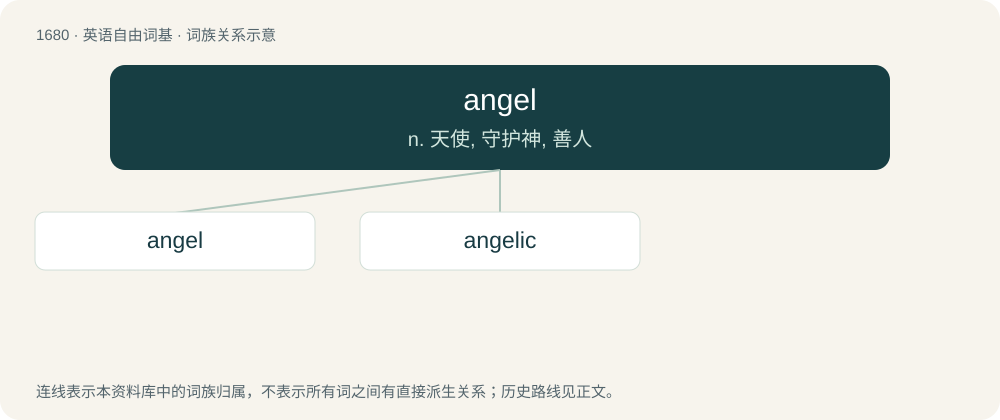

# 1777 · angel — n. 天使, 守护神, 善人

[总目录](../00_总目录_按常用程度.md)

**类型**：英语自由词基　｜　**来源语言**：见词源记录

## 核心含义与来源

- 核心含义：n. 天使, 守护神, 善人
- 英文含义：An incorporeal and holy or semidivine messenger from a deity or other divine entity, traditionally depicted as a youthful, winged figure in flowing robes.
- 词形：angel

**多个词源／构词路径**：同一拼写可能有不同来源；以下按词性和含义分别列出。

**来源记录 1**（名词；An incorporeal and holy or semidivine messenger from a deity or other divine entity, traditionally depicted as a youthful, winged figure in flowing robes.）

Two Baroque angels from southern Germany, from the mid-18th century Etymology tree Ancient Greek ἄγγελος (ángelos)bor. Latin angelusbor. Proto-West Germanic \*angil Old English enġel ▲ Latin angelusbor. Old English anġel Middle English aungel English angel From Middle English aungel, angel, from Old English anġel, either a modification of enġel after its etymon Latin angelus (through the intermediate of Proto-West Germanic \*angil) or a reborrowing from the Latin, which is in turn from Ancient Greek ἄγγελος (ángelos, “messenger”); later reinforced by Anglo-Norman angele, angel, from the same Latin source. The religious sense of the Greek word first appeared in the Septuagint as a translation of the Hebrew word מַלְאָךְ (malʾāḵ, “messenger”) or מַלְאַךְ יהוה (malʾāḵ YHWH, “messenger of YHWH”). Doublet of Angelus. Use of the term in some churches to refer to a church official derives from interpreting the "angels" of the Seven churches of Asia in Revelation as being bishops or ministers rather than angelic beings.

**来源记录 2**（名词；A person who has Angelman syndrome; often capitalized.）

Clipping of Angelman.

## 词族图

## 单词速览（常用到不常用）

| 单词 | 音标 | 释义 |
|---|---|---|
| [angel](#w-1) | /ˈeɪ̯n.d͡ʒəl/ | n. 天使, 守护神, 善人 |
| [angelic](#w-2) | /ænˈd͡ʒɛlɪk/ | a. 天使的, 天使般的 |

## 逐词详解

### 1. angel

**词性**：名词　｜　**音标**：/ˈeɪ̯n.d͡ʒəl/

**中文释义**：n. 天使, 守护神, 善人

**英文义项**：An incorporeal and holy or semidivine messenger from a deity or other divine entity, traditionally depicted as a youthful, winged figure in flowing robes. / One of the lowest order of such beings, below virtues.

**词源与演化**：

Two Baroque angels from southern Germany, from the mid-18th century Etymology tree Ancient Greek ἄγγελος (ángelos)bor. Latin angelusbor. Proto-West Germanic \*angil Old English enġel ▲ Latin angelusbor. Old English anġel Middle English aungel English angel From Middle English aungel, angel, from Old English anġel, either a modification of enġel after its etymon Latin angelus (through the intermediate of Proto-West Germanic \*angil) or a reborrowing from the Latin, which is in turn from Ancient Greek ἄγγελος (ángelos, “messenger”); later reinforced by Anglo-Norman angele, angel, from the same Latin source. The religious sense of the Greek word first appeared in the Septuagint as a translation of the Hebrew word מַלְאָךְ (malʾāḵ, “messenger”) or מַלְאַךְ יהוה (malʾāḵ YHWH, “messenger of YHWH”). Doublet of Angelus. Use of the term in some churches to refer to a church official derives from interpreting the "angels" of the Seven churches of Asia in Revelation as being bishops or ministers rather than angelic beings.

**例句**：

> Thanks for making me breakfast in bed, you little angel.

该用例对应义项：Someone who is kind or selfless.

### 2. angelic

**词性**：形容词　｜　**音标**：/ænˈd͡ʒɛlɪk/

**中文释义**：a. 天使的, 天使般的

**英文义项**：Belonging to, or proceeding from, angels; resembling, characteristic of, or partaking of the nature of, an angel. / Very sweet-natured, well-behaved, or beautiful.

**构词拆分**：angel + -ic

**词源与演化**：

From Middle English angelik, aungillik, aungellike, (also angellich, aungellich &gt; English angelly), from Old English anġelīċ, engellīċ, englelīċ, coalescing with Old French angélique, from Latin angelicus, from Ancient Greek ἀγγελικός (angelikós, “of or for a messenger”), from ἄγγελος (ángelos, “angel”). Equivalent to angel + -ic. Doublet of angelique (“plant of the genus Angelica”) and angélique (“plucked bowl lute”).

**例句**：

> The baby’s face looked so peaceful and angelic in sleep.

该用例对应义项：Very sweet-natured, well-behaved, or beautiful.
