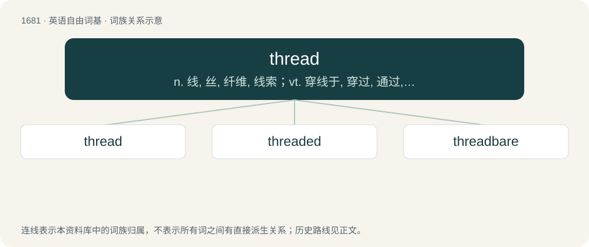

# 1778 · thread — n. 线, 丝, 纤维, 线索；vt. 穿线于, 穿过, 通过, 用线穿成；vi. 穿过

[总目录](../00_总目录_按常用程度.md)

**类型**：英语自由词基　｜　**来源语言**：见词源记录

## 核心含义与来源

- 核心含义：n. 线, 丝, 纤维, 线索；vt. 穿线于, 穿过, 通过, 用线穿成；vi. 穿过
- 英文含义：A cord formed by spinning or twisting together textile fibers or filaments into one or more continuous strands, typically used in needlework.
- 词形：thread

**来源记录 1**（名词；A cord formed by spinning or twisting together textile fibers or filaments into one or more continuous strands, typically used in needlework.）

From Middle English thred, þred, threed, from Old English þrǣd, from Proto-Germanic \*þrēduz, from Proto-Indo-European \*treh₁-tu-s, from \*terh₁- (“rub, twist”). Cognates Cognate with Yola dreade (“thread”), Saterland Frisian Träid (“thread, wire”), Cimbrian draat (“string, thread”), Dutch draad (“thread, wire”), German Draht (“thread, wire”), Luxembourgish Drot (“wire”), Danish, Norwegian Bokmål, Norwegian Nynorsk and Swedish tråd (“thread, wire”), Faroese tráður (“thread”), Icelandic þráður (“thread”). Non-Germanic cognates include Albanian dredh (“twist, turn”). More at throw.

## 词族图

## 单词速览（常用到不常用）

| 单词 | 音标 | 释义 |
|---|---|---|
| [thread](#w-1) | /ˈθɹɛd/ | n. 线, 丝, 纤维, 线索；vt. 穿线于, 穿过, 通过, 用线穿成；vi. 穿过 |
| [threaded](#w-2) | /θˈredid/ | a. 有线状图案装饰的 |
| [threadbare](#w-3) | 英 /ˈθɹɛdbɛə/；美 /ˈθɹɛdˌbɛ(ə)ɹ/ | a. 衣服磨薄了的, 穿旧了的, 衣着褴褛的, 俗套的, 乏味的 |

## 逐词详解

### 1. thread

**词性**：名词　｜　**音标**：/ˈθɹɛd/

**中文释义**：n. 线, 丝, 纤维, 线索；vt. 穿线于, 穿过, 通过, 用线穿成；vi. 穿过

**英文义项**：A cord formed by spinning or twisting together textile fibers or filaments into one or more continuous strands, typically used in needlework. / A piece of yarn, especially said of warps and wefts in a woven fabric.

**词源与演化**：

From Middle English thred, þred, threed, from Old English þrǣd, from Proto-Germanic \*þrēduz, from Proto-Indo-European \*treh₁-tu-s, from \*terh₁- (“rub, twist”). Cognates Cognate with Yola dreade (“thread”), Saterland Frisian Träid (“thread, wire”), Cimbrian draat (“string, thread”), Dutch draad (“thread, wire”), German Draht (“thread, wire”), Luxembourgish Drot (“wire”), Danish, Norwegian Bokmål, Norwegian Nynorsk and Swedish tråd (“thread, wire”), Faroese tráður (“thread”), Icelandic þráður (“thread”). Non-Germanic cognates include Albanian dredh (“twist, turn”). More at throw.

**例句**：

> I’ve lost the thread of what you’re saying.

该用例对应义项：A line of reasoning, sequence of ideas, or train of thought.

### 2. threaded

**词性**：形容词　｜　**音标**：/θˈredid/

**中文释义**：a. 有线状图案装饰的

**英文义项**：Having threads. / Of messages: arranged in a thread or threads.

**构词拆分**：thread + -ed

**词源与演化**：

From thread + -ed.

**例句**：

> Then, with hope and determination threaded through every sentence, he spoke.

### 3. threadbare

**词性**：形容词　｜　**音标**：英 /ˈθɹɛdbɛə/；美 /ˈθɹɛdˌbɛ(ə)ɹ/

**中文释义**：a. 衣服磨薄了的, 穿旧了的, 衣着褴褛的, 俗套的, 乏味的

**英文义项**：Of cloth, clothing, furnishings, etc.: frayed and worn to an extent that the nap is damaged and the warp and weft threads show; shabby, worn-out. / In poor condition; damaged, shabby; also, poorly equipped or provided for, inadequate, meagre, scanty.

**构词拆分**：thread + bare

**词源与演化**：

From Middle English thred-bar, thred-bare (“of cloth, clothing, etc.: worn to such an extent that the warp and weft threads show, shabby, worn-out; (figurative) inadequate, poor”) \[and other forms\], from thred (“piece of textile twine”) (from Old English þrǣd (“thread”), from Proto-Germanic \*þrēduz (“thread; twisted fibre”), ultimately from Proto-Indo-European \*terh₁- (“to drill, pierce; to rub; to turn, twist”)) + bar, bare (“naked, unclothed, bare; not covered”) (from Old English bær (“naked, bare; unconcealed”), ultimately from Proto-Germanic \*bazaz (“naked, bare”), from Proto-Indo-European \*bʰosós (“bare; barefoot”)). The English word is analysable as thread + bare.

**例句**：

> The towels seem new enough, if slightly threadbare.
