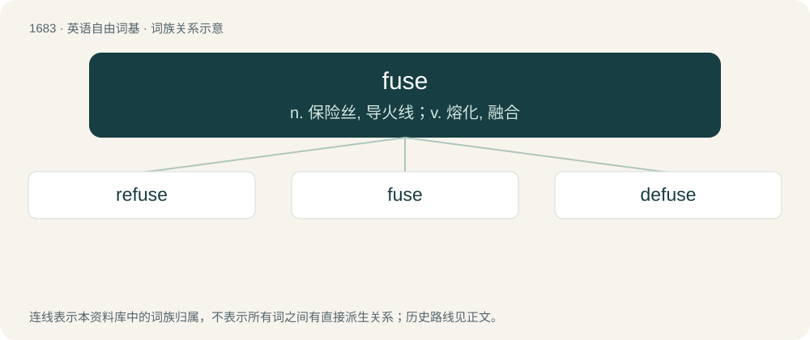

# 1780 · fuse — n. 保险丝, 导火线；v. 熔化, 融合

[总目录](../00_总目录_按常用程度.md)

**类型**：英语自由词基　｜　**来源语言**：见词源记录

## 核心含义与来源

- 核心含义：n. 保险丝, 导火线；v. 熔化, 融合
- 英文含义：A wick or cord used to convey flame to gunpowder, a bomb, or similar explosive.
- 词形：fuse

**多个词源／构词路径**：同一拼写可能有不同来源；以下按词性和含义分别列出。

**来源记录 1**（名词；A wick or cord used to convey flame to gunpowder, a bomb, or similar explosive.）

From Italian fuso and French fusée, from Latin fūsus (“spindle”).

**来源记录 2**（名词；A device to prevent excessive overcurrent from overload or short circuit in an electrical circuit, containing a component that melts and interrupts the current when too high a load is passed through it.）

Back-formation from fusion (“to melt”), first to verbal sense, then noun.

## 词族图

## 单词速览（常用到不常用）

| 单词 | 音标 | 释义 |
|---|---|---|
| [refuse](#w-1) | /ɹiːˈfjuːz/ | 【英文】To fuse again, as with, or after, heating or melting. |
| [fuse](#w-2) | /fjuːz/ | n. 保险丝, 导火线；v. 熔化, 融合 |
| [defuse](#w-3) | /diːˈfjuːz/ | vt. 去掉...的引信, 平息 |

## 逐词详解

### 1. refuse

**词性**：动词　｜　**音标**：/ɹiːˈfjuːz/

**英文义项**：To fuse again, as with, or after, heating or melting.

**构词拆分**：re- + fuse

**词源与演化**：

From re- + fuse.

### 2. fuse

**词性**：名词　｜　**音标**：/fjuːz/

**中文释义**：n. 保险丝, 导火线；v. 熔化, 融合

**英文义项**：A wick or cord used to convey flame to gunpowder, a bomb, or similar explosive. / An otherwise stable arbitrarily long repeating pattern that, when perturbed from one end, destructively carries that perturbation at a constant speed to the other end.

**词源与演化**：

From Italian fuso and French fusée, from Latin fūsus (“spindle”).

**例句**：

> When talking about being laid off, he has a short fuse.

该用例对应义项：A tendency to lose one's temper.

### 3. defuse

**词性**：动词　｜　**音标**：/diːˈfjuːz/

**中文释义**：vt. 去掉...的引信, 平息

**英文义项**：To remove the fuse from (e.g. a bomb). / To make less dangerous, tense, or hostile.

**构词拆分**：de- + fuse

**词源与演化**：

From de- + fuse.

**例句**：

> The diplomats are trying to defuse the escalating crisis.

该用例对应义项：To make less dangerous, tense, or hostile.
