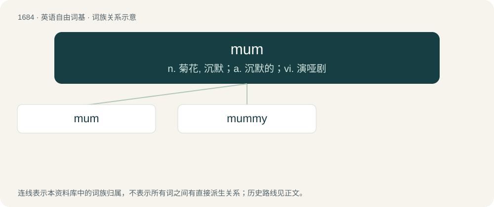

# 1781 · mum — n. 菊花, 沉默；a. 沉默的；vi. 演哑剧

[总目录](../00_总目录_按常用程度.md)

**类型**：英语自由词基　｜　**来源语言**：见词源记录

## 核心含义与来源

- 核心含义：n. 菊花, 沉默；a. 沉默的；vi. 演哑剧
- 英文含义：mother
- 词形：mum

**多个词源／构词路径**：同一拼写可能有不同来源；以下按词性和含义分别列出。

**来源记录 1**（名词；mother）

Alternative form of mam, or an abbreviation of mummy. Compare mom, mama.

**来源记录 2**（名词；A chrysanthemum.）

Abbreviation of chrysanthemum.

**来源记录 3**（形容词；Secret.）

From Middle English mum or mom (“silent”), reminiscent of the sound made when gagged or with a hand over one's mouth. Perhaps related to dated German Mumme (“mask”).

**来源记录 4**（名词；A type of strong beer, originally made in Brunswick, Germany.）

From German Mumme.

## 词族图

## 单词速览（常用到不常用）

| 单词 | 音标 | 释义 |
|---|---|---|
| [mum](#w-1) | /mʌm/ | n. 菊花, 沉默；a. 沉默的；vi. 演哑剧 |
| [mummy](#w-2) | /ˈmʌm.i/ | 【英文】mother. |

## 逐词详解

### 1. mum

**词性**：名词　｜　**音标**：/mʌm/

**中文释义**：n. 菊花, 沉默；a. 沉默的；vi. 演哑剧

**英文义项**：mother

**词源与演化**：

Alternative form of mam, or an abbreviation of mummy. Compare mom, mama.

**例句**：

> Mum, the rice crackers have gotten damp and they're not nice anymore.

### 2. mummy

**词性**：名词　｜　**音标**：/ˈmʌm.i/

**英文义项**：mother.

**构词拆分**：mum + -y (diminutive suffix)

**词源与演化**：

From mum + -y (diminutive suffix), related to mom and mommy, from mother.
