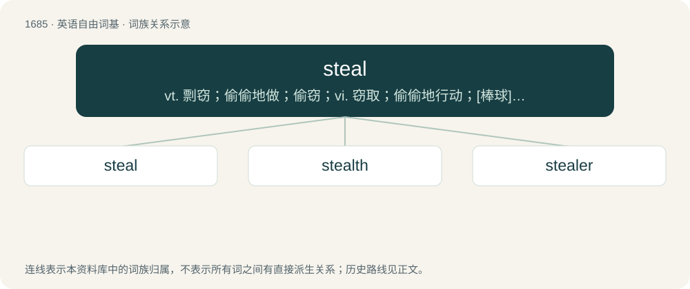

# 1782 · steal — vt. 剽窃；偷偷地做；偷窃；vi. 窃取；偷偷地行动；\[棒球\]偷垒；n. \[口\]偷窃；便宜货；偷垒；\[篮球\]断球

[总目录](../00_总目录_按常用程度.md)

**类型**：英语自由词基　｜　**来源语言**：见词源记录

## 核心含义与来源

- 核心含义：vt. 剽窃；偷偷地做；偷窃；vi. 窃取；偷偷地行动；\[棒球\]偷垒；n. \[口\]偷窃；便宜货；偷垒；\[篮球\]断球
- 英文含义：To take illegally, or without the owner's permission, something owned by someone else without intending to return it.
- 词形：steal

**来源记录 1**（动词；To take illegally, or without the owner's permission, something owned by someone else without intending to return it.）

Inherited from Middle English stelen, from Old English stelan, from Proto-West Germanic \*stelan, from Proto-Germanic \*stelaną. Cognate with Bavarian stöhn (“to steal”), Dutch stelen (“to steal”), German and Low German stehlen (“to steal”), Luxembourgish stielen (“to steal”), Danish stjæle (“to steal”), Faroese stjala (“to steal”), Icelandic stela (“to steal”), Norwegian Bokmål stjele (“to steal”), Norwegian Nynorsk stela, stele (“to steal”), Swedish stjäla (“to steal”), Gothic 𐍃𐍄𐌹𐌻𐌰𐌽 (stilan, “to steal”). For the meaning development compare with Russian красть (krastʹ, “to steal”) and Russian кра́сться (krástʹsja, “to stalk, to prowl, to slink”). etymology notes Proposed etymologies beyond Germanic are numerous and include \* Proto-Indo-European \*ster-: compare Welsh herw (“theft, raid”), Ancient Greek στερέω (steréō, “to deprive of”) \* Proto-Indo-European \*stel(H)- (“to stretch”): compare Albanian pë/mbështjell (“to confuse, mess up, mix, wrap up”), Old Church Slavonic стєлѭ (steljǫ, “I spread out (bed, roof)”), Ancient Greek τηλία (tēlía, “playing table”) \* Proto-Indo-European \*tsel- (“to sneak”): compare Sanskrit त्सरति (tsárati, “creep, sneak up on”) and other forms under Pokorny 5. \*sel- "schleichen, kriechen"

## 词族图

## 单词速览（常用到不常用）

| 单词 | 音标 | 释义 |
|---|---|---|
| [steal](#w-1) | /stiːl/ | vt. 剽窃；偷偷地做；偷窃；vi. 窃取；偷偷地行动；\[棒球\]偷垒；n. \[口\]偷窃；便宜货；偷垒；\[篮球\]断球 |
| [stealth](#w-2) | /stɛlθ/ | n. 秘密行动, 秘密, 鬼祟；\[法\] 秘密行动, 鬼祟 |
| [stealer](#w-3) | 英 /ˈstiːlə/；美 /ˈstilɚ/ | n. 偷取者, 偷干者, 僭据者；\[法\] 小偷 |

## 逐词详解

### 1. steal

**词性**：动词　｜　**音标**：/stiːl/

**中文释义**：vt. 剽窃；偷偷地做；偷窃；vi. 窃取；偷偷地行动；\[棒球\]偷垒；n. \[口\]偷窃；便宜货；偷垒；\[篮球\]断球

**英文义项**：To take illegally, or without the owner's permission, something owned by someone else without intending to return it. / To appropriate without giving credit or acknowledgement.

**词源与演化**：

Inherited from Middle English stelen, from Old English stelan, from Proto-West Germanic \*stelan, from Proto-Germanic \*stelaną. Cognate with Bavarian stöhn (“to steal”), Dutch stelen (“to steal”), German and Low German stehlen (“to steal”), Luxembourgish stielen (“to steal”), Danish stjæle (“to steal”), Faroese stjala (“to steal”), Icelandic stela (“to steal”), Norwegian Bokmål stjele (“to steal”), Norwegian Nynorsk stela, stele (“to steal”), Swedish stjäla (“to steal”), Gothic 𐍃𐍄𐌹𐌻𐌰𐌽 (stilan, “to steal”). For the meaning development compare with Russian красть (krastʹ, “to steal”) and Russian кра́сться (krástʹsja, “to stalk, to prowl, to slink”). etymology notes Proposed etymologies beyond Germanic are numerous and include \* Proto-Indo-European \*ster-: compare Welsh herw (“theft, raid”), Ancient Greek στερέω (steréō, “to deprive of”) \* Proto-Indo-European \*stel(H)- (“to stretch”): compare Albanian pë/mbështjell (“to confuse, mess up, mix, wrap up”), Old Church Slavonic стєлѭ (steljǫ, “I spread out (bed, roof)”), Ancient Greek τηλία (tēlía, “playing table”) \* Proto-Indo-European \*tsel- (“to sneak”): compare Sanskrit त्सरति (tsárati, “creep, sneak up on”) and other forms under Pokorny 5. \*sel- "schleichen, kriechen"

**例句**：

> Dawn was stealing over the mountaintops.

该用例对应义项：To move silently or secretly; to pass unnoticed.

### 2. stealth

**词性**：形容词　｜　**音标**：/stɛlθ/

**中文释义**：n. 秘密行动, 秘密, 鬼祟；\[法\] 秘密行动, 鬼祟

**英文义项**：Surreptitious; secret; not openly acknowledged. / Having properties that diminish radar signatures.

**构词拆分**：steal + -th (abstract nominal suffix)

**词源与演化**：

From Middle English stelthe, from Old English stǣlþ, from Proto-Germanic \*stēliþō, to Proto-Germanic \*stelaną (“to steal, to sneak”) + \*-iþō, equivalent to steal + -th (abstract nominal suffix). Compare Old English stalu (“theft, stealth”), Old High German stāla (“theft”), German Diebstahl (“theft”).

**用法示例／搭配（非完整句）**：

> go stealth; be stealth; live stealth

该用例对应义项：Hiding one's transgender status (in general or in specific areas of one's life, e.g. at work) after transition.

### 3. stealer

**词性**：名词　｜　**音标**：英 /ˈstiːlə/；美 /ˈstilɚ/

**中文释义**：n. 偷取者, 偷干者, 僭据者；\[法\] 小偷

**英文义项**：One who steals; a thief. / The endmost plank of a strake which stops short of the stem or stern.

**构词拆分**：steal + -er

**词源与演化**：

From Middle English stelere, equivalent to steal + -er. Cognate with Saterland Frisian Steler (“thief”), West Frisian steller, stelder (“stealer”), Dutch steler (“stealer, thief”), Danish stjæler (“stealer”).

**用法示例／搭配（非完整句）**：

> a chicken-stealer

该用例对应义项：One who steals; a thief.
