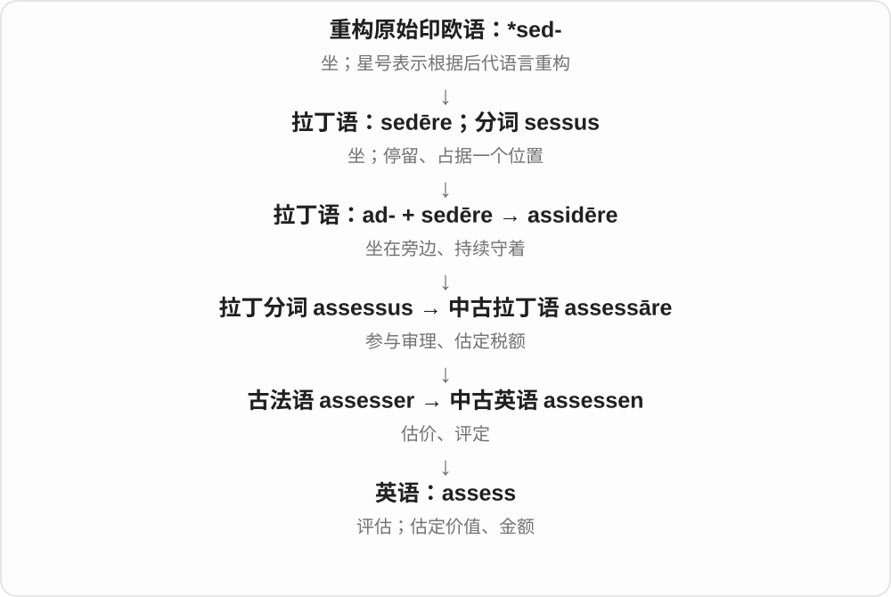
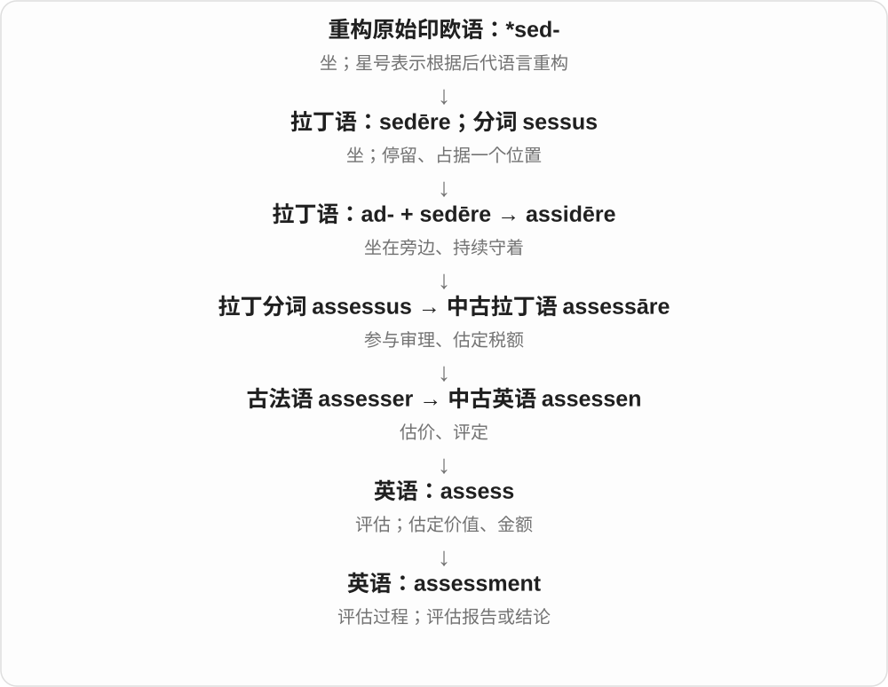

# 1786 · assess — 先评定，再形成评估结果，也可重新看

[逐词精讲目录](../00_逐词精讲目录.md) · [总目录](../00_总目录_按常用程度.md)

## 核心词根与来源

评估可以针对价值、风险、表现、证据；同一个 assess 不必都翻成给东西标价。

**ASSESS：看证据、掂分量、下判断**

assess → assessment；reassess 加再评一次，不等于直接推翻。

- **评估与评估结果**：assess · assessment
- **再评一次**：reassess

## 词形与演化规律

assess 的拉丁、法语旧评定路径 → assess；assess + -ment → assessment；re- + assess → reassess。

## 单词速览（按词族由简到繁）

同一基础词的相关扩展放在一起，先读基础形式，再读扩展；各组之间优先读常用的。具体词源关系见各词讲解。

| 单词 | 音标 | 核心意思 |
|---|---|---|
| [assess](#w-2) | /əˈses/ | 评估；判断；估定金额或价值 |
| [assessment](#w-1) | /əˈsesmənt/ | 评估；评价结果；考核 |
| [reassess](#w-3) | /ˌriːəˈses/ | 重新评估、重新判断 |

## 逐词讲解

### 1. assess — 评估；判断；估定金额或价值

**音标**：/əˈses/

**先抓住这个画面**

assess 的远处画面是坐在办事者旁边，协助判断、定价；今天就是看证据后估量某件事。

**怎么拆**

拉丁 ad- + sedēre → assidēre“坐在旁边”，经 assessus、assessāre、法语 assesser 和中古英语进入英语。

**怎么变成今天的意思**

可以 assess damage、ability、risk，也可估定税额。它强调有依据地判断，不一定要求算出一个数字。

**常见搭配与例句**

assess the damage；assess someone’s ability；assess whether。

> We need more information to assess the risks.

我们需要更多信息来评估风险。

> The teacher assessed each student’s progress.

老师评估了每位学生的进步情况。

**别混淆**

guess 可凭直觉猜；assess 通常意味着查看相关情况后作判断。

### 2. assessment — 评估；评价结果；考核

**音标**：/əˈsesmənt/

**先抓住这个画面**

assessment 像把证据摆在桌上，仔细看过之后给出判断：现在是什么情况，有多少价值或风险。

**怎么拆**

assess + -ment，表示评估行为或所得结论。

**怎么变成今天的意思**

a risk assessment 是风险评估；a language assessment 可以是语言能力考核；an honest assessment 是坦诚评价。

**常见搭配与例句**

make an assessment；a needs assessment；continuous assessment。

> The team completed an assessment of the building’s condition.

团队完成了对建筑状况的评估。

> Her assessment of the situation proved accurate.

她对局势的判断后来证明是准确的。

**别混淆**

test 可以只是一次测试；assessment 可综合观察、测试和材料形成判断。

### 3. reassess — 重新评估、重新判断

**音标**：/ˌriːəˈses/

**先抓住这个画面**

先前打过一个分，现在有新情况，拿回来再看一次；重评不保证一定改成更高或更低。

**怎么拆**

re- 再 + assess 评估，保留 assess 词族；assess 的较早来源接拉丁 assidēre、assessus 的坐在旁边协助判断等路径，不把 re + assess 编成重新坐下这个现代词义。

**怎么变成今天的意思**

**拉丁 assessus 等 → assess**  
从评定相关旧路径到评估

↓

**re- + assess → reassess**  
再次评估

reassess a situation 重新判断形势，reassess priorities 重估优先事项，reassess a decision 重新审视决定。

**常见搭配与例句**

reassess the situation；reassess priorities；reassess the evidence。

> We need to reassess our priorities.

我们需要重新评估事情的轻重缓急。

> The new evidence made her reassess the situation.

新证据让她重新判断了形势。

**别混淆**

reassess 再判断，reverse 推翻；重新看后也可以维持原判断。

## 这一组要分清什么

reassess/reverse 重审与推翻；assessment 过程或结果，要看具体对象。

## 串起来练习

The assessment gave us a reason to reassess the plan.

评估结果让我们有理由重新审视计划。
