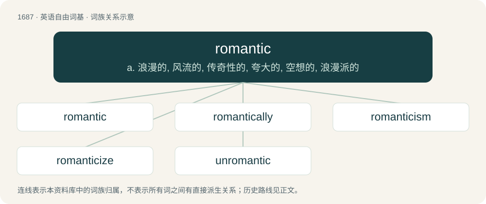

# 1786 · romantic — a. 浪漫的, 风流的, 传奇性的, 夸大的, 空想的, 浪漫派的

[总目录](../00_总目录_按常用程度.md)

**类型**：英语自由词基　｜　**来源语言**：见词源记录

## 核心含义与来源

- 核心含义：a. 浪漫的, 风流的, 传奇性的, 夸大的, 空想的, 浪漫派的
- 英文含义：Fantastic, unrealistic (of an idea etc.); fanciful, sentimental, impractical (of a person).
- 词形：romantic

**来源记录 1**（形容词；Fantastic, unrealistic (of an idea etc.); fanciful, sentimental, impractical (of a person).）

From romant + -ic, or borrowed from Late Latin romanticus (“(of a poem) having qualities of a romance”). Compare French romantique, which is borrowed from English. Also compare Spanish romántico, Portuguese romântico, Italian romantico, Dutch romantisch, and German romantisch and Romantiker (“a composer of Romantic music”), all of which are borrowed from English or French.

## 词族图

## 单词速览（常用到不常用）

| 单词 | 音标 | 释义 |
|---|---|---|
| [romantic](#w-1) | 英 /ɹə(ʊ)ˈmæntɪk/；美 /ɹoʊˈmæn(t)ɪk/ | a. 浪漫的, 风流的, 传奇性的, 夸大的, 空想的, 浪漫派的 |
| [romantically](#w-2) | /rəuˈmæntikli/ | adv. 浪漫地, 小说般地, 空想地 |
| [romanticism](#w-3) | /ɹəʊˈmæntɪsɪzəm/ | n. 浪漫主义精神, 浪漫主义 |
| [romanticize](#w-4) | 英 /rə(ʊ)ˈmantɪsaɪz/；美 /roʊˈmæntɪsaɪz/ | vi. 有浪漫思想, 以浪漫方式行事, 以浪漫风格描写；vt. 使浪漫化 |
| [unromantic](#w-5) | /ʌnrəˈmæntik/ | a. 平淡无奇的, 平庸的 |

## 逐词详解

### 1. romantic

**词性**：形容词　｜　**音标**：英 /ɹə(ʊ)ˈmæntɪk/；美 /ɹoʊˈmæn(t)ɪk/

**中文释义**：a. 浪漫的, 风流的, 传奇性的, 夸大的, 空想的, 浪漫派的

**英文义项**：Fantastic, unrealistic (of an idea etc.); fanciful, sentimental, impractical (of a person). / Having the qualities of romance (in the sense of something appealing deeply to the imagination); invoking on a powerfully sentimental idea of life; evocative, atmospheric.

**构词拆分**：romaunt + -ic；romant + -ic

**词源与演化**：

From romant + -ic, or borrowed from Late Latin romanticus (“(of a poem) having qualities of a romance”). Compare French romantique, which is borrowed from English. Also compare Spanish romántico, Portuguese romântico, Italian romantico, Dutch romantisch, and German romantisch and Romantiker (“a composer of Romantic music”), all of which are borrowed from English or French.

**例句**：

> Mary sighed, knowing her ideals were far too romantic to work in reality.

该用例对应义项：Fantastic, unrealistic (of an idea etc.); fanciful, sentimental, impractical (of a person).

### 2. romantically

**词性**：副词　｜　**音标**：/rəuˈmæntikli/

**中文释义**：adv. 浪漫地, 小说般地, 空想地

**英文义项**：In a romantic way.

**构词拆分**：romantic + -ally

**词源与演化**：

From romantic + -ally.

**用法示例／搭配（非完整句）**：

> Sing romantically

该用例对应义项：In a romantic way.

### 3. romanticism

**词性**：名词　｜　**音标**：/ɹəʊˈmæntɪsɪzəm/

**中文释义**：n. 浪漫主义精神, 浪漫主义

**英文义项**：A romantic quality, spirit or action.

**构词拆分**：romantic + -ism

**词源与演化**：

From romantic + -ism.

**例句**：

> In Asia, the French language is often associated with romanticism.

### 4. romanticize

**词性**：动词　｜　**音标**：英 /rə(ʊ)ˈmantɪsaɪz/；美 /roʊˈmæntɪsaɪz/

**中文释义**：vi. 有浪漫思想, 以浪漫方式行事, 以浪漫风格描写；vt. 使浪漫化

**英文义项**：To interpret, view, or portray something in a romantic (unrealistic, idealized) manner. / To think or act in a romantic manner.

**构词拆分**：romantic + -ize

**词源与演化**：

From romantic + -ize.

**例句**：

> Don't romanticize this uninteresting and hard work!

该用例对应义项：interpret romantically

### 5. unromantic

**词性**：形容词　｜　**音标**：/ʌnrəˈmæntik/

**中文释义**：a. 平淡无奇的, 平庸的

**英文义项**：Not romantic

**构词拆分**：un- + romantic

**词源与演化**：

From un- + romantic.
