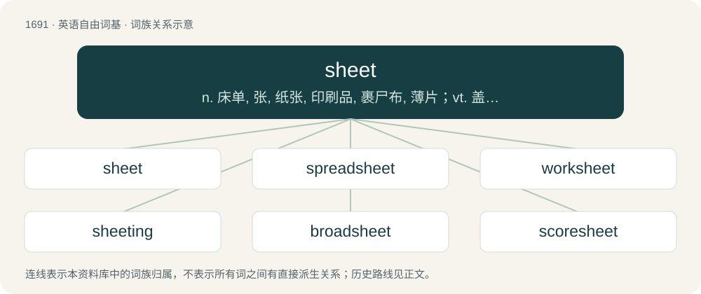

# 1788 · sheet — n. 床单, 张, 纸张, 印刷品, 裹尸布, 薄片；vt. 盖上被单, 遍布；vi. 大片落下

[总目录](../00_总目录_按常用程度.md)

**类型**：英语自由词基　｜　**来源语言**：见词源记录

## 核心含义与来源

- 核心含义：n. 床单, 张, 纸张, 印刷品, 裹尸布, 薄片；vt. 盖上被单, 遍布；vi. 大片落下
- 英文含义：A thin bed cloth used as a covering for a mattress or as a layer over the sleeper.
- 词形：sheet

**来源记录 1**（名词；A thin bed cloth used as a covering for a mattress or as a layer over the sleeper.）

From Middle English schete; partly from Old English sċīete (“a sheet, a piece of linen cloth”); partly from Old English sċēata (“a corner, angle; the lower corner of a sail, sheet”); and Old English sċēat (“a corner, angle”); all from Proto-Germanic \*skautijǭ, \*skautaz (“corner, wedge, lap”), from Proto-Indo-European \*(s)kewd- (“to throw, shoot, pursue, rush”). Cognate with North Frisian skut (“the fold of a garment, lap, coattail”), West Frisian skoat (“sheet; sail; lap”), Dutch schoot (“the fold of a garment, lap, sheet”), German Low German Schote (“a line from the foot of a sail”), German Schoß (“the fold of a garment, lap”), Danish skød (“lap, skirt”), Icelandic skaut (“the corner of a cloth, a line from the foot of a sail, the skirt or sleeve of a garment, a hood”), Norwegian skaut (“headdress”), Swedish sköt (“sheet”).

## 词族图

## 单词速览（常用到不常用）

| 单词 | 音标 | 释义 |
|---|---|---|
| [sheet](#w-1) | 英 /ʃiːt/；美 /ʃit/ | n. 床单, 张, 纸张, 印刷品, 裹尸布, 薄片；vt. 盖上被单, 遍布；vi. 大片落下 |
| [spreadsheet](#w-2) | 英 /ˈspɹɛd.ʃiːt/；美 /ˈspɹɛd.ʃit/ | n. 空白表格程序, 电子制表软件, 电子数据表；\[计\] 电子表格 |
| [worksheet](#w-3) |  | \[计\] 工作表；\[化\] 工作单; 加工单 |
| [sheeting](#w-4) | /ˈʃiːtɪŋ/ | n. 铺被单, 覆盖, 被单料子, 阔幅平布, 薄膜, 压片, 挡板, 板栅, 护墙板, 护堤板 |
| [broadsheet](#w-5) | /ˈbrɒːdʃiːt/ | n. 大幅单(或双)面印刷品 |
| [scoresheet](#w-6) | /ˈskɔːʃiːt/ | n. \[体\]记分单 |
| [datasheet](#w-7) |  | \[计\] 数据表 |
| [bedsheet](#w-8) | 英 /ˈbɛdʃiːt/ | n. 床单 |
| [sheetrock](#w-9) | /ˈʃiːtrɔk/ | n. (建筑用)石膏灰胶纸夹板 |

## 逐词详解

### 1. sheet

**词性**：名词　｜　**音标**：英 /ʃiːt/；美 /ʃit/

**中文释义**：n. 床单, 张, 纸张, 印刷品, 裹尸布, 薄片；vt. 盖上被单, 遍布；vi. 大片落下

**英文义项**：A thin bed cloth used as a covering for a mattress or as a layer over the sleeper. / A piece of paper, usually rectangular, that has been prepared for writing, artwork, drafting, wrapping, manufacture of packaging (boxes, envelopes, etc.), and for other uses. The word does not include scraps and irregular small pieces destined to be recycled, used for stuffing or cushioning or paper mache, etc. In modern books, each sheet of paper is typically folded in half, to produce two leaves and four pages. In the absence of folding, "leaf" and "sheet" are equivalent.

**词源与演化**：

From Middle English schete; partly from Old English sċīete (“a sheet, a piece of linen cloth”); partly from Old English sċēata (“a corner, angle; the lower corner of a sail, sheet”); and Old English sċēat (“a corner, angle”); all from Proto-Germanic \*skautijǭ, \*skautaz (“corner, wedge, lap”), from Proto-Indo-European \*(s)kewd- (“to throw, shoot, pursue, rush”). Cognate with North Frisian skut (“the fold of a garment, lap, coattail”), West Frisian skoat (“sheet; sail; lap”), Dutch schoot (“the fold of a garment, lap, sheet”), German Low German Schote (“a line from the foot of a sail”), German Schoß (“the fold of a garment, lap”), Danish skød (“lap, skirt”), Icelandic skaut (“the corner of a cloth, a line from the foot of a sail, the skirt or sleeve of a garment, a hood”), Norwegian skaut (“headdress”), Swedish sköt (“sheet”).

**例句**：

> Mud froze on the road in a solid sheet, then more rain froze into a sheet of ice on top of the mud!

该用例对应义项：A broad, flat expanse or covering of a material on a surface.

### 2. spreadsheet

**词性**：名词　｜　**音标**：英 /ˈspɹɛd.ʃiːt/；美 /ˈspɹɛd.ʃit/

**中文释义**：n. 空白表格程序, 电子制表软件, 电子数据表；\[计\] 电子表格

**英文义项**：A computer application for organization, analysis, and storage of data in tabular form. / A document created with such an application.

**构词拆分**：spread + sheet

**词源与演化**：

From spread + sheet.

**例句**：

> Once you get the hang of it, spreadsheet software is really useful.

### 3. worksheet

**词性**：名词

**中文释义**：\[计\] 工作表；\[化\] 工作单; 加工单

**英文义项**：A sheet of paper or computerized document on which problems are worked out or solved and the answers are recorded. / A sheet of paper listing work that is completed, to be completed or in progress.

**构词拆分**：work + sheet

**词源与演化**：

From work + sheet. First use appears c. 1823 in the publications of Isaac D'Israeli.

**例句**：

> The reward for finishing your worksheet early is another worksheet.

### 4. sheeting

**词性**：名词　｜　**音标**：/ˈʃiːtɪŋ/

**中文释义**：n. 铺被单, 覆盖, 被单料子, 阔幅平布, 薄膜, 压片, 挡板, 板栅, 护墙板, 护堤板

**英文义项**：Fabric used to make sheets (bedding). / The process of forming material into sheets.

**构词拆分**：From sheet + -ing.

**词源与演化**：

From sheet + -ing.

**例句**：

> Hay bales are often wrapped in a layer of green plastic sheeting.

### 5. broadsheet

**词性**：名词　｜　**音标**：/ˈbrɒːdʃiːt/

**中文释义**：n. 大幅单(或双)面印刷品

**英文义项**：A newspaper having pages of standard dimensions (as opposed to a tabloid), especially one that carries serious treatment of news.

**构词拆分**：broad + sheet

**词源与演化**：

From broad + sheet.

### 6. scoresheet

**词性**：名词　｜　**音标**：/ˈskɔːʃiːt/

**中文释义**：n. \[体\]记分单

**英文义项**：A sheet of paper (or similar) on which score is kept. / A list of people who have scored.

**构词拆分**：score + sheet

**词源与演化**：

From score + sheet.

### 7. datasheet

**词性**：名词

**中文释义**：\[计\] 数据表

**英文义项**：A document summarizing the performance and other technical characteristics of a product. / A display of the records in a table, arranged in rows and columns.

**构词拆分**：data + sheet

**词源与演化**：

From data + sheet.

### 8. bedsheet

**词性**：名词　｜　**音标**：英 /ˈbɛdʃiːt/

**中文释义**：n. 床单

**英文义项**：A sheet, a piece of cloth cut and finished as bedlinen.

**构词拆分**：bed + sheet

**词源与演化**：

From Middle English bedeschette, bedshete, bed shete, equivalent to bed + sheet.

**例句**：

> He wrapped himself in the bedsheet and pretended to be a ghost.

### 9. sheetrock

**词性**：名词　｜　**音标**：/ˈʃiːtrɔk/

**中文释义**：n. (建筑用)石膏灰胶纸夹板

**英文义项**：A building material comprising a sheet of gypsum sandwiched between two pieces of heavy paper, used mainly for interior walls and ceilings; drywall.

**构词拆分**：sheet + rock

**词源与演化**：

Genericized trademark (originally, and also, Sheetrock); from sheet + rock.
