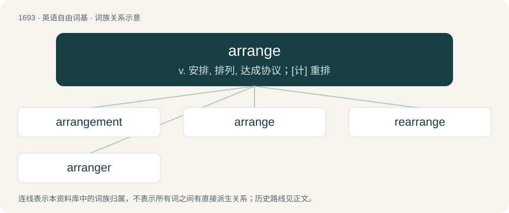

# 1789 · arrange — v. 安排, 排列, 达成协议；\[计\] 重排

[总目录](../00_总目录_按常用程度.md)

**类型**：英语自由词基　｜　**来源语言**：见词源记录

## 核心含义与来源

- 核心含义：v. 安排, 排列, 达成协议；\[计\] 重排
- 英文含义：To set up; to organize; to put into an orderly sequence or arrangement.
- 词形：arrange

**来源记录 1**（动词；To set up; to organize; to put into an orderly sequence or arrangement.）

Inherited from Middle English arengen, arrangen (“to draw up a battle line”), borrowed from Old French arengier, arangier (“to put in a line, put in a row”), derived from reng, rang, ranc (“line, row, rank”), from Frankish \*hring (“ring”), from Proto-Germanic \*hringaz, ultimately from Proto-Indo-European \*(s)krengʰ-, a form of Proto-Indo-European \*(s)ker- (“to turn, bend”).

## 词族图

## 单词速览（常用到不常用）

| 单词 | 音标 | 释义 |
|---|---|---|
| [arrangement](#w-1) | /əˈɹeɪnd͡ʒmənt/ | n. 排列, 整齐, 安排；\[计\] 排列 |
| [arrange](#w-2) | /əˈɹeɪnd͡ʒ/ | v. 安排, 排列, 达成协议；\[计\] 重排 |
| [rearrange](#w-3) | /ˌɹiːəˈɹeɪndʒ/ | vt. 再排列, 重新整理；\[计\] 重新排列; 重新整理 |
| [arranger](#w-4) |  | \[经\] 经办者, 组织者 |

## 逐词详解

### 1. arrangement

**词性**：名词　｜　**音标**：/əˈɹeɪnd͡ʒmənt/

**中文释义**：n. 排列, 整齐, 安排；\[计\] 排列

**英文义项**：The act of arranging. / The manner of being arranged.

**构词拆分**：arrange + -ment

**词源与演化**：

From French arrangement. Morphologically arrange + -ment.

**例句**：

> He changed the arrangement of the topics.

该用例对应义项：an organized structure for arranging or classifying

### 2. arrange

**词性**：动词　｜　**音标**：/əˈɹeɪnd͡ʒ/

**中文释义**：v. 安排, 排列, 达成协议；\[计\] 重排

**英文义项**：To set up; to organize; to put into an orderly sequence or arrangement. / To plan; to prepare in advance.

**词源与演化**：

Inherited from Middle English arengen, arrangen (“to draw up a battle line”), borrowed from Old French arengier, arangier (“to put in a line, put in a row”), derived from reng, rang, ranc (“line, row, rank”), from Frankish \*hring (“ring”), from Proto-Germanic \*hringaz, ultimately from Proto-Indo-European \*(s)krengʰ-, a form of Proto-Indo-European \*(s)ker- (“to turn, bend”).

**用法示例／搭配（非完整句）**：

> to arrange to meet; to arrange for supper

该用例对应义项：To plan; to prepare in advance.

### 3. rearrange

**词性**：动词　｜　**音标**：/ˌɹiːəˈɹeɪndʒ/

**中文释义**：vt. 再排列, 重新整理；\[计\] 重新排列; 重新整理

**英文义项**：To change the order or arrangement of (one or more items).

**构词拆分**：re- + arrange

**词源与演化**：

From re- + arrange.

**例句**：

> Please rearrange these files.

该用例对应义项：put into a new order or arrangement

### 4. arranger

**词性**：名词

**中文释义**：\[经\] 经办者, 组织者

**英文义项**：One who arranges. / Digital keyboard to play music with accompaniment styles.

**构词拆分**：arrange + -er

**词源与演化**：

From arrange + -er.

**例句**：

> Throughout his remarkable career that began in the 1940s, the pianist, composer and arranger always had one goal in mind.
