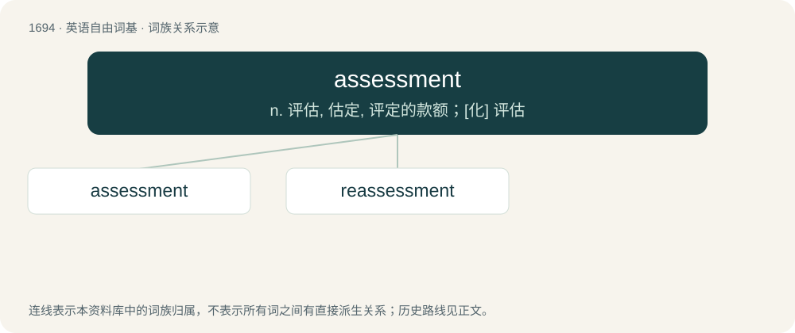

# 1790 · assessment — n. 评估, 估定, 评定的款额；\[化\] 评估

[总目录](../00_总目录_按常用程度.md)

**类型**：英语自由词基　｜　**来源语言**：见词源记录

## 核心含义与来源

- 核心含义：n. 评估, 估定, 评定的款额；\[化\] 评估
- 英文含义：The act of assessing or an amount (of tax, levy or duty etc) assessed.
- 词形：assessment

**来源记录 1**（名词；The act of assessing or an amount (of tax, levy or duty etc) assessed.）

From assess + -ment.

## 词族图

## 单词速览（常用到不常用）

| 单词 | 音标 | 释义 |
|---|---|---|
| [assessment](#w-1) | /əˈsɛsmənt/ | n. 评估, 估定, 评定的款额；\[化\] 评估 |
| [reassessment](#w-2) |  | \[经\] 重新估价 |

## 逐词详解

### 1. assessment

**词性**：名词　｜　**音标**：/əˈsɛsmənt/

**中文释义**：n. 评估, 估定, 评定的款额；\[化\] 评估

**英文义项**：The act of assessing or an amount (of tax, levy or duty etc) assessed. / An appraisal or evaluation.

**构词拆分**：assess + -ment

**词源与演化**：

From assess + -ment.

**例句**：

> The assessment for repairs outraged the club's membership.

该用例对应义项：an amount determined as payable

### 2. reassessment

**词性**：名词

**中文释义**：\[经\] 重新估价

**英文义项**：The act of reassessing; a second or subsequent assessment.

**构词拆分**：re- + assessment

**词源与演化**：

From re- + assessment.
