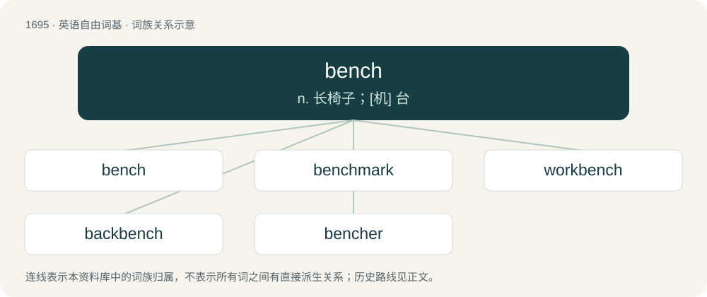

# 1791 · bench — n. 长椅子；\[机\] 台

[总目录](../00_总目录_按常用程度.md)

**类型**：英语自由词基　｜　**来源语言**：见词源记录

## 核心含义与来源

- 核心含义：n. 长椅子；\[机\] 台
- 英文含义：A long seat with or without a back, found for example in parks and schools.
- 词形：bench

**多个词源／构词路径**：同一拼写可能有不同来源；以下按词性和含义分别列出。

**来源记录 1**（名词；A long seat with or without a back, found for example in parks and schools.）

From Middle English bench, benk, bynk, from Old English benċ (“bench”), from Proto-West Germanic \*banki, from Proto-Germanic \*bankiz (“bench”), from Proto-Indo-European \*bʰeg-. Cognate with Scots benk, bink (“bench”), West Frisian bank (“bench”), Dutch bank (“bench”), German Bank (“bench”), Danish bænk (“bench”), Swedish bänk (“bench”), Icelandic bekkur (“bench”). Doublet of banc, banco, and bank.

**来源记录 2**（动词；To lift by bench pressing）

From bench press by shortening.

## 词族图

## 单词速览（常用到不常用）

| 单词 | 音标 | 释义 |
|---|---|---|
| [bench](#w-1) | 英 /ˈbɛnt͡ʃ/；美 /ˈbɪnt͡ʃ/ | n. 长椅子；\[机\] 台 |
| [benchmark](#w-2) | 英 /ˈbɛnt͡ʃmɑːk/；美 /ˈbɛnt͡ʃmɑɹk/ | \[计\] 基准程序; 基准 |
| [workbench](#w-3) | 美 /ˈwɝk.bɛnt͡ʃ/ | n. 工作台；\[化\] 成型台 |
| [backbench](#w-4) | /ˈbækbentʃ/ | n. 后座议员席；a. 后座议员的 |
| [bencher](#w-5) | /ˈbɛnt͡ʃɚ/ | n. 坐凳子的人, 律师协会的主管委员, 划手 |

## 逐词详解

### 1. bench

**词性**：名词　｜　**音标**：英 /ˈbɛnt͡ʃ/；美 /ˈbɪnt͡ʃ/

**中文释义**：n. 长椅子；\[机\] 台

**英文义项**：A long seat with or without a back, found for example in parks and schools. / The people who decide on the verdict, collectively; the judiciary.

**词源与演化**：

From Middle English bench, benk, bynk, from Old English benċ (“bench”), from Proto-West Germanic \*banki, from Proto-Germanic \*bankiz (“bench”), from Proto-Indo-European \*bʰeg-. Cognate with Scots benk, bink (“bench”), West Frisian bank (“bench”), Dutch bank (“bench”), German Bank (“bench”), Danish bænk (“bench”), Swedish bänk (“bench”), Icelandic bekkur (“bench”). Doublet of banc, banco, and bank.

**例句**：

> After removing the bench, we can use the mark left on the wall as a reference point.

该用例对应义项：A bracket used to mount land surveying equipment onto a stone or a wall.

### 2. benchmark

**词性**：名词　｜　**音标**：英 /ˈbɛnt͡ʃmɑːk/；美 /ˈbɛnt͡ʃmɑɹk/

**中文释义**：\[计\] 基准程序; 基准

**英文义项**：A standard by which something is evaluated or measured. / A surveyor's mark made on some stationary object and shown on a map; used as a reference point.

**构词拆分**：bench + mark

**词源与演化**：

From bench + mark. First use appears c. 1842. Originally a mark cut into a stone by land surveyors to secure a bench (from land surveying jargon in the 19th century, meaning a type of bracket), to mount measuring equipment. The figurative sense first appears c. 1884.

**例句**：

> His painting sets the benchmark of quality.

该用例对应义项：a standard by which something can be measured or judged

### 3. workbench

**词性**：名词　｜　**音标**：美 /ˈwɝk.bɛnt͡ʃ/

**中文释义**：n. 工作台；\[化\] 成型台

**英文义项**：A sturdy bench or table at which manual work is done by a carpenter, machinist, etc. / A horizontal padded surface, usually adjustable in height and inclination and often with attached weight rack, used for proper posture during exercise.

**构词拆分**：work + bench

**词源与演化**：

From work + bench.

**例句**：

> Ziri used a clamp on the workbench for stability.

### 4. backbench

**词性**：形容词　｜　**音标**：/ˈbækbentʃ/

**中文释义**：n. 后座议员席；a. 后座议员的

**英文义项**：relating to the back benches in parliament / Pertaining to the preparation of a donor organ prior to transplantation.

**构词拆分**：back + bench

**词源与演化**：

From back + bench.

**例句**：

> He prefers to be a backbench MP.

该用例对应义项：relating to the back benches in parliament

### 5. bencher

**词性**：名词　｜　**音标**：/ˈbɛnt͡ʃɚ/

**中文释义**：n. 坐凳子的人, 律师协会的主管委员, 划手

**英文义项**：A senior member of a law society in a Canadian province (except New Brunswick). / One of the senior governing members of an Inn of Court.

**构词拆分**：bench + -er

**词源与演化**：

From bench + -er.
