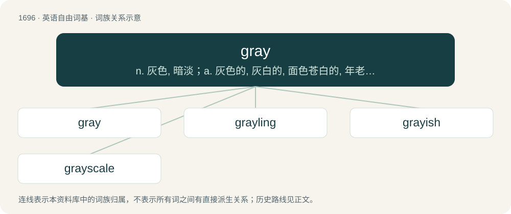

# 1792 · gray — n. 灰色, 暗淡；a. 灰色的, 灰白的, 面色苍白的, 年老的, 老练的, 阴沉的；v. (使)变灰色

[总目录](../00_总目录_按常用程度.md)

**类型**：英语自由词基　｜　**来源语言**：见词源记录

## 核心含义与来源

- 核心含义：n. 灰色, 暗淡；a. 灰色的, 灰白的, 面色苍白的, 年老的, 老练的, 阴沉的；v. (使)变灰色
- 英文含义：Of a color between black and white, having neutral hue and intermediate brightness.
- 词形：gray

**多个词源／构词路径**：同一拼写可能有不同来源；以下按词性和含义分别列出。

**来源记录 1**（形容词；Of a color between black and white, having neutral hue and intermediate brightness.）

From Middle English gray, from Old English grǣġ (West Saxon). The spelling gray reflects the West Saxon vowel development, whereas the variant grey stems from the Anglian form grēġ (through Middle English grey). Further derived from Proto-West Germanic \*grāu, from Proto-Germanic \*grēwaz (“grey”), from Proto-Indo-European \*ǵʰreh₁- (“to green, to grow”). Cognate with West Frisian grau (“grey”), Dutch grauw (“grey”), German Low German grau, graag (“grey”), German grau (“grey”), Swedish grå (“grey”), Icelandic grár (“grey”), Latin rāvus (“tawny, grey”), Old Church Slavonic зьрѭ (zĭrjǫ, “to see, to glance”), archaic Russian зреть (zretʹ, “to watch, to look at”), Lithuanian žeriù (“to shine”).

**来源记录 2**（名词；In the International System of Units, the derived unit of absorbed dose of radiation (radiation absorbed by a patient); one joule of energy absorbed per kilogram of the patient's mass.）

Named after English physicist Louis Harold Gray (1905–1965).

## 词族图

## 单词速览（常用到不常用）

| 单词 | 音标 | 释义 |
|---|---|---|
| [gray](#w-1) | /ɡɹeɪ/ | n. 灰色, 暗淡；a. 灰色的, 灰白的, 面色苍白的, 年老的, 老练的, 阴沉的；v. (使)变灰色 |
| [grayling](#w-2) | /ˈgreiliŋ/ | n. 茴鱼, 眼蝶 |
| [grayish](#w-3) | /ˈɡɹeɪ.ɪʃ/ | a. 浅灰色的, 微带灰色的 |
| [grayscale](#w-4) | 美 /ˈɡɹeɪˌskeɪl/ | 灰度；灰度级；灰度图；灰度模式 |

## 逐词详解

### 1. gray

**词性**：形容词　｜　**音标**：/ɡɹeɪ/

**中文释义**：n. 灰色, 暗淡；a. 灰色的, 灰白的, 面色苍白的, 年老的, 老练的, 阴沉的；v. (使)变灰色

**英文义项**：Of a color between black and white, having neutral hue and intermediate brightness. / Dreary, gloomy, cloudy.

**词源与演化**：

From Middle English gray, from Old English grǣġ (West Saxon). The spelling gray reflects the West Saxon vowel development, whereas the variant grey stems from the Anglian form grēġ (through Middle English grey). Further derived from Proto-West Germanic \*grāu, from Proto-Germanic \*grēwaz (“grey”), from Proto-Indo-European \*ǵʰreh₁- (“to green, to grow”). Cognate with West Frisian grau (“grey”), Dutch grauw (“grey”), German Low German grau, graag (“grey”), German grau (“grey”), Swedish grå (“grey”), Icelandic grár (“grey”), Latin rāvus (“tawny, grey”), Old Church Slavonic зьрѭ (zĭrjǫ, “to see, to glance”), archaic Russian зреть (zretʹ, “to watch, to look at”), Lithuanian žeriù (“to shine”).

**例句**：

> I have already gone gray and lost my looks.

该用例对应义项：Gray-haired.

### 2. grayling

**词性**：名词　｜　**音标**：/ˈgreiliŋ/

**中文释义**：n. 茴鱼, 眼蝶

**英文义项**：Any freshwater fish of the genus Thymallus or specifically Thymallus thymallus, of the salmon family, having a large dorsal fin. / Thymallus arcticus (Arctic grayling)

**构词拆分**：gray + -ling

**词源与演化**：

From Middle English greylyng, equivalent to gray + -ling.

### 3. grayish

**词性**：形容词　｜　**音标**：/ˈɡɹeɪ.ɪʃ/

**中文释义**：a. 浅灰色的, 微带灰色的

**英文义项**：Somewhat gray.

**构词拆分**：gray + -ish

**词源与演化**：

From gray + -ish.

**例句**：

> A grayish fish is calmly swimming in the stream.

### 4. grayscale

**词性**：名词　｜　**音标**：美 /ˈɡɹeɪˌskeɪl/

**中文释义**：灰度；灰度级；灰度图；灰度模式

**英文义项**：A printed strip of graduated tones used to check exposure and development times. / The use of black and white, representing color with shades of gray.

**构词拆分**：gray + scale

**词源与演化**：

From gray + scale.
