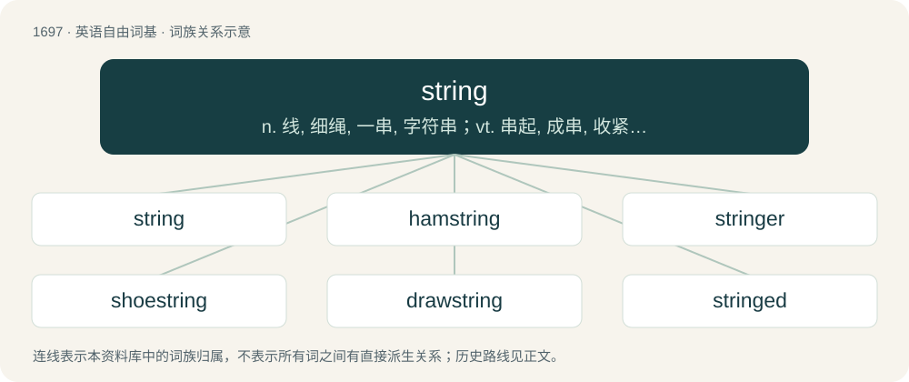

# 1794 · string — n. 线, 细绳, 一串, 字符串；vt. 串起, 成串, 收紧, 缚, 扎；vi. 成一串

[总目录](../00_总目录_按常用程度.md)

**类型**：英语自由词基　｜　**来源语言**：见词源记录

## 核心含义与来源

- 核心含义：n. 线, 细绳, 一串, 字符串；vt. 串起, 成串, 收紧, 缚, 扎；vi. 成一串
- 英文含义：A long, thin and flexible structure made from threads twisted together.
- 词形：string

**多个词源／构词路径**：同一拼写可能有不同来源；以下按词性和含义分别列出。

**来源记录 1**（名词；A long, thin and flexible structure made from threads twisted together.）

From Middle English string, streng, strynge, from Old English strenġ, from Proto-West Germanic \*strangi, from Proto-Germanic \*strangiz (“string”), from Proto-Indo-European \*strengʰ- (“rope, cord, strand; to tighten”). Cognate with Scots string (“string”), Dutch streng (“cord, strand”), Low German strenge (“strand, cord, rope”), German Strang (“strand, cord, rope”), Danish streng (“string”), Swedish sträng (“string, cord, wire”), Icelandic strengur (“string”), Latvian stringt (“to be tight, wither”), Latin stringō (“to tighten”), Ancient Greek στραγγαλόομαι (strangalóomai, “to strangle”), from στραγγάλη (strangálē, “halter”), Ancient Greek στραγγός (strangós, “tied together, entangled, twisted”).

**来源记录 2**（动词；To put (items) on a string.）

From Middle English stryngen, strengen, from the noun (see above).

## 词族图

## 单词速览（常用到不常用）

| 单词 | 音标 | 释义 |
|---|---|---|
| [string](#w-1) | 英 /stɹɪŋ/ | n. 线, 细绳, 一串, 字符串；vt. 串起, 成串, 收紧, 缚, 扎；vi. 成一串 |
| [hamstring](#w-2) | /ˈhæmstɹɪŋ/ | n. 后腿腱；vt. 切断腿腱使成跛腿, 使瘫痪 |
| [stringer](#w-3) | 英 /stɹɪŋə/；美 /stɹɪŋɚ/ | n. 纵梁, 楼梯基, 上弦工人, 出售弓弦的人, 制造弓弦的人 |
| [shoestring](#w-4) | 英 /ˈʃuːstɹɪŋ/；美 /ˈʃustɹɪŋ/ | n. 鞋带, 小额资本 |
| [drawstring](#w-5) | /ˈdrɒːstriŋ/ | n. 束带, 拉绳 |
| [stringed](#w-6) | /striŋd/ | a. 有弦的 |
| [stringy](#w-7) | /ˈstɹɪŋi/ | a. 线, 绳的, 纤维的, 粘性的 |

## 逐词详解

### 1. string

**词性**：名词　｜　**音标**：英 /stɹɪŋ/

**中文释义**：n. 线, 细绳, 一串, 字符串；vt. 串起, 成串, 收紧, 缚, 扎；vi. 成一串

**英文义项**：A long, thin and flexible structure made from threads twisted together. / Control; influence.

**词源与演化**：

From Middle English string, streng, strynge, from Old English strenġ, from Proto-West Germanic \*strangi, from Proto-Germanic \*strangiz (“string”), from Proto-Indo-European \*strengʰ- (“rope, cord, strand; to tighten”). Cognate with Scots string (“string”), Dutch streng (“cord, strand”), Low German strenge (“strand, cord, rope”), German Strang (“strand, cord, rope”), Danish streng (“string”), Swedish sträng (“string, cord, wire”), Icelandic strengur (“string”), Latvian stringt (“to be tight, wither”), Latin stringō (“to tighten”), Ancient Greek στραγγαλόομαι (strangalóomai, “to strangle”), from στραγγάλη (strangálē, “halter”), Ancient Greek στραγγός (strangós, “tied together, entangled, twisted”).

**例句**：

> I always know what position he'll take because the Chairwoman of the Board has her string on him.

该用例对应义项：Control; influence.

### 2. hamstring

**词性**：名词　｜　**音标**：/ˈhæmstɹɪŋ/

**中文释义**：n. 后腿腱；vt. 切断腿腱使成跛腿, 使瘫痪

**英文义项**：One of the great tendons situated in each side of the ham, or space back of the knee, and connected with the muscles of the back of the thigh. / The biceps femoris, semimembranosus, and semitendinosus muscles.

**构词拆分**：From ham (“region back of the knee joint”) + string.

**词源与演化**：

From ham (“region back of the knee joint”) + string.

**例句**：

> The hamstring muscles include the biceps femoris, the semitendinosus and the semimembranosus.

### 3. stringer

**词性**：名词　｜　**音标**：英 /stɹɪŋə/；美 /stɹɪŋɚ/

**中文释义**：n. 纵梁, 楼梯基, 上弦工人, 出售弓弦的人, 制造弓弦的人

**英文义项**：Someone who threads something; one who makes or provides strings, especially for bows. / Someone who strings someone along.

**构词拆分**：From string + -er.

**词源与演化**：

From string + -er.

**例句**：

> A stringer of beads.

该用例对应义项：a worker who strings

### 4. shoestring

**词性**：名词　｜　**音标**：英 /ˈʃuːstɹɪŋ/；美 /ˈʃustɹɪŋ/

**中文释义**：n. 鞋带, 小额资本

**英文义项**：The string or lace used to secure a shoe to the foot; a shoelace. / An object that is long and thin, like a shoestring (sense 1).

**构词拆分**：shoe + string

**词源与演化**：

The noun is derived from shoe + string. The adjective is derived from the noun, while the verb is derived from terms such as shoestring catch and shoestring tackle.

**例句**：

> He was able to organize the event on a shoestring.

该用例对应义项：Chiefly in on a shoestring: very little money; a tight budget.

### 5. drawstring

**词性**：名词　｜　**音标**：/ˈdrɒːstriŋ/

**中文释义**：n. 束带, 拉绳

**英文义项**：A string or cord, encased in a fabric tube, with one or more small openings into the tube, on a bag or garment, allowing the item to be closed (as with a bag) or tightened (as with sweatpants or a bathing suit).

**构词拆分**：draw + string

**词源与演化**：

From draw + string.

**例句**：

> He pulled the drawstring and closed the bag.

该用例对应义项：a tie consisting of a cord that goes through a seam around an opening

### 6. stringed

**词性**：形容词　｜　**音标**：/striŋd/

**中文释义**：a. 有弦的

**英文义项**：Having strings

**构词拆分**：string + -ed

**词源与演化**：

From Middle English strynged, y-strenged, equivalent to string + -ed.

**例句**：

> The violin is a stringed instrument but without frets.

该用例对应义项：Having strings

### 7. stringy

**词性**：形容词　｜　**音标**：/ˈstɹɪŋi/

**中文释义**：a. 线, 绳的, 纤维的, 粘性的

**英文义项**：Composed of, or resembling, string or strings. / Tough to the bite, as containing too much sinew or string tissue.

**构词拆分**：From string + -y.

**词源与演化**：

From string + -y.

**例句**：

> The meat was quite stringy.

该用例对应义项：Tough to the bite, as containing too much sinew or string tissue.
