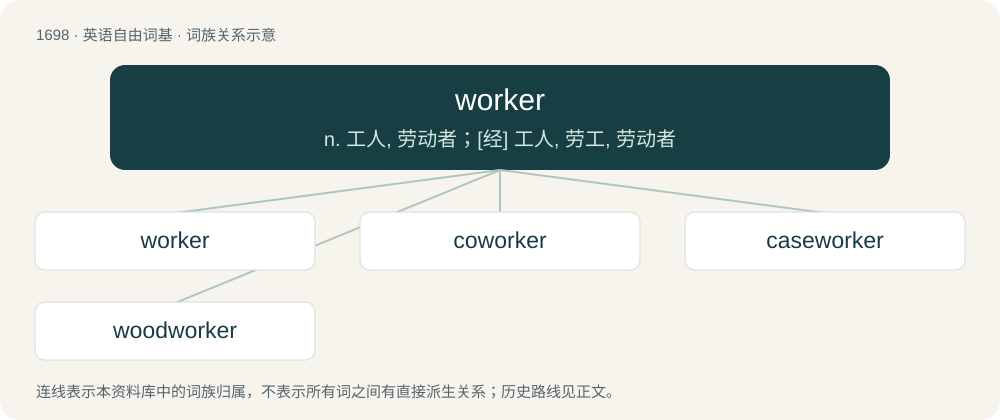

# 1795 · worker — n. 工人, 劳动者；\[经\] 工人, 劳工, 劳动者

[总目录](../00_总目录_按常用程度.md)

**类型**：英语自由词基　｜　**来源语言**：见词源记录

## 核心含义与来源

- 核心含义：n. 工人, 劳动者；\[经\] 工人, 劳工, 劳动者
- 英文含义：One who works: a person who performs labor for a living; traditionally, especially, manual labor.
- 词形：worker

**来源记录 1**（名词；One who works: a person who performs labor for a living; traditionally, especially, manual labor.）

Inherited from Middle English worchere, werkere, equivalent to work + -er. Displaced the older term wright, from Old English wyrhta.

## 词族图

## 单词速览（常用到不常用）

| 单词 | 音标 | 释义 |
|---|---|---|
| [worker](#w-1) | 英 /ˈwɜː.kə/；美 /ˈwɝ.kɚ/ | n. 工人, 劳动者；\[经\] 工人, 劳工, 劳动者 |
| [coworker](#w-2) | 英 /ˌkəʊˈwɜː.kər/；美 /ˌkoʊˈwɝː.kɚ/ | n. 共同工作的人, 同事, 合作者 |
| [caseworker](#w-3) | /ˈkeɪswɜːkə(r)/ | n. 社会工作者 |
| [woodworker](#w-4) | /ˈwud.wəːkə/ | n. 木工 |

## 逐词详解

### 1. worker

**词性**：名词　｜　**音标**：英 /ˈwɜː.kə/；美 /ˈwɝ.kɚ/

**中文释义**：n. 工人, 劳动者；\[经\] 工人, 劳工, 劳动者

**英文义项**：One who works: a person who performs labor for a living; traditionally, especially, manual labor. / A nonreproductive social insect, such as ant, bee, termite, or wasp.

**构词拆分**：work + -er

**词源与演化**：

Inherited from Middle English worchere, werkere, equivalent to work + -er. Displaced the older term wright, from Old English wyrhta.

**例句**：

> This FTP client spawns a separate worker for each file to be uploaded.

该用例对应义项：A thread performing one instance of a particular task within a program.

### 2. coworker

**词性**：名词　｜　**音标**：英 /ˌkəʊˈwɜː.kər/；美 /ˌkoʊˈwɝː.kɚ/

**中文释义**：n. 共同工作的人, 同事, 合作者

**英文义项**：Somebody with whom one works. / A person in the lowest common denominator, especially regarding popular culture.

**构词拆分**：co- + worker

**词源与演化**：

From co- + worker.

**例句**：

> He heard from a coworker that the company planned to merge those departments.

该用例对应义项：Somebody with whom one works.

### 3. caseworker

**词性**：名词　｜　**音标**：/ˈkeɪswɜːkə(r)/

**中文释义**：n. 社会工作者

**英文义项**：A social worker. / Someone who makes casework; someone who builds wooden furniture.

**构词拆分**：case + worker

**词源与演化**：

From case + worker.

### 4. woodworker

**词性**：名词　｜　**音标**：/ˈwud.wəːkə/

**中文释义**：n. 木工

**英文义项**：A person skilled at woodworking.

**构词拆分**：wood + worker

**词源与演化**：

From wood + worker.

**例句**：

> Carlos is a skilled woodworker who understands the intricacies of different types of wood and tools.
