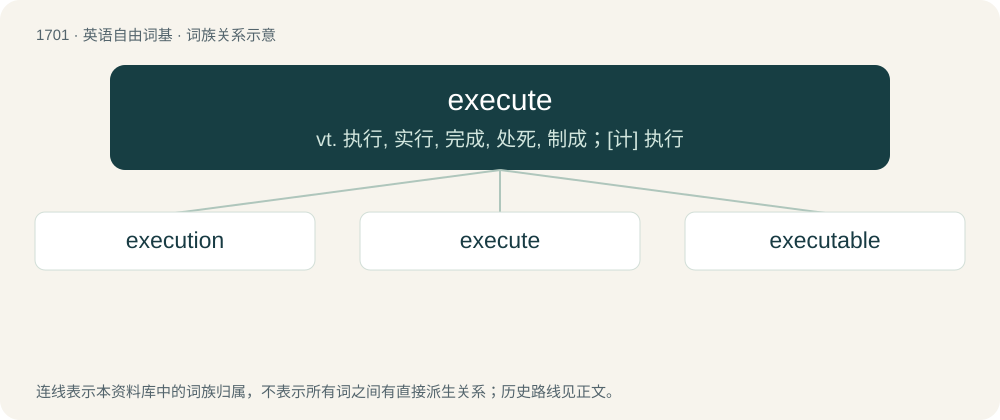

# 1798 · execute — vt. 执行, 实行, 完成, 处死, 制成；\[计\] 执行

[总目录](../00_总目录_按常用程度.md)

**类型**：英语自由词基　｜　**来源语言**：见词源记录

## 核心含义与来源

- 核心含义：vt. 执行, 实行, 完成, 处死, 制成；\[计\] 执行
- 英文含义：To kill, especially as punishment for a capital crime.
- 词形：execute

**来源记录 1**（动词；To kill, especially as punishment for a capital crime.）

From Old French executer (French exécuter), from Latin exsecutus, past participle of exsequor (“to follow (up/through)”, particularly in the sense “to go through with a deed or punishment”), from ex- (“out”) + sequor (“to follow”).

## 词族图

## 单词速览（常用到不常用）

| 单词 | 音标 | 释义 |
|---|---|---|
| [execution](#w-1) | /ˌɛk.sɪˈkjuː.ʃən/ | n. 实行, 完成, 执行, 死刑；\[计\] 执行 |
| [execute](#w-2) | /ˈɛksɪˌkjuːt/ | vt. 执行, 实行, 完成, 处死, 制成；\[计\] 执行 |
| [executable](#w-3) | /ˈɛksəkjutəbl/ | a. 可执行的, 可以作成的, 可实行的；\[计\] 可执行的 |

## 逐词详解

### 1. execution

**词性**：名词　｜　**音标**：/ˌɛk.sɪˈkjuː.ʃən/

**中文释义**：n. 实行, 完成, 执行, 死刑；\[计\] 执行

**英文义项**：The act, manner or style of executing (actions, maneuvers, performances). / The state of being accomplished.

**构词拆分**：execute + -ion

**词源与演化**：

From Old French execution (c.1360), from Latin exsecutiō, an agent noun from exsequor (“to follow out”), from ex (“out”) + sequor (“follow”). Equivalent to execute + -ion.

**例句**：

> The entire machine slowed down during the execution of the virus checker.

该用例对应义项：The carrying out of an instruction, program or program segment by a computer.

### 2. execute

**词性**：动词　｜　**音标**：/ˈɛksɪˌkjuːt/

**中文释义**：vt. 执行, 实行, 完成, 处死, 制成；\[计\] 执行

**英文义项**：To kill, especially as punishment for a capital crime. / To carry out; to put into effect.

**词源与演化**：

From Old French executer (French exécuter), from Latin exsecutus, past participle of exsequor (“to follow (up/through)”, particularly in the sense “to go through with a deed or punishment”), from ex- (“out”) + sequor (“to follow”).

**例句**：

> There are certain states where it is lawful to execute prisoners convicted of certain crimes.

该用例对应义项：To kill, especially as punishment for a capital crime.

### 3. executable

**词性**：名词　｜　**音标**：/ˈɛksəkjutəbl/

**中文释义**：a. 可执行的, 可以作成的, 可实行的；\[计\] 可执行的

**英文义项**：A file that can be run directly by a computer's hardware or a p-code interpreter with no further processing.

**构词拆分**：execute + -able

**词源与演化**：

From execute + -able.

**例句**：

> The program as written by the programmer is generally processed into an executable that can be run.

该用例对应义项：A file that can be run directly by a computer's hardware or a p-code interpreter with no further processing.
