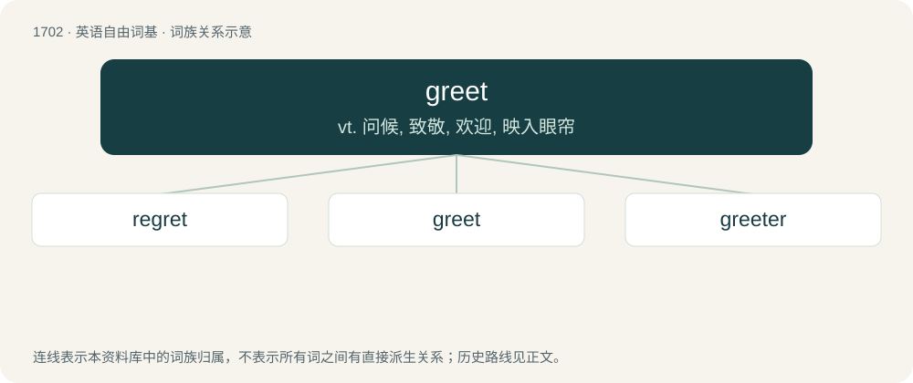

# 1800 · greet — vt. 问候, 致敬, 欢迎, 映入眼帘

[总目录](../00_总目录_按常用程度.md)

**类型**：英语自由词基　｜　**来源语言**：见词源记录

## 核心含义与来源

- 核心含义：vt. 问候, 致敬, 欢迎, 映入眼帘
- 英文含义：To welcome in a friendly manner, either in person or through another means such as writing.
- 词形：greet

**多个词源／构词路径**：同一拼写可能有不同来源；以下按词性和含义分别列出。

**来源记录 1**（动词；To welcome in a friendly manner, either in person or through another means such as writing.）

From Middle English greten, from Old English grētan, from Proto-West Germanic \*grōtijan, from Proto-Germanic \*grōtijaną. Cognate with Dutch groeten, German grüßen, grüssen.

**来源记录 2**（形容词；Great.）

From Middle English greet, grete (“great”).

**来源记录 3**（动词；To weep; to cry.）

From a blend of two Old English verbs, grētan, grǣtan (itself from Proto-West Germanic \*grātan); and of Old English grēotan (itself from \*greutan), both meaning "to weep, lament". Possibly reinforced in Northern England and Scotland by Old Norse gráta, whence also Danish græde, Norwegian gråte, Swedish gråta, all meaning "to cry, to weep".

## 词族图

## 单词速览（常用到不常用）

| 单词 | 音标 | 释义 |
|---|---|---|
| [regret](#w-1) | /ɹɪˈɡɹɛt/ | n. 遗憾, 后悔, 悔恨, 抱歉, 歉意；vt. 为...感到遗憾, 后悔, 惋惜, 懊悔, 抱歉；vi. 感到抱歉 |
| [greet](#w-2) | /ɡɹiːt/ | vt. 问候, 致敬, 欢迎, 映入眼帘 |
| [greeter](#w-3) | /ˈgriːtə(r)/ | n. 欢迎人员 |

## 逐词详解

### 1. regret

**词性**：动词　｜　**音标**：/ɹɪˈɡɹɛt/

**中文释义**：n. 遗憾, 后悔, 悔恨, 抱歉, 歉意；vt. 为...感到遗憾, 后悔, 惋惜, 懊悔, 抱歉；vi. 感到抱歉

**英文义项**：To feel sorry about (a thing that has or has not happened), afterthink: to wish that a thing had not happened, that something else had happened instead. / To feel sorry about (any thing).

**构词拆分**：re- + greet

**词源与演化**：

From Middle English regretten, regreten, from Old French regreter, regrater (“to lament”), from re- (intensive prefix) + \*greter, \*grater (“to weep”), from Frankish \*grātan (“to weep, mourn, lament”), from Proto-Germanic \*grētaną (“to weep”), from Proto-Indo-European \*ǵʰreh₁d- (“to sound”); and Frankish \*greutan (“to cry, weep”), from Proto-Germanic \*greutaną (“to weep, cry”), from Proto-Indo-European \*gʰrewd- (“to weep, be sad”), equivalent to re- + greet. Cognate with Old High German grāzan (“to cry”), Old English grǣtan (“to weep, greet”), Old English grēotan (“to weep, lament”), Old Norse gráta (“to weep, groan”), Gothic 𐌲𐍂𐌴𐍄𐌰𐌽 (grētan, “to weep”). More at greet.

**例句**：

> I don't regret enrolling in law, but I regret not studying some Chinese.

该用例对应义项：To feel sorry about (a thing that has or has not happened), afterthink: to wish that a thing had not happened, that something else had happened instead.

### 2. greet

**词性**：动词　｜　**音标**：/ɡɹiːt/

**中文释义**：vt. 问候, 致敬, 欢迎, 映入眼帘

**英文义项**：To welcome in a friendly manner, either in person or through another means such as writing. / To arrive at or reach, or meet.

**词源与演化**：

From Middle English greten, from Old English grētan, from Proto-West Germanic \*grōtijan, from Proto-Germanic \*grōtijaną. Cognate with Dutch groeten, German grüßen, grüssen.

**例句**：

> A brilliant dawn greeted her eyes as she looked out of the window.

该用例对应义项：To be perceived by (someone).

### 3. greeter

**词性**：名词　｜　**音标**：/ˈgriːtə(r)/

**中文释义**：n. 欢迎人员

**英文义项**：A person who greets people on their arrival. / A volunteer who shows tourists around their home city or region for free.

**构词拆分**：greet + -er

**词源与演化**：

From Middle English greter, gretter, equivalent to greet + -er.

**用法示例／搭配（非完整句）**：

> Walmart greeter

该用例对应义项：A person who greets people on their arrival.
