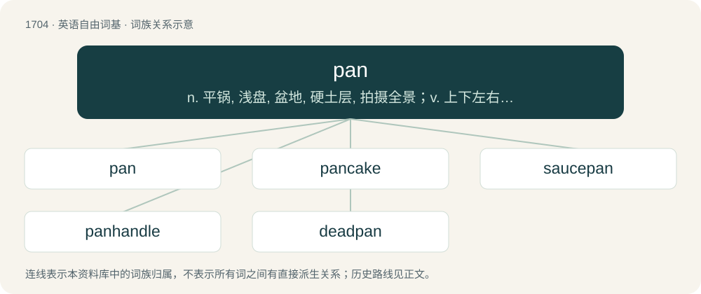

# 1802 · pan — n. 平锅, 浅盘, 盆地, 硬土层, 拍摄全景；v. 上下左右移动, 摇镜头, 淘洗, 淘金

[总目录](../00_总目录_按常用程度.md)

**类型**：英语自由词基　｜　**来源语言**：见词源记录

## 核心含义与来源

- 核心含义：n. 平锅, 浅盘, 盆地, 硬土层, 拍摄全景；v. 上下左右移动, 摇镜头, 淘洗, 淘金
- 英文含义：A wide, flat receptacle used around the house, especially for cooking.
- 词形：pan

**多个词源／构词路径**：同一拼写可能有不同来源；以下按词性和含义分别列出。

**来源记录 1**（名词；A wide, flat receptacle used around the house, especially for cooking.）

From Middle English panne, from Old English panne, from Proto-West Germanic \*pannā, from Proto-Germanic \*pannǭ. Further origin uncertain. Alois Walde firstly suggests that it might be from Late Latin panna, from Latin patina (“broad, shallow dish, pan, stewpan”), from Ancient Greek πατάνη (patánē, “kind of flat dish”), which is probably from Pre-Greek. But the sound shifting from /patina/ → /patna/ → /panna/ raises questions as -tn- to -nn- is rarely seen in Latin. The mainstream theory as of now (Friedrich Kluge, Julius Pokorny, Guus Kroonen) suggests that it is from Late Latin panna. But its sparse attestation only in the frontier inscriptions and not widespread in most Romance languages raises doubts among a few scholars (notably Michiel de Vaan), being skeptical about its origin, and open for any interpretations (Oxford English Dictionary). Vladmir Orel, in his work Albanian Etymological Dictionary, suggests that both Proto-Germanic \*pannǭ and Late Latin panna could be from a non-IE Mediterranean substrate word, considering that classical Latin attestations are scarce and distributed in a specific region, and Proto-Germanic loanwords from non-IE substrates often include agricultural terms, seafaring vocabulary, or animal names. Although, this substrate hypothesis is controversial and most scholars remain skeptical about it. In either case of relationship to the Latin, the English word is a doublet of patina; see there for more doublets and further detail. Cognate with West Frisian panne, Saterland Frisian Ponne, Dutch pan, German Low German Panne, Pann, German Pfanne, Danish pande, Swedish panna, Icelandic panna.

**来源记录 2**（动词；(of a camera) To turn horizontally.）

Clipping of panorama.

**来源记录 3**（动词；To join or fit together; to unite.）

Of unknown origin.

**来源记录 4**（名词；A part; a portion.）

From Old English. See pane.

**来源记录 5**（形容词；Pansexual or panromantic.）

Clipping of pansexual or panromantic.

## 词族图

## 单词速览（常用到不常用）

| 单词 | 音标 | 释义 |
|---|---|---|
| [pan](#w-1) | 英 /pæn/；美 /pæn/ | n. 平锅, 浅盘, 盆地, 硬土层, 拍摄全景；v. 上下左右移动, 摇镜头, 淘洗, 淘金 |
| [pancake](#w-2) | /ˈpæn.keɪk/ | n. 薄烤饼, 薄煎饼, 烙饼 |
| [saucepan](#w-3) | 英 /ˈsɔːs.pən/；美 /ˈsɔsˌpæn/ | n. (长柄有盖)深平底锅, 炖锅 |
| [panhandle](#w-4) | 英 /ˈpænˌhæn.dəl/ | n. 锅柄, 锅柄状地区, 狭长土地；v. 街头行乞, 讨钱 |
| [deadpan](#w-5) | /ˈdɛdpæn/ | n. 无表情的脸 |

## 逐词详解

### 1. pan

**词性**：名词　｜　**音标**：英 /pæn/；美 /pæn/

**中文释义**：n. 平锅, 浅盘, 盆地, 硬土层, 拍摄全景；v. 上下左右移动, 摇镜头, 淘洗, 淘金

**英文义项**：A wide, flat receptacle used around the house, especially for cooking. / The contents of such a receptacle.

**词源与演化**：

From Middle English panne, from Old English panne, from Proto-West Germanic \*pannā, from Proto-Germanic \*pannǭ. Further origin uncertain. Alois Walde firstly suggests that it might be from Late Latin panna, from Latin patina (“broad, shallow dish, pan, stewpan”), from Ancient Greek πατάνη (patánē, “kind of flat dish”), which is probably from Pre-Greek. But the sound shifting from /patina/ → /patna/ → /panna/ raises questions as -tn- to -nn- is rarely seen in Latin. The mainstream theory as of now (Friedrich Kluge, Julius Pokorny, Guus Kroonen) suggests that it is from Late Latin panna. But its sparse attestation only in the frontier inscriptions and not widespread in most Romance languages raises doubts among a few scholars (notably Michiel de Vaan), being skeptical about its origin, and open for any interpretations (Oxford English Dictionary). Vladmir Orel, in his work Albanian Etymological Dictionary, suggests that both Proto-Germanic \*pannǭ and Late Latin panna could be from a non-IE Mediterranean substrate word, considering that classical Latin attestations are scarce and distributed in a specific region, and Proto-Germanic loanwords from non-IE substrates often include agricultural terms, seafaring vocabulary, or animal names. Although, this substrate hypothesis is controversial and most scholars remain skeptical about it. In either case of relationship to the Latin, the English word is a doublet of patina; see there for more doublets and further detail. Cognate with West Frisian panne, Saterland Frisian Ponne, Dutch pan, German Low German Panne, Pann, German Pfanne, Danish pande, Swedish panna, Icelandic panna.

**用法示例／搭配（非完整句）**：

> flash in the pan

该用例对应义项：The part of a matchlock, flintlock, or wheellock firearm that holds the priming.

### 2. pancake

**词性**：名词　｜　**音标**：/ˈpæn.keɪk/

**中文释义**：n. 薄烤饼, 薄煎饼, 烙饼

**英文义项**：An thin batter cake similar to a crepe, typically unleavened. / A leavened, thicker, fluffier cake.

**构词拆分**：By surface analysis, pan + cake

**词源与演化**：

Inherited from Middle English pancake, panne cake, pankake, ponkake. By surface analysis, pan + cake. Perhaps adapted from Middle Low German pankôke, pannekôke, from Old Saxon \*pannakōko (suggested by derivatives Old Saxon pannakōkilo and pannakōkilīn), where the compound is much older; compare Old High German phankuohho (8th century), whence Middle High German phankuoche, German Pfannkuchen (“pancake”); further Saterland Frisian Ponkouke, Ponkuuke (“pancake”), West Frisian pankoek (“pancake”), Dutch pannenkoek (“pancake”), German Low German Pannkook (“pancake”). The juggling sense is by analogy with a pancake being tossed in a pan.

**用法示例／搭配（非完整句）**：

> pancake lens

该用例对应义项：Anything very thin and flat.

### 3. saucepan

**词性**：名词　｜　**音标**：英 /ˈsɔːs.pən/；美 /ˈsɔsˌpæn/

**中文释义**：n. (长柄有盖)深平底锅, 炖锅

**英文义项**：A deep cooking vessel with a long protruding handle and sometimes a lid; used for boiling, stewing and making sauces.

**构词拆分**：sauce + pan

**词源与演化**：

From sauce + pan.

**例句**：

> Tom opened a can of soup and emptied it into a saucepan.

### 4. panhandle

**词性**：名词　｜　**音标**：英 /ˈpænˌhæn.dəl/

**中文释义**：n. 锅柄, 锅柄状地区, 狭长土地；v. 街头行乞, 讨钱

**英文义项**：The handle of a pan. / An area within a nation or subnational division that appears to stick out or project when viewed on a map; an especially elongated salient.

**构词拆分**：pan + handle

**词源与演化**：

From pan + handle.

**例句**：

> Wheeling is located in the northern panhandle of West Virginia.

该用例对应义项：a relatively narrow strip of land projecting from some larger area

### 5. deadpan

**词性**：形容词　｜　**音标**：/ˈdɛdpæn/

**中文释义**：n. 无表情的脸

**英文义项**：Deliberately impassive or expressionless. / Having such a face or look.

**构词拆分**：dead + pan (“face”)

**词源与演化**：

From dead + pan (“face”).

**例句**：

> The comedian remained deadpan.

该用例对应义项：Having such a face or look.
