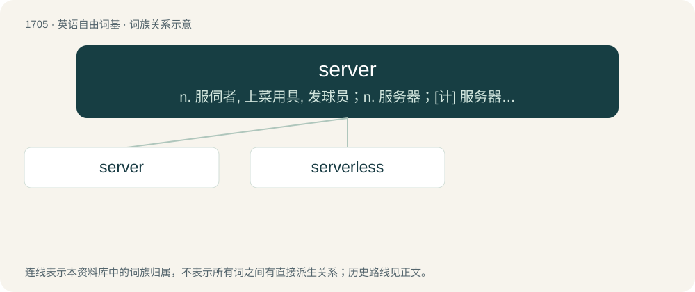

# 1803 · server — n. 服伺者, 上菜用具, 发球员；n. 服务器；\[计\] 服务器, 服务器启动程序, 服务台程序

[总目录](../00_总目录_按常用程度.md)

**类型**：英语自由词基　｜　**来源语言**：见词源记录

## 核心含义与来源

- 核心含义：n. 服伺者, 上菜用具, 发球员；n. 服务器；\[计\] 服务器, 服务器启动程序, 服务台程序
- 英文含义：A program that provides services to other programs or devices, either in the same computer or over a computer network.
- 词形：server

**来源记录 1**（名词；A program that provides services to other programs or devices, either in the same computer or over a computer network.）

From Middle English servere, equivalent to serve + -er.

## 词族图

## 单词速览（常用到不常用）

| 单词 | 音标 | 释义 |
|---|---|---|
| [server](#w-1) | 英 /ˈsɜːvə/；美 /ˈsɝvɚ/ | n. 服伺者, 上菜用具, 发球员；n. 服务器；\[计\] 服务器, 服务器启动程序, 服务台程序 |
| [serverless](#w-2) |  | 【英文】Based on a cloud computing execution model in which the cloud provider allocates machine resources on demand. |

## 逐词详解

### 1. server

**词性**：名词　｜　**音标**：英 /ˈsɜːvə/；美 /ˈsɝvɚ/

**中文释义**：n. 服伺者, 上菜用具, 发球员；n. 服务器；\[计\] 服务器, 服务器启动程序, 服务台程序

**英文义项**：A program that provides services to other programs or devices, either in the same computer or over a computer network. / A computer dedicated to running such programs.

**构词拆分**：serve + -er

**词源与演化**：

From Middle English servere, equivalent to serve + -er.

**例句**：

> The server encountered a temporary error and could not complete your request.

### 2. serverless

**词性**：形容词

**英文义项**：Based on a cloud computing execution model in which the cloud provider allocates machine resources on demand. / Not involving a server; composed only of clients.

**构词拆分**：server + -less

**词源与演化**：

From server + -less.

**用法示例／搭配（非完整句）**：

> serverless architecture

该用例对应义项：Not involving a server; composed only of clients.
