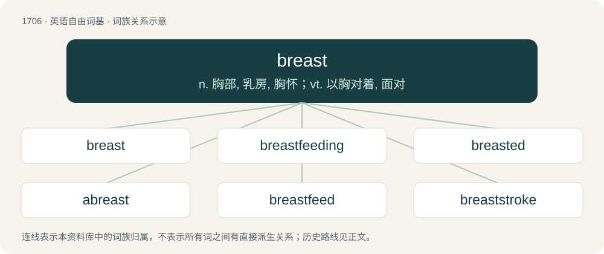

# 1804 · breast — n. 胸部, 乳房, 胸怀；vt. 以胸对着, 面对

[总目录](../00_总目录_按常用程度.md)

**类型**：英语自由词基　｜　**来源语言**：见词源记录

## 核心含义与来源

- 核心含义：n. 胸部, 乳房, 胸怀；vt. 以胸对着, 面对
- 英文含义：Either of the two organs on the front of a female human's chest, which contain the mammary glands; also the analogous organs in males.
- 词形：breast

**来源记录 1**（名词；Either of the two organs on the front of a female human's chest, which contain the mammary glands; also the analogous organs in males.）

From Middle English brest, from Old English brēost, from Proto-West Germanic \*breust, from Proto-Germanic \*breustą, from Proto-Indo-European \*bʰrews- (“to swell”). Compare West Frisian boarst, Danish bryst, Swedish bröst; cf. also Dutch borst, German Brust.

## 词族图

## 单词速览（常用到不常用）

| 单词 | 音标 | 释义 |
|---|---|---|
| [breast](#w-1) | 英 /bɹɛst/ | n. 胸部, 乳房, 胸怀；vt. 以胸对着, 面对 |
| [breastfeeding](#w-2) | /ˈbɹɛstˌfidɪŋ/ | v. 用母乳喂养, 哺乳( breastfeed的现在分词 ) |
| [breasted](#w-3) | /ˈbɹɛstɪd/ | n. 布雷斯特德（姓氏） |
| [abreast](#w-4) | /əˈbɹɛst/ | adv. 并肩地, 并列地 |
| [breastfeed](#w-5) | /ˈbɹɛs(t)fiːd/ | vt.& vi. 用母乳喂养, 哺乳 |
| [breaststroke](#w-6) | 美 /ˈbɹɛstˌstɹoʊk/ | n. 俯泳 |
| [breastplate](#w-7) | 美 /ˈbɹɛstˌpleɪt/ | n. 护胸甲, 腹甲, 胸革带 |

## 逐词详解

### 1. breast

**词性**：名词　｜　**音标**：英 /bɹɛst/

**中文释义**：n. 胸部, 乳房, 胸怀；vt. 以胸对着, 面对

**英文义项**：Either of the two organs on the front of a female human's chest, which contain the mammary glands; also the analogous organs in males. / The chest, or front of the human thorax.

**词源与演化**：

From Middle English brest, from Old English brēost, from Proto-West Germanic \*breust, from Proto-Germanic \*breustą, from Proto-Indo-European \*bʰrews- (“to swell”). Compare West Frisian boarst, Danish bryst, Swedish bröst; cf. also Dutch borst, German Brust.

**例句**：

> She kindled hope in the breast of all who heard her.

该用例对应义项：The figurative seat of the emotions, feelings etc.; one’s heart or innermost thoughts.

### 2. breastfeeding

**词性**：名词　｜　**音标**：/ˈbɹɛstˌfidɪŋ/

**中文释义**：v. 用母乳喂养, 哺乳( breastfeed的现在分词 )

**英文义项**：The act or process of feeding a baby or young child milk from a lactating breast. / An instance (session) of such feeding activity.

**构词拆分**：breast + feeding

**词源与演化**：

From breast + feeding.

**例句**：

> Is it safe to use hair dye when I'm pregnant or breastfeeding?

### 3. breasted

**词性**：形容词　｜　**音标**：/ˈbɹɛstɪd/

**中文释义**：n. 布雷斯特德（姓氏）

**英文义项**：Having a breast, or breasts. / Having a specified kind of breast or covering.

**构词拆分**：breast + -ed

**词源与演化**：

From breast + -ed.

**例句**：

> The yellow breasted capuchin monkey (S. xanthosternos) at Una Biological Reserve in Bahia, Brazil, is a critically-endangered primate targeted by hunters for bush meat.

### 4. abreast

**词性**：形容词　｜　**音标**：/əˈbɹɛst/

**中文释义**：adv. 并肩地, 并列地

**英文义项**：Side by side, facing forward. / Alongside; parallel to.

**构词拆分**：By surface analysis, a- (“on, at”) + breast

**词源与演化**：

From Middle English abrest. By surface analysis, a- (“on, at”) + breast, meaning “breasts (chests) in line, side-by-side and exactly equally advanced”; roughly “breast-by-breast”.

**用法示例／搭配（非完整句）**：

> to keep abreast of \[or with\] the present state of science

该用例对应义项：Up to a certain level or line; equally advanced

### 5. breastfeed

**词性**：动词　｜　**音标**：/ˈbɹɛs(t)fiːd/

**中文释义**：vt.& vi. 用母乳喂养, 哺乳

**英文义项**：To feed (a baby) milk via the breasts; to suckle; to nurse. / To nurse, to suck milk from a breast.

**构词拆分**：breast + feed

**词源与演化**：

From breast + feed.

**例句**：

> This is a designated place for mothers to breastfeed their babies.

该用例对应义项：To feed (a baby) milk via the breasts; to suckle; to nurse.

### 6. breaststroke

**词性**：名词　｜　**音标**：美 /ˈbɹɛstˌstɹoʊk/

**中文释义**：n. 俯泳

**英文义项**：A swimming stroke in which the swimmer lies face down, the arms being swept forward, outward and back under the water and the legs are kicked like a frog's

**构词拆分**：breast + stroke

**词源与演化**：

From breast + stroke.

**例句**：

> I can do the breaststroke but not the backstroke.

### 7. breastplate

**词性**：名词　｜　**音标**：美 /ˈbɹɛstˌpleɪt/

**中文释义**：n. 护胸甲, 腹甲, 胸革带

**英文义项**：A piece of armor that covers the chest. / A piece of armor that covers the torso; a cuirass, the breast- (front) and back-plate, taken together as a unit.

**构词拆分**：breast + plate

**词源与演化**：

From Middle English brestplate, equivalent to breast + plate. Displaced Old English brēostbeorg.
