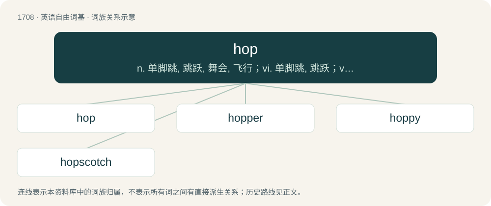

# 1806 · hop — n. 单脚跳, 跳跃, 舞会, 飞行；vi. 单脚跳, 跳跃；vt. 跃过, 跳上, 加蛇麻子于, 服麻醉药

[总目录](../00_总目录_按常用程度.md)

**类型**：英语自由词基　｜　**来源语言**：见词源记录

## 核心含义与来源

- 核心含义：n. 单脚跳, 跳跃, 舞会, 飞行；vi. 单脚跳, 跳跃；vt. 跃过, 跳上, 加蛇麻子于, 服麻醉药
- 英文含义：A short jump.
- 词形：hop

**多个词源／构词路径**：同一拼写可能有不同来源；以下按词性和含义分别列出。

**来源记录 1**（名词；A short jump.）

From Middle English hoppen, from Old English hoppian (“to hop, spring, leap, dance”), from Proto-West Germanic \*huppōn, from Proto-Germanic \*huppōną (“to hop”), from Proto-Indo-European \*kewb- (“to bend, bow”). Cognate with Dutch hoppen (“to hop”), German hopfen, hoppen (“to hop”), Danish hoppe (“to hop, leap, jump”), Swedish hoppa (“to hop, leap, jump”), Icelandic hoppa (“to hop, skip”).

**来源记录 2**（名词；A plant of species Humulus lupulus, native to northern Europe, female flowers of which are used to flavour many types of beer during brewing.）

From Middle English hoppe, from Middle Dutch hoppe, from Old Dutch \*hoppo, from Proto-Germanic \*huppô, possibly from Proto-Indo-European \*(s)keup (“tuft, hair of the head”), referring to the plant's appearance. Cognate with German Hopfen and French houblon.

## 词族图

## 单词速览（常用到不常用）

| 单词 | 音标 | 释义 |
|---|---|---|
| [hop](#w-1) | 英 /hɒp/；美 /hɑp/ | n. 单脚跳, 跳跃, 舞会, 飞行；vi. 单脚跳, 跳跃；vt. 跃过, 跳上, 加蛇麻子于, 服麻醉药 |
| [hopper](#w-2) | 英 /ˈhɒp.ə(ɹ)/；美 /ˈhɑ.pɚ/ | n. 跳跃的东西, 单足跳者, 跳虫；\[化\] 漏斗; 贮斗; 料斗; 集尘箱; 集尘斗 |
| [hoppy](#w-3) | 英 /ˈhɒpi/；美 /ˈhɑpi/ | n. 吸毒成瘾者；a. 蛇麻草的；啤酒花的；跳动的 |
| [hopscotch](#w-4) | 英 /ˈhɒpˌskɒt͡ʃ/；美 /ˈhɑpˌskɑt͡ʃ/ | n. "跳房子"游戏 |

## 逐词详解

### 1. hop

**词性**：名词　｜　**音标**：英 /hɒp/；美 /hɑp/

**中文释义**：n. 单脚跳, 跳跃, 舞会, 飞行；vi. 单脚跳, 跳跃；vt. 跃过, 跳上, 加蛇麻子于, 服麻醉药

**英文义项**：A short jump. / A jump on one leg.

**词源与演化**：

From Middle English hoppen, from Old English hoppian (“to hop, spring, leap, dance”), from Proto-West Germanic \*huppōn, from Proto-Germanic \*huppōną (“to hop”), from Proto-Indo-European \*kewb- (“to bend, bow”). Cognate with Dutch hoppen (“to hop”), German hopfen, hoppen (“to hop”), Danish hoppe (“to hop, leap, jump”), Swedish hoppa (“to hop, leap, jump”), Icelandic hoppa (“to hop, skip”).

**例句**：

> For popular radio stars in New York and Los Angeles, it was a short hop to network television.

该用例对应义项：A brief period of development or progress.

### 2. hopper

**词性**：名词　｜　**音标**：英 /ˈhɒp.ə(ɹ)/；美 /ˈhɑ.pɚ/

**中文释义**：n. 跳跃的东西, 单足跳者, 跳虫；\[化\] 漏斗; 贮斗; 料斗; 集尘箱; 集尘斗

**英文义项**：One who or that which hops. / A temporary storage bin, filled from the top and emptied from the bottom, often funnel-shaped.

**构词拆分**：hop + -er

**词源与演化**：

From Middle English hoppere, alteration of \*hoppe (found in grashoppe (“grasshopper”)), from Old English \*hoppa (“one who hops, hopper”), equivalent to hop + -er. Cognate with Dutch hopper (“hopper”), Swedish hoppare (“hopper, jumper”), Icelandic hoppari (“hopper”).

**例句**：

> To catch a big fish, use a hopper that jumps across the pond surface.

该用例对应义项：An artificial fishing lure.

### 3. hoppy

**词性**：形容词　｜　**音标**：英 /ˈhɒpi/；美 /ˈhɑpi/

**中文释义**：n. 吸毒成瘾者；a. 蛇麻草的；啤酒花的；跳动的

**英文义项**：Having a taste of hops; heavily flavoured with hops.

**构词拆分**：hop + -y

**词源与演化**：

From hop + -y.

**用法示例／搭配（非完整句）**：

> a hoppy bunny

该用例对应义项：Characterised by a hopping motion.

### 4. hopscotch

**词性**：名词　｜　**音标**：英 /ˈhɒpˌskɒt͡ʃ/；美 /ˈhɑpˌskɑt͡ʃ/

**中文释义**：n. "跳房子"游戏

**英文义项**：A child's game, in which a player, hopping on one foot, drives a stone from one compartment to another of a figure traced or scotched on the ground.

**构词拆分**：hop + scotch (“scratch”)

**词源与演化**：

From hop + scotch (“scratch”).

**例句**：

> In the schoolyard you often see kids playing hopscotch.
