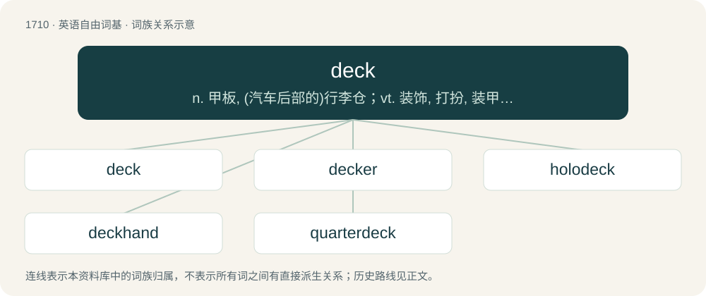

# 1807 · deck — n. 甲板, (汽车后部的)行李仓；vt. 装饰, 打扮, 装甲板；\[计\] 纸牌背面图案

[总目录](../00_总目录_按常用程度.md)

**类型**：英语自由词基　｜　**来源语言**：见词源记录

## 核心含义与来源

- 核心含义：n. 甲板, (汽车后部的)行李仓；vt. 装饰, 打扮, 装甲板；\[计\] 纸牌背面图案
- 英文含义：Any raised flat surface that can be walked on: a balcony; a porch; a raised patio; a flat rooftop.
- 词形：deck

**多个词源／构词路径**：同一拼写可能有不同来源；以下按词性和含义分别列出。

**来源记录 1**（名词；Any raised flat surface that can be walked on: a balcony; a porch; a raised patio; a flat rooftop.）

From Middle English dekke, borrowed from Middle Dutch dec (“roof, covering”), from Middle Dutch decken, from Old Dutch thecken, from Proto-West Germanic \*þakkjan, from Proto-Germanic \*þakjaną. Formed the same: German Decke (“covering, blanket”). Doublet of thatch and thack.

**来源记录 2**（动词；To cover; to overspread.）

From Middle English dekken, from Middle Dutch dekken (“to cover”), from Old Dutch thecken, from Proto-West Germanic \*þakkjan, from Proto-Germanic \*þakjaną (“to roof; cover”).

## 词族图

## 单词速览（常用到不常用）

| 单词 | 音标 | 释义 |
|---|---|---|
| [deck](#w-1) | 英 /ˈdɛk/ | n. 甲板, (汽车后部的)行李仓；vt. 装饰, 打扮, 装甲板；\[计\] 纸牌背面图案 |
| [decker](#w-2) | /ˈdɛkə(ɹ)/ | n. 装饰者, (用以构成复合词的)有...层甲板的船只, 有...层面的车辆 |
| [holodeck](#w-3) |  | 【英文】A room that provides holographic simulations for recreation, training, etc. |
| [deckhand](#w-4) | 美 /ˈdɛkˌhænd/ | n. 甲板水手, 普通水手 |
| [quarterdeck](#w-5) | /ˈkwɔːtədek/ | n. 后甲板 |

## 逐词详解

### 1. deck

**词性**：名词　｜　**音标**：英 /ˈdɛk/

**中文释义**：n. 甲板, (汽车后部的)行李仓；vt. 装饰, 打扮, 装甲板；\[计\] 纸牌背面图案

**英文义项**：Any raised flat surface that can be walked on: a balcony; a porch; a raised patio; a flat rooftop. / The floorlike covering of the horizontal sections, or compartments, of a ship or boat. Small vessels have only one deck; larger ships have two or three decks.

**词源与演化**：

From Middle English dekke, borrowed from Middle Dutch dec (“roof, covering”), from Middle Dutch decken, from Old Dutch thecken, from Proto-West Germanic \*þakkjan, from Proto-Germanic \*þakjaną. Formed the same: German Decke (“covering, blanket”). Doublet of thatch and thack.

**例句**：

> We hit the deck as bullets began to fly.

该用例对应义项：The floor.

### 2. decker

**词性**：名词　｜　**音标**：/ˈdɛkə(ɹ)/

**中文释义**：n. 装饰者, (用以构成复合词的)有...层甲板的船只, 有...层面的车辆

**英文义项**：One who, or that which, decks or adorns; a coverer.

**构词拆分**：deck + -er

**词源与演化**：

From deck (verb) + -er.

**用法示例／搭配（非完整句）**：

> a table decker

该用例对应义项：One who, or that which, decks or adorns; a coverer.

### 3. holodeck

**词性**：名词

**英文义项**：A room that provides holographic simulations for recreation, training, etc.

**构词拆分**：holo- + deck

**词源与演化**：

From holo- + deck, coined in the television series Star Trek: The Next Generation.

### 4. deckhand

**词性**：名词　｜　**音标**：美 /ˈdɛkˌhænd/

**中文释义**：n. 甲板水手, 普通水手

**英文义项**：A member of the crew of a merchant ship who performs manual labour. / A stagehand.

**构词拆分**：deck + hand

**词源与演化**：

From deck + hand.

**例句**：

> He went to sea as a deckhand at the age of fourteen.

### 5. quarterdeck

**词性**：名词　｜　**音标**：/ˈkwɔːtədek/

**中文释义**：n. 后甲板

**英文义项**：The aft part of the upper deck of a ship; normally reserved for officers

**构词拆分**：quarter + deck

**词源与演化**：

From quarter + deck.
