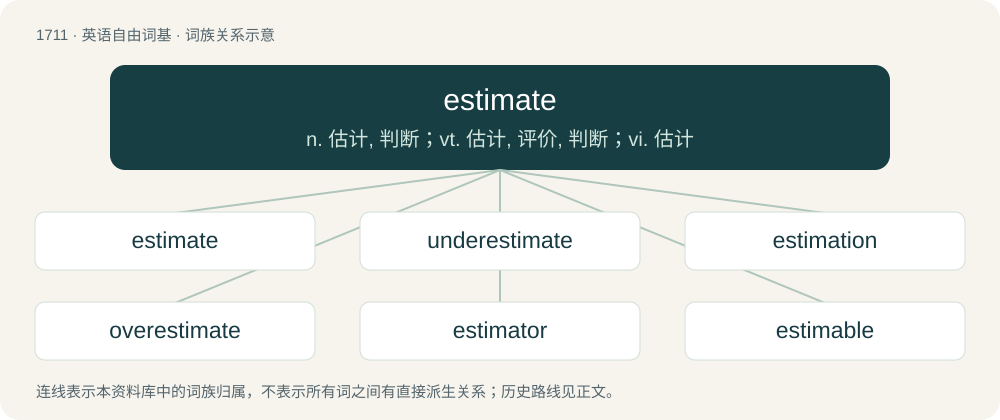

# 1809 · estimate — n. 估计, 判断；vt. 估计, 评价, 判断；vi. 估计

[总目录](../00_总目录_按常用程度.md)

**类型**：英语自由词基　｜　**来源语言**：见词源记录

## 核心含义与来源

- 核心含义：n. 估计, 判断；vt. 估计, 评价, 判断；vi. 估计
- 英文含义：A rough calculation or assessment of the value, size, or cost of something.
- 词形：estimate

**多个词源／构词路径**：同一拼写可能有不同来源；以下按词性和含义分别列出。

**来源记录 1**（名词；A rough calculation or assessment of the value, size, or cost of something.）

From Middle English estimat, borrowed from Latin aestimātus (“valuing, estimate”, only used in the ablative singular: "aestimātū..." (in valuing...)), from aestimō + -tus (“action noun-forming suffix”).

**来源记录 2**（动词；To calculate roughly, often from imperfect data.）

Borrowed from Latin aestimātus, perfect passive participle of aestimō (“to estimate”) (see -ate), older form aestumō (“to value, rate, esteem”); from Old Latin \*ais-temos (“one who cuts copper”), meaning one in the Roman Republic who mints money. Compare Middle English estymatt (“reputed”) / estimat. See also the doublet esteem, as well as aim.

## 词族图

## 单词速览（常用到不常用）

| 单词 | 音标 | 释义 |
|---|---|---|
| [estimate](#w-1) | /ˈɛs.tɪ.mət/ | n. 估计, 判断；vt. 估计, 评价, 判断；vi. 估计 |
| [underestimate](#w-2) | 美 /ʌndɚˈɛs.tɪ.meɪt/ | n. 低估；vt. 低估, 看轻 |
| [estimation](#w-3) | 英 /ˌɛs.tɪˈmeɪ.ʃən/；美 /ˌɛs.təˈmeɪ.ʃən/ | n. 判断, 估计, 尊重；\[化\] 估计; 估定; 测定; 估值 |
| [overestimate](#w-4) | /ˌəʊvəɹˈɛstɪmeɪt/ | vt. 评价过高, 过高估价；n. 估计过高, 评价过高 |
| [estimator](#w-5) | 英 /ˈɛs.tɪˌmeɪ.tə/；美 /ˈɛs.təˌmeɪ.tɚ/ | n. 估计者；\[化\] 估计器; 估计量 |
| [estimable](#w-6) | /ˈɛstɪməbəl/ | a. 可尊敬的, 可估计的 |

## 逐词详解

### 1. estimate

**词性**：名词　｜　**音标**：/ˈɛs.tɪ.mət/

**中文释义**：n. 估计, 判断；vt. 估计, 评价, 判断；vi. 估计

**英文义项**：A rough calculation or assessment of the value, size, or cost of something. / A document (or verbal notification) specifying how much a job is likely to cost.

**词源与演化**：

From Middle English estimat, borrowed from Latin aestimātus (“valuing, estimate”, only used in the ablative singular: "aestimātū..." (in valuing...)), from aestimō + -tus (“action noun-forming suffix”).

**例句**：

> He got an estimate from the car repair shop.

该用例对应义项：a statement indicating the likely cost of some job

### 2. underestimate

**词性**：动词　｜　**音标**：美 /ʌndɚˈɛs.tɪ.meɪt/

**中文释义**：n. 低估；vt. 低估, 看轻

**英文义项**：To estimate too low; to perceive (someone or something) as having a lower value, quantity, worth, etc., than what he/she/it actually has. / To perceive or expect (someone or something) to be less significant or difficult than it actually is.

**构词拆分**：under- + estimate

**词源与演化**：

From under- + estimate.

**例句**：

> Don't underestimate the danger of such a raft trip on this river.

该用例对应义项：make too low an estimate of

### 3. estimation

**词性**：名词　｜　**音标**：英 /ˌɛs.tɪˈmeɪ.ʃən/；美 /ˌɛs.təˈmeɪ.ʃən/

**中文释义**：n. 判断, 估计, 尊重；\[化\] 估计; 估定; 测定; 估值

**英文义项**：The process of making an estimate. / The amount, extent, position, size, or value reached in an estimate.

**构词拆分**：estimate + -ion

**词源与演化**：

From Middle English estimacioun, estimacion, from Old French estimacion, from Latin aestimatio. Morphologically estimate + -ion.

**例句**：

> According to my estimations, we should get to the border in five hours, give or take.

该用例对应义项：The process of making an estimate.

### 4. overestimate

**词性**：动词　｜　**音标**：/ˌəʊvəɹˈɛstɪmeɪt/

**中文释义**：vt. 评价过高, 过高估价；n. 估计过高, 评价过高

**英文义项**：To judge or calculate too highly.

**构词拆分**：over- + estimate

**词源与演化**：

From over- + estimate.

**例句**：

> It's hardly possible to overestimate the political significance of Turkey in this region.

### 5. estimator

**词性**：名词　｜　**音标**：英 /ˈɛs.tɪˌmeɪ.tə/；美 /ˈɛs.təˌmeɪ.tɚ/

**中文释义**：n. 估计者；\[化\] 估计器; 估计量

**英文义项**：A person who estimates, especially one who estimates costs / A function of a random sample of a population used to estimate some parameter of the whole population

**构词拆分**：estimate + -or

**词源与演化**：

From Latin aestimātor; equivalent to estimate + -or.

### 6. estimable

**词性**：形容词　｜　**音标**：/ˈɛstɪməbəl/

**中文释义**：a. 可尊敬的, 可估计的

**英文义项**：Worthy of esteem; admirable. / Capable of being estimated; estimatable.

**构词拆分**：esteem + -able；estimate + -able

**词源与演化**：

From Middle English estimable, estymable, from Old French estimable, from Latin aestimābilis. Equivalent to esteem + -able and estimate + -able.
