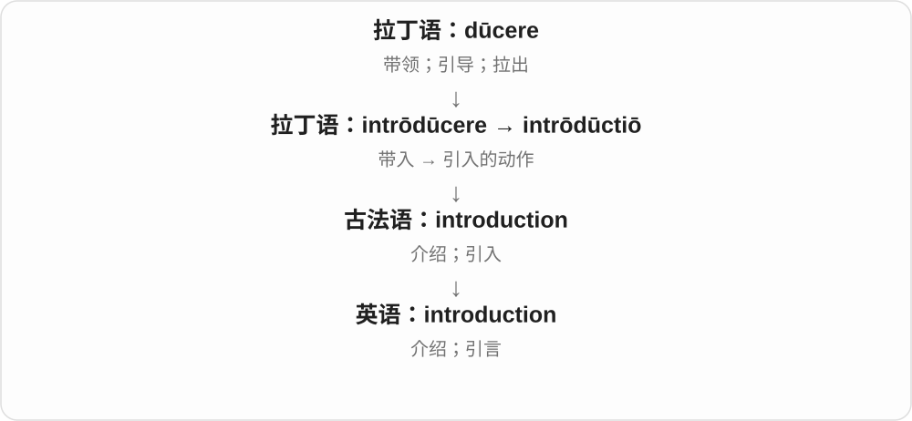

# 1810 · introduction — 引入、介绍和再次带回

[逐词精讲目录](../00_逐词精讲目录.md) · [总目录](../00_总目录_按常用程度.md)

## 核心词根与来源

介绍人让彼此认识，引言把读者带进主题，引入设备把东西带进系统。re- 加上后，是同类动作再发生一次。

**INTRODUCTION：把人、主题或事物带进来**

introduction → reintroduction 再次引入、恢复。

- **基本带入及再次带入**：introduction · reintroduction
- **introduction → intro：开场、介绍的短称**：intro

## 词形与演化规律

intrō- 向里 + dūc- 带领 → intrōdūctiō → introduction；re- + introduction。

intro 是 introduction 的现代截短；独立短称和已有拉丁前缀 intro- 是不同层次，不能把所有 intro- 开头词都当这个短称扩出来。

## 单词速览（按词族由简到繁）

同一基础词的相关扩展放在一起，先读基础形式，再读扩展；各组之间优先读常用的。具体词源关系见各词讲解。

| 单词 | 音标 | 核心意思 |
|---|---|---|
| [introduction](#w-1) | /ˌɪntrəˈdʌkʃən/ | 介绍；引言；引入 |
| [intro](#w-3) | 英 /ˈɪntrəʊ/；美 /ˈɪntroʊ/ | 开场；引子；介绍〔口语短称〕 |
| [reintroduction](#w-2) | 英 /ˌriːɪntrəˈdʌkʃən/；美 /ˌriːɪntrəˈdʌkʃən/ | 重新引入、恢复推行；把物种重新引回原有地区 |

## 逐词讲解

### 1. introduction — 介绍；引言；引入

**音标**：/ˌɪntrəˈdʌkʃən/

**先抓住这个画面**

introduction 像在门口有人领你进去：认识一个人、开始接触一门知识，或在文章开头知道接下来要讲什么。

**怎么拆**

来自拉丁语 intrōdūctiō，经法语传入。它与 introduce 对应，使用拉丁语的 duct- 词形，并非随意把英语 ce 改成 ction。

**怎么变成今天的意思**

人际 introduction 帮人认识彼此；书的 introduction 把读者带进主题；新制度的 introduction 则是把制度引入现实使用。

**常见搭配与例句**

an introduction to physics（物理入门）；a brief introduction（简短介绍）；the introduction of a new system（新系统的引入）。

> The book provides a clear introduction to astronomy.

这本书清楚地介绍了天文学的入门知识。

> The introduction of the new system took several months.

引入新系统花了几个月。

**别混淆**

introduction 帮你进入主题；conclusion 在最后收束。书名 An Introduction to… 常是入门教材。

### 2. intro — 开场；引子；介绍〔口语短称〕

**音标**：英 /ˈɪntrəʊ/；美 /ˈɪntroʊ/

**先抓住这个画面**

正式内容开始前，先放一小段音乐、说几句引入的话，这一小段常叫 intro。它就是 introduction 的短称。

**怎么拆**

introduction 截短 → intro。introduction 远接拉丁 intro- 向里 + ducere 带领的名词词族；短称留下了开头几个音节。

**怎么变成今天的意思**

**拉丁引入的名词词族 → 法语、英语 introduction**  
先有引入、介绍这一完整词

↓

**introduction → intro**  
现代短称，用于音乐开头、文章引子、简短介绍

a short intro 是简短开场；the song’s intro 是歌曲前奏；write an intro 是写一段引言。

**常见搭配与例句**

a short intro；the song’s intro；write an intro。

> The song has a quiet piano intro.

这首歌有一段轻柔的钢琴前奏。

> Please write a short intro for the article.

请给文章写一段简短引言。

**别混淆**

独立名词 intro 是缩短词；拉丁前缀 intro- 本来另有更早历史。学习短词在前，不代表短称先造出 introduction。

### 3. reintroduction — 重新引入、恢复推行；把物种重新引回原有地区

**音标**：英 /ˌriːɪntrəˈdʌkʃən/；美 /ˌriːɪntrəˈdʌkʃən/

**先抓住这个画面**

以前有过，后来没有了，如今再带回来：政策可以重推，物种也可以回到原有分布区。

**怎么拆**

re- 再次 + introduction 引入。introduction 上接拉丁 intrōdūctiō 的 duct- 带领材料，长词不是随意把 introduce 字尾拼错。

**怎么变成今天的意思**

**拉丁 intrōdūctiō → introduction**  
带进、引入的动作或结果

↓

**re- + introduction → reintroduction**  
再次引入；恢复原有状态或分布

the reintroduction of a policy 重新推行政策，species reintroduction 物种重新引入，a reintroduction program 重引入计划。

**常见搭配与例句**

the reintroduction of；species reintroduction；a reintroduction program。

> The proposal calls for the reintroduction of the old bus route.

提议要求恢复原来的公交线路。

> The documentary follows a species reintroduction program.

纪录片跟踪了一项物种重新引入计划。

**别混淆**

reintroduction 物种义通常是回到原有地区；把从未在此存在的外来物种随便带来，不因此就叫重引入。

## 这一组要分清什么

introduction 引言与 introduce 动词分用；reintroduction 不只是首次引进，物种语境尤其看原有分布。

## 串起来练习

The introduction explains why the reintroduction of the route is being considered.

引言解释了为什么正在考虑恢复这条线路。
