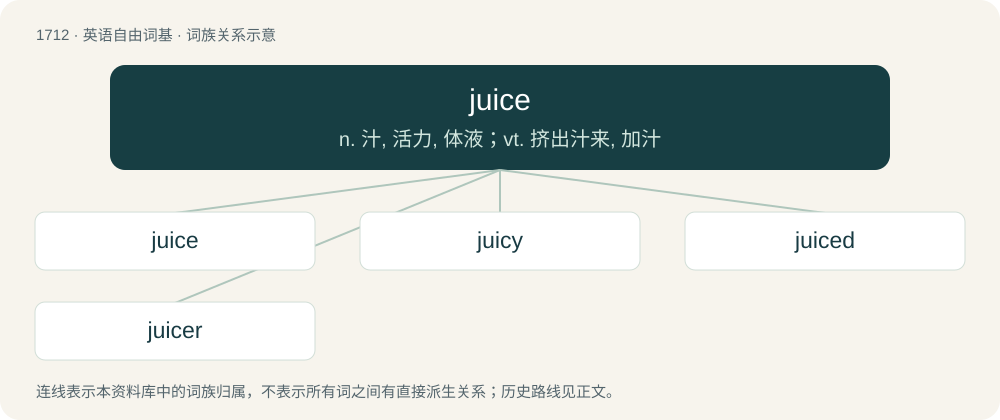

# 1810 · juice — n. 汁, 活力, 体液；vt. 挤出汁来, 加汁

[总目录](../00_总目录_按常用程度.md)

**类型**：英语自由词基　｜　**来源语言**：见词源记录

## 核心含义与来源

- 核心含义：n. 汁, 活力, 体液；vt. 挤出汁来, 加汁
- 英文含义：A liquid made from plant, especially fruit.
- 词形：juice

**来源记录 1**（名词；A liquid made from plant, especially fruit.）

From Middle English jus, juis, from Old French jus, jous, from Latin jūs (“broth, soup, sauce”), from Proto-Indo-European \*yéwHs, from \*yewH- (“to mix (of meal preparation)”). Doublet of jus and ukha. In this sense, mostly displaced native Middle English sew (“juice”), from Old English sēaw (“juice, sap”) (&gt; English sew (“juice, broth, gravy”)). Sense of "soft drink" most likely an ellipsis of fizzy juice, another similarly common term in Scotland.

## 词族图

## 单词速览（常用到不常用）

| 单词 | 音标 | 释义 |
|---|---|---|
| [juice](#w-1) | 英 /d͡ʒuːs/；美 /d͡ʒus/ | n. 汁, 活力, 体液；vt. 挤出汁来, 加汁 |
| [juicy](#w-2) | /ˈd͡ʒuːsi/ | a. 多汁液的, 生动的, 多水分的 |
| [juiced](#w-3) | /dʒuːst/ | a. 有汁的,喝醉的 |
| [juicer](#w-4) | 美 /ˈd͡ʒusɚ/ | n. 榨汁器, 照明技师 |

## 逐词详解

### 1. juice

**词性**：名词　｜　**音标**：英 /d͡ʒuːs/；美 /d͡ʒus/

**中文释义**：n. 汁, 活力, 体液；vt. 挤出汁来, 加汁

**英文义项**：A liquid made from plant, especially fruit. / A beverage made of juice.

**词源与演化**：

From Middle English jus, juis, from Old French jus, jous, from Latin jūs (“broth, soup, sauce”), from Proto-Indo-European \*yéwHs, from \*yewH- (“to mix (of meal preparation)”). Doublet of jus and ukha. In this sense, mostly displaced native Middle English sew (“juice”), from Old English sēaw (“juice, sap”) (&gt; English sew (“juice, broth, gravy”)). Sense of "soft drink" most likely an ellipsis of fizzy juice, another similarly common term in Scotland.

**例句**：

> Squeeze the orange and some juice will come out.

该用例对应义项：A liquid made from plant, especially fruit.

### 2. juicy

**词性**：形容词　｜　**音标**：/ˈd͡ʒuːsi/

**中文释义**：a. 多汁液的, 生动的, 多水分的

**英文义项**：Having lots of juice. / Exciting; titillating.

**构词拆分**：By surface analysis, juic(e) + -y

**词源与演化**：

From Middle English jousy, jowsy (“drunken”, literally “full of juice (liquor)”). By surface analysis, juic(e) + -y.

**例句**：

> I do not keep up with all the latest juicy rumors.

该用例对应义项：Exciting; titillating.

### 3. juiced

**词性**：形容词　｜　**音标**：/dʒuːst/

**中文释义**：a. 有汁的,喝醉的

**英文义项**：That has had the juice extracted. / Drunk.

**构词拆分**：From juice + -d.

**词源与演化**：

From juice + -d.

**例句**：

> The whole school is juiced about tonight's game.

该用例对应义项：Excited.

### 4. juicer

**词性**：名词　｜　**音标**：美 /ˈd͡ʒusɚ/

**中文释义**：n. 榨汁器, 照明技师

**英文义项**：A manual or electrical device used for rendering the juice of fruits or vegetables. / A person who extracts juice for consumption.

**构词拆分**：juice + -er

**词源与演化**：

From juice + -er.

**例句**：

> A keen juicer, she has tried all kinds of fruits and vegetables.

该用例对应义项：A person who extracts juice for consumption.
