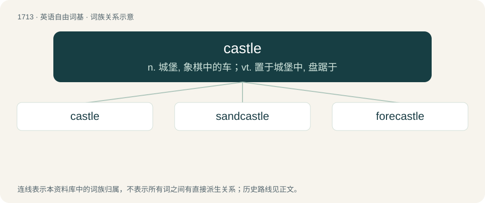

# 1811 · castle — n. 城堡, 象棋中的车；vt. 置于城堡中, 盘踞于

[总目录](../00_总目录_按常用程度.md)

**类型**：英语自由词基　｜　**来源语言**：见词源记录

## 核心含义与来源

- 核心含义：n. 城堡, 象棋中的车；vt. 置于城堡中, 盘踞于
- 英文含义：A large residential building or compound that is fortified and contains many defences; in previous ages often inhabited by a nobleman or king. Also, a house or mansion with some of the architectural features of medieval castles.
- 词形：castle

**来源记录 1**（名词；A large residential building or compound that is fortified and contains many defences; in previous ages often inhabited by a nobleman or king. Also, a house or mansion with some of the architectural features of medieval castles.）

From Middle English castle, castel, from late Old English castel, castell (“a town, village”), borrowed from Late Latin castellum (“small camp, fort”), diminutive of Latin castrum (“camp, fort, citadel, stronghold”). Doublet of cashel, castell, castellum, and château. Parallel borrowings (from Late Latin or Old French) are Scots castel, castell (“castle”), West Frisian kastiel (“castle”), Dutch kasteel (“castle”), German Kastell (“castle”), Danish kastel (“citadel”), Swedish kastell (“citadel”), Icelandic kastali (“castle”), Welsh castell. The late Old English word was borrowed from biblical Latin castellum which has been translated as town or village. With the sense of castle, from Anglo-Norman/Old Northern French castel (“castle”), itself from Late Latin castellum (“small camp, fort”) (compare modern French château from Old French chastel). If Latin castrum (“camp, fort, citadel, stronghold”) is from Proto-Indo-European \*kat- (“hut, shed”), Latin casa (“cottage, hut”) is related. Possibly related also to Gothic 𐌷𐌴𐌸𐌾𐍉 (hēþjō, “chamber”), Old English heaþor (“restraint, confinement, enclosure, prison”). See also casino, cassock.

## 词族图

## 单词速览（常用到不常用）

| 单词 | 音标 | 释义 |
|---|---|---|
| [castle](#w-1) | 英 /ˈkɑːsəl/；/ˈkæsəl/ | n. 城堡, 象棋中的车；vt. 置于城堡中, 盘踞于 |
| [sandcastle](#w-2) | 美 /ˈsæn(d)ˌkæsəl/ | n. 沙堡 |
| [forecastle](#w-3) | 美 /ˈfoʊk.səl/ | n. 前甲板下面的水手舱, 船头船楼, 前甲板 |

## 逐词详解

### 1. castle

**词性**：名词　｜　**音标**：英 /ˈkɑːsəl/；/ˈkæsəl/

**中文释义**：n. 城堡, 象棋中的车；vt. 置于城堡中, 盘踞于

**英文义项**：A large residential building or compound that is fortified and contains many defences; in previous ages often inhabited by a nobleman or king. Also, a house or mansion with some of the architectural features of medieval castles. / An instance of castling.

**词源与演化**：

From Middle English castle, castel, from late Old English castel, castell (“a town, village”), borrowed from Late Latin castellum (“small camp, fort”), diminutive of Latin castrum (“camp, fort, citadel, stronghold”). Doublet of cashel, castell, castellum, and château. Parallel borrowings (from Late Latin or Old French) are Scots castel, castell (“castle”), West Frisian kastiel (“castle”), Dutch kasteel (“castle”), German Kastell (“castle”), Danish kastel (“citadel”), Swedish kastell (“citadel”), Icelandic kastali (“castle”), Welsh castell. The late Old English word was borrowed from biblical Latin castellum which has been translated as town or village. With the sense of castle, from Anglo-Norman/Old Northern French castel (“castle”), itself from Late Latin castellum (“small camp, fort”) (compare modern French château from Old French chastel). If Latin castrum (“camp, fort, citadel, stronghold”) is from Proto-Indo-European \*kat- (“hut, shed”), Latin casa (“cottage, hut”) is related. Possibly related also to Gothic 𐌷𐌴𐌸𐌾𐍉 (hēþjō, “chamber”), Old English heaþor (“restraint, confinement, enclosure, prison”). See also casino, cassock.

**例句**：

> Seen from a distance, the big rock looks like an old castle.

### 2. sandcastle

**词性**：名词　｜　**音标**：美 /ˈsæn(d)ˌkæsəl/

**中文释义**：n. 沙堡

**英文义项**：A sculpture made of sand and resembling a miniature castle; typically, but not always, made for fun by a child on a beach.

**构词拆分**：sand + castle

**词源与演化**：

From sand + castle.

**例句**：

> Robert made a sandcastle as a last memory on that beach.

### 3. forecastle

**词性**：名词　｜　**音标**：美 /ˈfoʊk.səl/

**中文释义**：n. 前甲板下面的水手舱, 船头船楼, 前甲板

**英文义项**：A raised part of the upper deck at the front of a ship; the structure of this part of the ship; the crew's quarters located within it.

**构词拆分**：fore- + castle

**词源与演化**：

From Middle English forecastel, forcastel, (whence also Anglo-French forechasteil), equivalent to fore- + castle. Compare Dutch voorkasteel.
