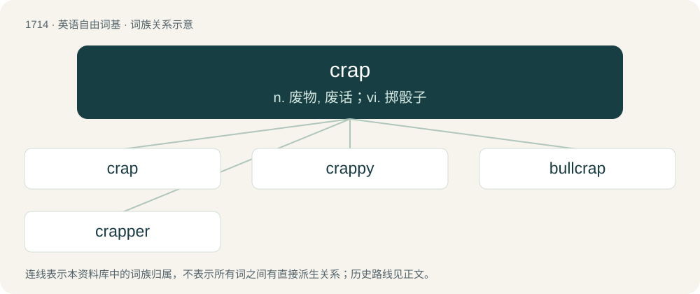

# 1812 · crap — n. 废物, 废话；vi. 掷骰子

[总目录](../00_总目录_按常用程度.md)

**类型**：英语自由词基　｜　**来源语言**：见词源记录

## 核心含义与来源

- 核心含义：n. 废物, 废话；vi. 掷骰子
- 英文含义：Something worthless or of poor quality; junk.
- 词形：crap

**多个词源／构词路径**：同一拼写可能有不同来源；以下按词性和含义分别列出。

**来源记录 1**（名词；Something worthless or of poor quality; junk.）

From Middle English crappe, also in plural: crappys, craps (“chaff; buckwheat”), from Middle French crape, from Old French crappe, crapin (“chaff”) (compare Medieval Latin crappa pl, also crapinum), from Old Dutch krappen (“to cut off, pluck off”) (whence Middle Dutch crappe, crap (“a chop, cutlet”), whence Dutch krip (“a steak”)). Related to crop.

**来源记录 2**（名词；A losing throw of 2, 3, or 12 in craps.）

From crab's eyes.

## 词族图

## 单词速览（常用到不常用）

| 单词 | 音标 | 释义 |
|---|---|---|
| [crap](#w-1) | /kɹæp/ | n. 废物, 废话；vi. 掷骰子 |
| [crappy](#w-2) | 美 /ˈkɹæpi/ | a. &lt;俚&gt;蹩脚的, 没价值的, 讨厌的 |
| [bullcrap](#w-3) | /ˈbʊlkɹæp/ | 【英文】Bullshit. |
| [crapper](#w-4) | 美 /ˈkɹæ.pɚ/ | n. &lt;鄙&gt;厕所 |

## 逐词详解

### 1. crap

**词性**：名词　｜　**音标**：/kɹæp/

**中文释义**：n. 废物, 废话；vi. 掷骰子

**英文义项**：Something worthless or of poor quality; junk. / Nonsense; something untrue.

**词源与演化**：

From Middle English crappe, also in plural: crappys, craps (“chaff; buckwheat”), from Middle French crape, from Old French crappe, crapin (“chaff”) (compare Medieval Latin crappa pl, also crapinum), from Old Dutch krappen (“to cut off, pluck off”) (whence Middle Dutch crappe, crap (“a chop, cutlet”), whence Dutch krip (“a steak”)). Related to crop.

**例句**：

> The long-running game show went from offering good prizes to crap in no time.

该用例对应义项：Something worthless or of poor quality; junk.

### 2. crappy

**词性**：形容词　｜　**音标**：美 /ˈkɹæpi/

**中文释义**：a. &lt;俚&gt;蹩脚的, 没价值的, 讨厌的

**英文义项**：Of very poor quality; unpleasant; distasteful. / Bad, sick, or depressed.

**构词拆分**：crap + -y

**词源与演化**：

From crap + -y.

**例句**：

> Put the crappy diapers in the brown pail and the wet ones in the yellow pail.

该用例对应义项：Covered in crap (faeces/feces).

### 3. bullcrap

**词性**：名词　｜　**音标**：/ˈbʊlkɹæp/

**英文义项**：Bullshit.

**构词拆分**：bull + crap

**词源与演化**：

From bull + crap.

### 4. crapper

**词性**：名词　｜　**音标**：美 /ˈkɹæ.pɚ/

**中文释义**：n. &lt;鄙&gt;厕所

**英文义项**：A chamber pot or toilet, particularly (dated) a flush toilet by Thomas Crapper. / A lavatory or outhouse.

**构词拆分**：crap + -er

**词源与演化**：

From crap + -er, although possibly repopularized by barracks employing Thomas Crapper's plumbing fixtures used during the First World War. The occupational surname Crapper derives from a dialectal variant of cropper (“harvester of crops, farmer”).
