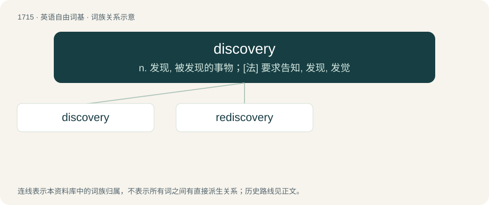

# 1813 · discovery — n. 发现, 被发现的事物；\[法\] 要求告知, 发现, 发觉

[总目录](../00_总目录_按常用程度.md)

**类型**：英语自由词基　｜　**来源语言**：见词源记录

## 核心含义与来源

- 核心含义：n. 发现, 被发现的事物；\[法\] 要求告知, 发现, 发觉
- 英文含义：Something discovered.
- 词形：discovery

**来源记录 1**（名词；Something discovered.）

from discover + -ery, on the pattern of the pair recover, recovery. Displaced native Old English onfundennes.

## 词族图

## 单词速览（常用到不常用）

| 单词 | 音标 | 释义 |
|---|---|---|
| [discovery](#w-1) | 英 /dɪˈskʌv.ɹi/ | n. 发现, 被发现的事物；\[法\] 要求告知, 发现, 发觉 |
| [rediscovery](#w-2) | /.riːdisˈkʌvəri/ | n. 重新发现 |

## 逐词详解

### 1. discovery

**词性**：名词　｜　**音标**：英 /dɪˈskʌv.ɹi/

**中文释义**：n. 发现, 被发现的事物；\[法\] 要求告知, 发现, 发觉

**英文义项**：Something discovered. / The discovering of new things.

**构词拆分**：discover + -ery

**词源与演化**：

from discover + -ery, on the pattern of the pair recover, recovery. Displaced native Old English onfundennes.

**例句**：

> This latest discovery should eventually lead to much better treatments for disease.

该用例对应义项：Something discovered.

### 2. rediscovery

**词性**：名词　｜　**音标**：/.riːdisˈkʌvəri/

**中文释义**：n. 重新发现

**英文义项**：The act of rediscovering. / A second or subsequent discovery of the same thing.

**构词拆分**：re- + discovery

**词源与演化**：

From re- + discovery.
