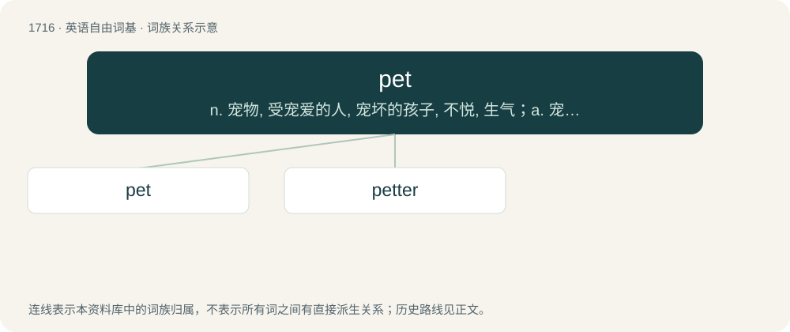

# 1814 · pet — n. 宠物, 受宠爱的人, 宠坏的孩子, 不悦, 生气；a. 宠爱的, 表示亲昵的, 养着观赏的, 特别珍爱的, 格外的；vt. 宠爱, 溺爱, 抚摸

[总目录](../00_总目录_按常用程度.md)

**类型**：英语自由词基　｜　**来源语言**：见词源记录

## 核心含义与来源

- 核心含义：n. 宠物, 受宠爱的人, 宠坏的孩子, 不悦, 生气；a. 宠爱的, 表示亲昵的, 养着观赏的, 特别珍爱的, 格外的；vt. 宠爱, 溺爱, 抚摸
- 英文含义：An animal kept as a companion or otherwise for pleasure, rather than for some practical benefit or use.
- 词形：pet

**多个词源／构词路径**：同一拼写可能有不同来源；以下按词性和含义分别列出。

**来源记录 1**（名词；An animal kept as a companion or otherwise for pleasure, rather than for some practical benefit or use.）

Originally northern dialectal, from Scots pet (“an animal that has been tamed and is kept as a pet; a darling or favourite; a petted or spoiled child”), probably from Scottish Gaelic peata (“pet, tamed animal, spoiled child”), from Middle Irish petta, peta (“pet, lap-dog”), of uncertain origin, possibly from a pre-Indo-European substrate. Compare also peat (“pet, darling, woman”), which is likely not related. The verb is derived from the noun.

**来源记录 2**（名词；A fit of petulance, a sulk, arising from the impression that one has been offended or slighted.）

Clipping of petulance.

**来源记录 3**（名词；A term of endearment usually applied to women and children.）

Clipping of petal.

## 词族图

## 单词速览（常用到不常用）

| 单词 | 音标 | 释义 |
|---|---|---|
| [pet](#w-1) | /pɛt/ | n. 宠物, 受宠爱的人, 宠坏的孩子, 不悦, 生气；a. 宠爱的, 表示亲昵的, 养着观赏的, 特别珍爱的, 格外的；vt. 宠爱, 溺爱, 抚摸 |
| [petter](#w-2) | 英 /ˈpɛtə/；美 /ˈpɛtə(ɹ)/ | 培特 |

## 逐词详解

### 1. pet

**词性**：名词　｜　**音标**：/pɛt/

**中文释义**：n. 宠物, 受宠爱的人, 宠坏的孩子, 不悦, 生气；a. 宠爱的, 表示亲昵的, 养着观赏的, 特别珍爱的, 格外的；vt. 宠爱, 溺爱, 抚摸

**英文义项**：An animal kept as a companion or otherwise for pleasure, rather than for some practical benefit or use. / Something kept as a companion, including inanimate objects.

**词源与演化**：

Originally northern dialectal, from Scots pet (“an animal that has been tamed and is kept as a pet; a darling or favourite; a petted or spoiled child”), probably from Scottish Gaelic peata (“pet, tamed animal, spoiled child”), from Middle Irish petta, peta (“pet, lap-dog”), of uncertain origin, possibly from a pre-Indo-European substrate. Compare also peat (“pet, darling, woman”), which is likely not related. The verb is derived from the noun.

**例句**：

> My dog Fido has been a loyal pet for ten years.

该用例对应义项：An animal kept as a companion or otherwise for pleasure, rather than for some practical benefit or use.

### 2. petter

**词性**：名词　｜　**音标**：英 /ˈpɛtə/；美 /ˈpɛtə(ɹ)/

**中文释义**：培特

**英文义项**：One who pets.

**构词拆分**：pet + -er

**词源与演化**：

From pet + -er.
