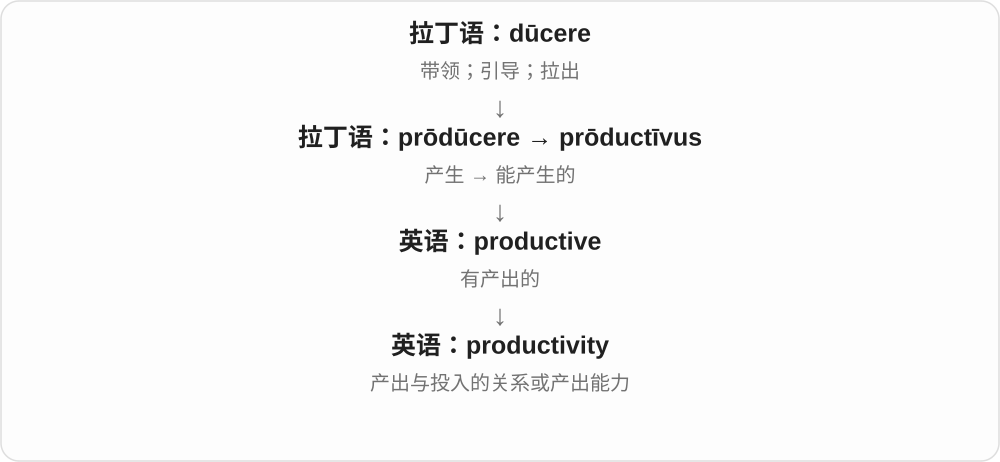

# 1814 · productive — 产生结果，再问结果多少、方向对不对

[逐词精讲目录](../00_逐词精讲目录.md) · [总目录](../00_总目录_按常用程度.md)

## 核心词根与来源

一忙到底不等于有成效；没有帮助和帮倒忙也不同。reproductive 则转到复制、繁殖的固定语义分支。

**PRODUCTIVE：做出来有用结果**

productive → productively、productivity；unproductive 无成果；counterproductive 反效果；reproductive 接再产生、繁殖。

- **产出性质、方式与效率**：productive · productively · productivity
- **没成果与反效果**：unproductive · counterproductive
- **再产生与繁殖**：reproductive

## 词形与演化规律

prōdūcere、product- → productive；+ -ly、-ity；un-/counter-/re- + productive。

## 单词速览（按词族由简到繁）

同一基础词的相关扩展放在一起，先读基础形式，再读扩展；各组之间优先读常用的。具体词源关系见各词讲解。

| 单词 | 音标 | 核心意思 |
|---|---|---|
| [productive](#w-1) | /prəˈdʌktɪv/ | 有成效的；产出多的 |
| [productivity](#w-2) | 英 /ˌprɒdʌkˈtɪvəti/；美 /ˌprɑːdʌkˈtɪvəti/ | 生产率；工作效率；产出能力 |
| [productively](#w-6) | /prəˈdʌktɪvli/ | 有成果地、有成效地 |
| [reproductive](#w-3) | /ˌriːprəˈdʌktɪv/ | 生殖的、繁殖的；复制、再现相关的 |
| [unproductive](#w-4) | /ˌʌnprəˈdʌktɪv/ | 无成果的、成效低的；不再能产新词的〔语言学〕 |
| [counterproductive](#w-5) | 英 /ˌkaʊntəprəˈdʌktɪv/；美 /ˌkaʊntərprəˈdʌktɪv/ | 适得其反的、产生反效果的 |

## 逐词讲解

### 1. productive — 有成效的；产出多的

**音标**：/prəˈdʌktɪv/

**先抓住这个画面**

productive 关心“忙过以后留下了什么”。讨论解决了问题、工作交出了成果，才叫 productive，不只是一直在动。

**怎么拆**

来自晚期拉丁语 prōductīvus，与 product、produce 同族；-ive 表示具有相关作用或倾向。

**怎么变成今天的意思**

可形容人、土地、会议或一天的工作。重点是实际产出；在语言学中也可说一种构词方式能不断产生新词。

**常见搭配与例句**

a productive meeting（有成效的会议）；a productive day（成果充实的一天）；productive land（高产土地）。

> We had a productive meeting and agreed on the next steps.

会议很有成效，我们确定了下一步安排。

> She is most productive early in the morning.

她清晨工作最有成效。

**别混淆**

busy 是忙；productive 是有产出。efficiency 还涉及花了多少投入，同样多的产出也可能消耗不同时间。

### 2. productivity — 生产率；工作效率；产出能力

**音标**：英 /ˌprɒdʌkˈtɪvəti/；美 /ˌprɑːdʌkˈtɪvəti/

**先抓住这个画面**

productivity 问的是“投入这么多时间、人力或资源，做出了多少”。不是只数忙了几小时，而是看这些投入带来了什么。

**怎么拆**

productive + -ity，去掉词尾 e，形成表示性质或程度的名词。

**怎么变成今天的意思**

经济分析里常按单位投入衡量产出；日常也泛指完成工作的能力。讨论时最好说清楚自己衡量的是数量、质量还是某个具体结果。

**常见搭配与例句**

improve productivity（提高生产率）；labor productivity（劳动生产率）；productivity gains（效率提升）。

> Better tools increased productivity without extending working hours.

更好的工具提高了效率，而没有延长工时。

> The report measures productivity as output per worker.

报告用每位员工的产出衡量生产率。

**别混淆**

production 可以只是总产量；productivity 更关心产量相对于投入。多雇一倍人、多产一倍，不一定提高生产率。

### 3. productively — 有成果地、有成效地

**音标**：/prəˈdʌktɪvli/

**先抓住这个画面**

时间花了，事情也真往前推进了；不是只看人忙不忙，而是有没有有用结果。

**怎么拆**

productive 有成果的 + -ly，副词修饰使用时间、工作、讨论等动作。

**怎么变成今天的意思**

**拉丁 prōdūcere、product- → productīvus、法语 productif 等 → productive**  
带出来、产生 → 能产出、能带来结果的

↓

**productive + -ly → productively**  
以能带来成果的方式

use time productively 有效利用时间，work productively 有成效地工作，discuss productively 有建设性地讨论。

**常见搭配与例句**

use time productively；work productively；spend the morning productively。

> We used the waiting time productively.

我们有效利用了等待时间。

> The two teams worked productively together.

两个团队合作得很有成效。

**别混淆**

productively 不等于 constantly 不停地；休整后更有成果也可以叫 working productively。

### 4. reproductive — 生殖的、繁殖的；复制、再现相关的

**音标**：/ˌriːprəˈdʌktɪv/

**先抓住这个画面**

产生下一代，是生命意义的再产生；艺术、复制语境里也可说把原物再现出来的能力。

**怎么拆**

re- 再 + productive，与 reproduce、reproduction 词族对应。生物生殖义已经固定，不能每次只按再次高效工作来译。

**怎么变成今天的意思**

**拉丁 prōdūcere、product- → productīvus、法语 productif 等 → productive**  
带出来、产生 → 能产出、能带来结果的

↓

**re- + productive → reproductive**  
再产生、复制；生殖繁殖相关

reproductive behaviour 繁殖行为，reproductive cycle 生殖周期，reproductive art 复制、再现性艺术〔特定语境〕。

**常见搭配与例句**

reproductive behaviour；reproductive cycle；reproductive success。

> The documentary explains the birds’ reproductive behaviour.

纪录片解释了这些鸟的繁殖行为。

> The species has a short reproductive cycle.

这个物种的繁殖周期很短。

**别混淆**

reproductive 生殖、复制相关，productive 高产或有成果；reproductive success 说繁殖成功，不是办公室业绩。

### 5. unproductive — 无成果的、成效低的；不再能产新词的〔语言学〕

**音标**：/ˌʌnprəˈdʌktɪv/

**先抓住这个画面**

忙了半天，没产生想要的进展；像对着空地撒力气，却没收成。

**怎么拆**

un- 不 + productive，否定产出、成效；语言学也用来形容不再活跃产生新形式的构词模式。

**怎么变成今天的意思**

**拉丁 prōdūcere、product- → productīvus、法语 productif 等 → productive**  
带出来、产生 → 能产出、能带来结果的

↓

**un- + productive → unproductive**  
缺少有用产出；不活跃产新形式

an unproductive meeting 没成果的会议，unproductive work 成效低的工作，an unproductive argument 无益争论。

**常见搭配与例句**

an unproductive meeting；an unproductive argument；unproductive work。

> The meeting was long and unproductive.

会议又长又没成果。

> They spent hours in an unproductive argument.

他们在无益争论中耗了几个小时。

**别混淆**

unproductive 没推进，counterproductive 反把事情往坏处推；一下午没完成任务与越催越乱，程度和方向不同。

### 6. counterproductive — 适得其反的、产生反效果的

**音标**：英 /ˌkaʊntəprəˈdʌktɪv/；美 /ˌkaʊntərprəˈdʌktɪv/

**先抓住这个画面**

本想催快，结果把人催乱、做得更慢；不只是没帮上忙，而是把目标往反方向推。

**怎么拆**

counter- 对抗、相反 + productive，整体表示产生与所希望相反的效果。不是 counter 柜台产出的东西。

**怎么变成今天的意思**

**拉丁 prōdūcere、product- → productīvus、法语 productif 等 → productive**  
带出来、产生 → 能产出、能带来结果的

↓

**counter- + productive → counterproductive**  
效果与目标相反

a counterproductive policy 适得其反的政策，counterproductive pressure 反起坏作用的压力，prove counterproductive 结果适得其反。

**常见搭配与例句**

prove counterproductive；counterproductive pressure；a counterproductive approach。

> Constant criticism can be counterproductive.

不断批评可能适得其反。

> Rushing the repair proved counterproductive.

抢着赶工修理，结果反而坏了事。

**别混淆**

unproductive 可以只是没有成果，counterproductive 更突出坏了原本想办好的事；是否反效果要结合目标看。

## 这一组要分清什么

unproductive/counterproductive 没推进与倒退；productive/reproductive 有成果与生殖复制相关。

## 串起来练习

Pressure that makes a productive team less effective is counterproductive.

如果压力让一个有成效的团队效率下降，它就起了反作用。
