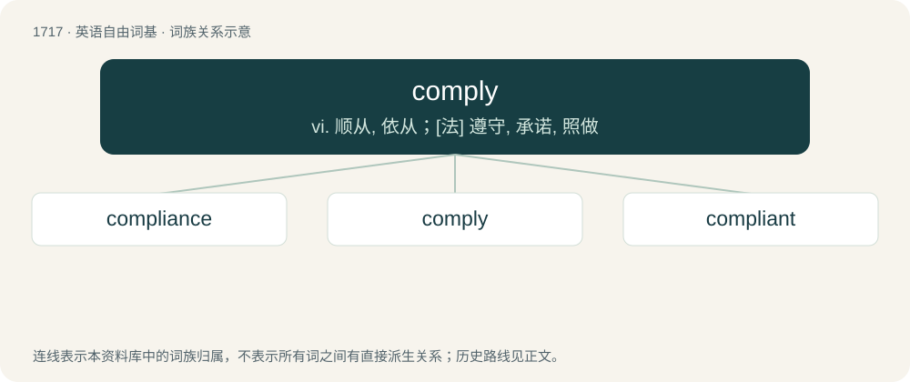

# 1815 · comply — vi. 顺从, 依从；\[法\] 遵守, 承诺, 照做

[总目录](../00_总目录_按常用程度.md)

**类型**：英语自由词基　｜　**来源语言**：见词源记录

## 核心含义与来源

- 核心含义：vi. 顺从, 依从；\[法\] 遵守, 承诺, 照做
- 英文含义：To yield assent; to accord; to acquiesce, agree, consent; to adapt oneself, to conform.
- 词形：comply

**来源记录 1**（动词；To yield assent; to accord; to acquiesce, agree, consent; to adapt oneself, to conform.）

From Italian complire, Catalan complir (“to complete, fulfil; to carry out”), Spanish cumplir (“to complete, fulfil”), (alternatively from Old French compli), from Latin complēre, from compleō (“to finish, complete; to fulfil”), from com- (prefix indicating completeness of an act) (ultimately from Proto-Indo-European \*ḱóm (“beside, near; by, with”)) + pleō (“to fill; to fulfil”) (ultimately from Proto-Indo-European \*pleh₁- (“to fill”)). The word is very close to the French verb complaire which means to satisfy or to please. The word is also cognate with Old French complir (“to accomplish, complete; to do”) (modern French accomplir (“to accomplish, achieve”)). Compare complete, compliment.

## 词族图

## 单词速览（常用到不常用）

| 单词 | 音标 | 释义 |
|---|---|---|
| [compliance](#w-1) | 英 /kəmˈplaɪ.əns/ | n. 遵从, 顺从, 屈从；\[化\] 柔顺; 顺应 |
| [comply](#w-2) | 英 /kəmˈplaɪ/ | vi. 顺从, 依从；\[法\] 遵守, 承诺, 照做 |
| [compliant](#w-3) | 英 /kəmˈplʌɪənt/；美 /kəmˈplaɪənt/ | a. 顺从的, 屈从的；\[电\] 适用于, 配合...使用 |

## 逐词详解

### 1. compliance

**词性**：名词　｜　**音标**：英 /kəmˈplaɪ.əns/

**中文释义**：n. 遵从, 顺从, 屈从；\[化\] 柔顺; 顺应

**英文义项**：An act of complying. / The state of being compliant.

**构词拆分**：comply + -ance

**词源与演化**：

From comply + -ance.

**例句**：

> The software ensures compliance with data protection laws.

该用例对应义项：The state of being compliant.

### 2. comply

**词性**：动词　｜　**音标**：英 /kəmˈplaɪ/

**中文释义**：vi. 顺从, 依从；\[法\] 遵守, 承诺, 照做

**英文义项**：To yield assent; to accord; to acquiesce, agree, consent; to adapt oneself, to conform.

**词源与演化**：

From Italian complire, Catalan complir (“to complete, fulfil; to carry out”), Spanish cumplir (“to complete, fulfil”), (alternatively from Old French compli), from Latin complēre, from compleō (“to finish, complete; to fulfil”), from com- (prefix indicating completeness of an act) (ultimately from Proto-Indo-European \*ḱóm (“beside, near; by, with”)) + pleō (“to fill; to fulfil”) (ultimately from Proto-Indo-European \*pleh₁- (“to fill”)). The word is very close to the French verb complaire which means to satisfy or to please. The word is also cognate with Old French complir (“to accomplish, complete; to do”) (modern French accomplir (“to accomplish, achieve”)). Compare complete, compliment.

**例句**：

> All workers must comply with safety regulations.

该用例对应义项：To yield assent; to accord; to acquiesce, agree, consent; to adapt oneself, to conform.

### 3. compliant

**词性**：形容词　｜　**音标**：英 /kəmˈplʌɪənt/；美 /kəmˈplaɪənt/

**中文释义**：a. 顺从的, 屈从的；\[电\] 适用于, 配合...使用

**英文义项**：Willing to comply; submissive; willing to do what someone wants. / Compatible with or following guidelines, specifications, rules, or laws.

**构词拆分**：comply + -ant

**词源与演化**：

From comply + -ant.

**例句**：

> The workplace is compliant with the Americans with Disabilities Act.

该用例对应义项：Compatible with or following guidelines, specifications, rules, or laws.
