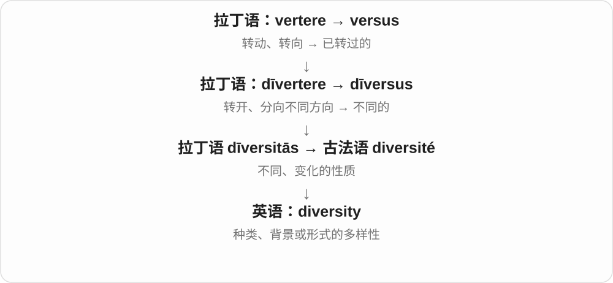
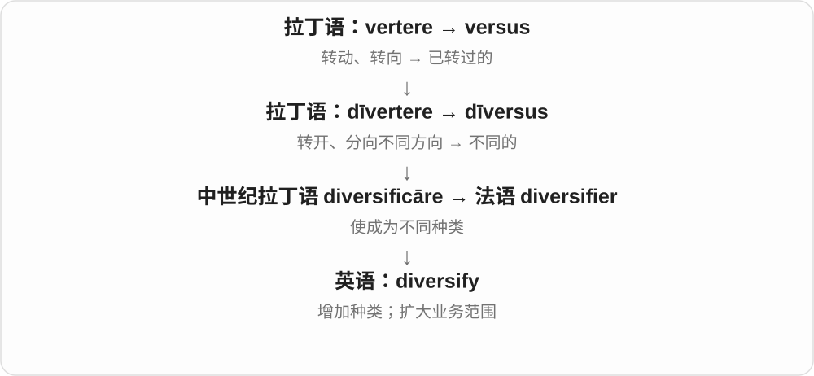

# 1815 · diverse — 不同；多样；使多样化

[逐词精讲目录](../00_逐词精讲目录.md) · [总目录](../00_总目录_按常用程度.md)

## 核心词根与来源

diverse 经法语联系拉丁 diversus 转向不同方向。diversity 是多样性，diversify 是使种类或分布更加多样的动作。

**DIVERSE：组成部分有不同类型和特点**

一组人不只来自同一个地方，一项业务也不只依赖一种产品。

- **状态和性质**：diverse · diversity
- **改变组成**：diversify

## 词形与演化规律

diverse → diversity；diversify → diversified／diversifying。现代词形互相关联，名词、形容词和动词的句法职责不同。

## 单词速览（按词族由简到繁）

同一基础词的相关扩展放在一起，先读基础形式，再读扩展；各组之间优先读常用的。具体词源关系见各词讲解。

| 单词 | 音标 | 核心意思 |
|---|---|---|
| [diverse](#w-2) | 英 /daɪˈvɜːs/；美 /daɪˈvɜːrs/ | 多种多样的；各不相同的 |
| [diversity](#w-1) | 英 /daɪˈvɜːsəti/；美 /daɪˈvɜːrsəti/、/dɪˈvɜːrsəti/ | 多样性；差异的丰富程度 |
| [diversify](#w-3) | 英 /daɪˈvɜːsɪfaɪ/；美 /daɪˈvɜːrsəfaɪ/、/dɪˈvɜːrsəfaɪ/ | 使多样化；扩展到不同领域 |

## 逐词讲解

### 1. diverse — 多种多样的；各不相同的

**音标**：英 /daɪˈvɜːs/；美 /daɪˈvɜːrs/

**先抓住这个画面**

大家没有转向同一个方向：背景、想法、种类各有不同，所以构成了多样的一组。

**怎么拆**

拉丁语 dīversus 是 dīvertere 的分词，形成“不同”的形容词，经法语 divers 进入英语。

**怎么变成今天的意思**

可形容物种、经验、意见或人群。a diverse group 通常是在某些明确维度上成员不同，不是说其中每个人都代表全部差异。

**常见搭配与例句**

diverse backgrounds；a diverse range；diverse opinions。

> The course attracts students from diverse backgrounds.

这门课吸引了背景各异的学生。

> The garden contains a diverse range of plants.

花园里种着多种多样的植物。

**别混淆**

different 比较差别；diverse 常强调一组对象内部种类丰富。

### 2. diversity — 多样性；差异的丰富程度

**音标**：英 /daɪˈvɜːsəti/；美 /daɪˈvɜːrsəti/、/dɪˈvɜːrsəti/

**先抓住这个画面**

不只看数量多不多，还看是不是只有同一种：一千棵同种树数量很多，种类却未必丰富。

**怎么拆**

拉丁语 dīversitās，经法语 diversité 进入英语；现代与 diverse + -ity 对应。

**怎么变成今天的意思**

可说 biodiversity、cultural diversity、diversity of opinion。它要配合具体维度理解，不是所有“不同”都能用一个数字概括。

**常见搭配与例句**

cultural diversity；a diversity of views；biological diversity。

> The survey revealed a surprising diversity of opinions.

调查显示人们的意见出人意料地多样。

> The exhibition celebrates the diversity of local traditions.

展览展示并赞美当地传统的多样性。

**别混淆**

variety 也说种类；diversity 更常用于整体构成及差异分布的讨论。

### 3. diversify — 使多样化；扩展到不同领域

**音标**：英 /daɪˈvɜːsɪfaɪ/；美 /daɪˈvɜːrsəfaɪ/、/dɪˈvɜːrsəfaɪ/

**先抓住这个画面**

原本只靠一种产品、一种活动，现在多开几条路，不把全部事情压在同一种选择上。

**怎么拆**

经法语 diversifier 借入；拉丁语词族中 dīversus“不同”与 facere“使、做”结合。现代可看 diverse + -ify。

**怎么变成今天的意思**

可以及物：diversify the menu；也可不及物：diversify into tourism。它是增加不同类型，不只是把旧产品生产得更多。

**常见搭配与例句**

diversify into；diversify the business；diversify the menu。

> The farm diversified into fruit growing and tourism.

这家农场把业务扩展到了水果种植和旅游。

> The library wants to diversify its collection of authors.

图书馆希望收藏来自更多不同背景作者的作品。

**别混淆**

expand 是扩大；diversify 需要种类或方向增加，二者并不完全相同。

## 这一组要分清什么

diverse 不等于 dispersed 分散；diversify 强调类型或来源的变化，不只是把相同东西搬到不同位置。

## 串起来练习

The team recruited people with diverse backgrounds to increase its diversity.

团队招募背景不同的人，以增加多样性。
