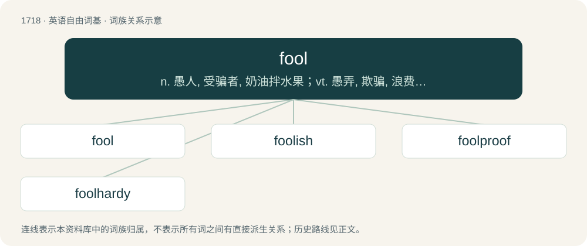

# 1817 · fool — n. 愚人, 受骗者, 奶油拌水果；vt. 愚弄, 欺骗, 浪费；vi. 干傻事, 开玩笑, 游荡

[总目录](../00_总目录_按常用程度.md)

**类型**：英语自由词基　｜　**来源语言**：见词源记录

## 核心含义与来源

- 核心含义：n. 愚人, 受骗者, 奶油拌水果；vt. 愚弄, 欺骗, 浪费；vi. 干傻事, 开玩笑, 游荡
- 英文含义：A person with poor judgment or little intelligence.
- 词形：fool

**多个词源／构词路径**：同一拼写可能有不同来源；以下按词性和含义分别列出。

**来源记录 1**（名词；A person with poor judgment or little intelligence.）

From Middle English fol (“fool”), from Old French fol (cf. modern French fou (“mad”)) from Latin follis. Doublet of fals and follis. Displaced native Old English dwæs.

**来源记录 2**（名词；A type of dessert made of puréed fruit and custard or cream.）

From French fouler (“to trample”).

## 词族图

## 单词速览（常用到不常用）

| 单词 | 音标 | 释义 |
|---|---|---|
| [fool](#w-1) | 英 /fuːl/；美 /ful/ | n. 愚人, 受骗者, 奶油拌水果；vt. 愚弄, 欺骗, 浪费；vi. 干傻事, 开玩笑, 游荡 |
| [foolish](#w-2) | /ˈfuː.lɪʃ/ | a. 愚蠢的, 傻的 |
| [foolproof](#w-3) | /ˈfuːl ˌpɹuːf/ | a. 十分简单的, 十分安全的 |
| [foolhardy](#w-4) | 英 /ˈfuːlhɑːdi/；美 /ˈfulˌhɑɹdi/ | a. 愚勇的, 有勇无谋的 |

## 逐词详解

### 1. fool

**词性**：名词　｜　**音标**：英 /fuːl/；美 /ful/

**中文释义**：n. 愚人, 受骗者, 奶油拌水果；vt. 愚弄, 欺骗, 浪费；vi. 干傻事, 开玩笑, 游荡

**英文义项**：A person with poor judgment or little intelligence. / A stock character typified by unintelligence, naïveté or lucklessness, usually as a form of comic relief; often used as a source of insight or pathos for the audience, as such characters are generally less bound by social expectations.

**词源与演化**：

From Middle English fol (“fool”), from Old French fol (cf. modern French fou (“mad”)) from Latin follis. Doublet of fals and follis. Displaced native Old English dwæs.

**例句**：

> You were a fool to cross that busy road without looking.

该用例对应义项：A person with poor judgment or little intelligence.

### 2. foolish

**词性**：形容词　｜　**音标**：/ˈfuː.lɪʃ/

**中文释义**：a. 愚蠢的, 傻的

**英文义项**：Lacking good sense or judgement as a general trait; unwise; stupid. / Not based on good sense or judgement; as a fool would do or conclude.

**构词拆分**：fool + -ish

**词源与演化**：

From Middle English folisch; equivalent to fool + -ish.

**例句**：

> It's foolish to think that smoking has little to do with cancer.

### 3. foolproof

**词性**：动词　｜　**音标**：/ˈfuːl ˌpɹuːf/

**中文释义**：a. 十分简单的, 十分安全的

**英文义项**：To render (something) foolproof.

**构词拆分**：fool + -proof

**词源与演化**：

From fool + -proof.

**例句**：

> We foolproofed the operations.

该用例对应义项：To render (something) foolproof.

### 4. foolhardy

**词性**：形容词　｜　**音标**：英 /ˈfuːlhɑːdi/；美 /ˈfulˌhɑɹdi/

**中文释义**：a. 愚勇的, 有勇无谋的

**英文义项**：Marked by unthinking recklessness with disregard for danger; boldly rash; hotheaded.

**构词拆分**：fool + hardy

**词源与演化**：

From Middle English folehardy, foolhardi, folherdi, from Old French fol hardi (“foolishly bold”), from Old French fol (“foolish, silly; insane, mad”) (from Latin follis (“bellows; purse, sack; inflated ball; belly, paunch”), ultimately from Proto-Indo-European \*bʰelǵʰ- (“to swell”)) + Old French hardi (“durable, hardy, tough”) (past tense of hardir (“to harden”), from the unattested Frankish \*hartjan, from Proto-Germanic \*harduz (“hard; brave”)), equivalent to fool + hardy. Compare fool-bold, fool-large, etc.

**例句**：

> Foolhardy enough to try to seize the gun from the hijacker.

该用例对应义项：marked by defiant disregard for danger or consequences
