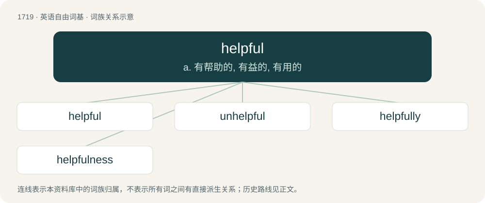

# 1818 · helpful — a. 有帮助的, 有益的, 有用的

[总目录](../00_总目录_按常用程度.md)

**类型**：英语自由词基　｜　**来源语言**：见词源记录

## 核心含义与来源

- 核心含义：a. 有帮助的, 有益的, 有用的
- 英文含义：Furnishing help; gives aid; useful.
- 词形：helpful

**来源记录 1**（形容词；Furnishing help; gives aid; useful.）

From Middle English helpful; equivalent to help + -ful.

## 词族图

## 单词速览（常用到不常用）

| 单词 | 音标 | 释义 |
|---|---|---|
| [helpful](#w-1) | /ˈhɛlp.fl̩/ | a. 有帮助的, 有益的, 有用的 |
| [unhelpful](#w-2) | /ʌnˈhɛlpfəl/ | a. 不起帮助作用的, 无用的, 无益的, 不予帮助的, 不予合作的 |
| [helpfully](#w-3) | /ˈhɛlp.fəl.i/ | adv. 有用地；有益地 |
| [helpfulness](#w-4) | /ˈhɛlp.fʊl.nəs/ | n. 有益；有助 |

## 逐词详解

### 1. helpful

**词性**：形容词　｜　**音标**：/ˈhɛlp.fl̩/

**中文释义**：a. 有帮助的, 有益的, 有用的

**英文义项**：Furnishing help; gives aid; useful.

**构词拆分**：help + -ful

**词源与演化**：

From Middle English helpful; equivalent to help + -ful.

**用法示例／搭配（非完整句）**：

> a helpful person

该用例对应义项：Furnishing help; gives aid; useful.

### 2. unhelpful

**词性**：形容词　｜　**音标**：/ʌnˈhɛlpfəl/

**中文释义**：a. 不起帮助作用的, 无用的, 无益的, 不予帮助的, 不予合作的

**英文义项**：Not providing help or assistance; not helpful.

**构词拆分**：un- + helpful

**词源与演化**：

From un- + helpful.

**用法示例／搭配（非完整句）**：

> Even if you are genuinely a victim, having a victim mentality is unhelpful because it is disempowering. ― Ned Kelly, "NFL Players Are Setting A Bad Example By Teaching Black People To Encourage Victimhood", 8th of October 2017

该用例对应义项：Not providing help or assistance; not helpful.

### 3. helpfully

**词性**：副词　｜　**音标**：/ˈhɛlp.fəl.i/

**中文释义**：adv. 有用地；有益地

**英文义项**：In a helpful manner.

**构词拆分**：helpful + -ly

**词源与演化**：

From helpful + -ly.

**例句**：

> The subtitles are helpfully conveyed.

该用例对应义项：in a helpful manner

### 4. helpfulness

**词性**：名词　｜　**音标**：/ˈhɛlp.fʊl.nəs/

**中文释义**：n. 有益；有助

**英文义项**：The quality of being helpful.

**构词拆分**：helpful + -ness

**词源与演化**：

From helpful + -ness.

**例句**：

> He's taking advantage of my helpfulness.
