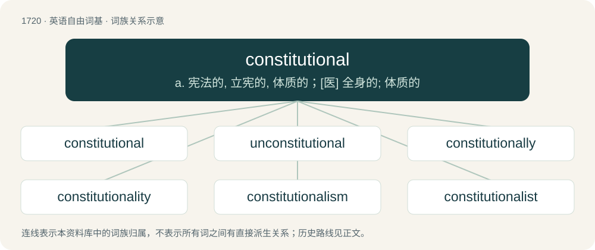

# 1820 · constitutional — a. 宪法的, 立宪的, 体质的；\[医\] 全身的; 体质的

[总目录](../00_总目录_按常用程度.md)

**类型**：英语自由词基　｜　**来源语言**：见词源记录

## 核心含义与来源

- 核心含义：a. 宪法的, 立宪的, 体质的；\[医\] 全身的; 体质的
- 英文含义：Belonging to, or inherent in, the constitution or structure of one's body or mind.
- 词形：constitutional

**来源记录 1**（形容词；Belonging to, or inherent in, the constitution or structure of one's body or mind.）

From constitution + -al (suffix meaning ‘of or pertaining to’ forming adjectives). Constitution is derived from Middle English constitucioun, constitucion (“edict, law, ordinance, regulation, rule, statute; body of laws or rules, or customs; body of fundamental principles; principle or rule (of science); creation”) from Old French constitucion (modern French constitution), a learned borrowing from Latin cōnstitūtiō, cōnstitūtiōnem (“character, constitution, disposition, nature; definition; point in dispute; order, regulation; arrangement, system”), from cōnstituō (“to establish, set up; to confirm; to decide, resolve”) (from con- (prefix indicating a being or bringing together of several objects) + statuō (“to set up, station; to establish; to determine, fix”) (ultimately from Proto-Indo-European \*steh₂- (“to stand (up)”))) + -tiō (suffix forming nouns relating to actions or the results of actions), -tiōnem (accusative singular of -tiō).

## 词族图

## 单词速览（常用到不常用）

| 单词 | 音标 | 释义 |
|---|---|---|
| [constitutional](#w-1) | 英 /ˌkɒn.stɪˈtjuː.ʃ(ə)n.(ə)l/；美 /ˌkɑn.stɪˈt(j)u.ʃ(ə)n.(ə)l/ | a. 宪法的, 立宪的, 体质的；\[医\] 全身的; 体质的 |
| [unconstitutional](#w-2) | /ˈʌnkɔnstiˈtjuːʃənəl/ | a. 违反宪法的, 不符合宪法的；\[法\] 违反宪法的, 违宪的, 不合宪法规定的 |
| [constitutionally](#w-3) | 英 /kɒnstɪˈt͡ʃuːʃənəli/；美 /kɑnstəˈtuʃənəli/ | adv. 本质地, 天生, 体质上 |
| [constitutionality](#w-4) | /ˈkɔnsti,tjuːʃəˈnæləti/ | n. 合宪法性；\[法\] 符合宪法, 合宪性, 立宪 |
| [constitutionalism](#w-5) | 英 /ˌkɒnstɪˈtjuːʃənəˌlɪzəm/；美 /ˌkɑnstɪˈtuʃənəˌlɪzəm/ | n. 立宪；\[法\] 立宪制度, 立宪主义, 宪法论 |
| [constitutionalist](#w-6) | /-ist/ | n. 立宪主义者, 拥护宪政者 |

## 逐词详解

### 1. constitutional

**词性**：形容词　｜　**音标**：英 /ˌkɒn.stɪˈtjuː.ʃ(ə)n.(ə)l/；美 /ˌkɑn.stɪˈt(j)u.ʃ(ə)n.(ə)l/

**中文释义**：a. 宪法的, 立宪的, 体质的；\[医\] 全身的; 体质的

**英文义项**：Belonging to, or inherent in, the constitution or structure of one's body or mind. / For the benefit of one's constitution or health.

**构词拆分**：constitution + -al (suffix meaning ‘of or pertaining to’ forming adjectives)

**词源与演化**：

From constitution + -al (suffix meaning ‘of or pertaining to’ forming adjectives). Constitution is derived from Middle English constitucioun, constitucion (“edict, law, ordinance, regulation, rule, statute; body of laws or rules, or customs; body of fundamental principles; principle or rule (of science); creation”) from Old French constitucion (modern French constitution), a learned borrowing from Latin cōnstitūtiō, cōnstitūtiōnem (“character, constitution, disposition, nature; definition; point in dispute; order, regulation; arrangement, system”), from cōnstituō (“to establish, set up; to confirm; to decide, resolve”) (from con- (prefix indicating a being or bringing together of several objects) + statuō (“to set up, station; to establish; to determine, fix”) (ultimately from Proto-Indo-European \*steh₂- (“to stand (up)”))) + -tiō (suffix forming nouns relating to actions or the results of actions), -tiōnem (accusative singular of -tiō).

**例句**：

> The Supreme Court ruled against the applicant and found the statute constitutional.

该用例对应义项：In compliance with or valid under a legal or political constitution.

### 2. unconstitutional

**词性**：形容词　｜　**音标**：/ˈʌnkɔnstiˈtjuːʃənəl/

**中文释义**：a. 违反宪法的, 不符合宪法的；\[法\] 违反宪法的, 违宪的, 不合宪法规定的

**英文义项**：Contrary to or violative of the constitution of a state or other sovereign institution.

**构词拆分**：un- + constitutional

**词源与演化**：

From un- + constitutional.

**例句**：

> That recently passed political bill has been declared unconstitutional.

该用例对应义项：Contrary to or violative of the constitution of a state or other sovereign institution.

### 3. constitutionally

**词性**：副词　｜　**音标**：英 /kɒnstɪˈt͡ʃuːʃənəli/；美 /kɑnstəˈtuʃənəli/

**中文释义**：adv. 本质地, 天生, 体质上

**英文义项**：Pertaining to one's bodily constitution; physically, physiologically. / Pertaining to one's fundamental values or mental inclinations.

**构词拆分**：constitutional + -ly

**词源与演化**：

From constitutional + -ly.

**例句**：

> This was constitutionally ruled out.

该用例对应义项：according to the constitution

### 4. constitutionality

**词性**：名词　｜　**音标**：/ˈkɔnsti,tjuːʃəˈnæləti/

**中文释义**：n. 合宪法性；\[法\] 符合宪法, 合宪性, 立宪

**英文义项**：The status of being constitutional; of being in accord with the provisions of the appropriate constitution.

**构词拆分**：constitutional + -ity

**词源与演化**：

From constitutional + -ity.

### 5. constitutionalism

**词性**：名词　｜　**音标**：英 /ˌkɒnstɪˈtjuːʃənəˌlɪzəm/；美 /ˌkɑnstɪˈtuʃənəˌlɪzəm/

**中文释义**：n. 立宪；\[法\] 立宪制度, 立宪主义, 宪法论

**英文义项**：A constitutional system of governance. / Adherence to constitutional principles.

**构词拆分**：constitutional + -ism

**词源与演化**：

From constitutional + -ism.

### 6. constitutionalist

**词性**：名词　｜　**音标**：/-ist/

**中文释义**：n. 立宪主义者, 拥护宪政者

**英文义项**：A person who adheres to the philosophy of constitutionalism. / A person who is expert in constitutional law.

**构词拆分**：constitutional + -ist

**词源与演化**：

From constitutional + -ist.
