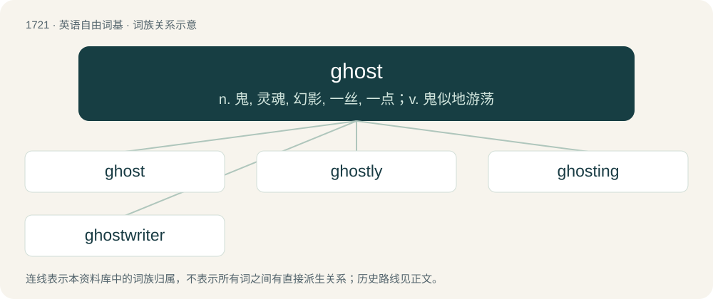

# 1821 · ghost — n. 鬼, 灵魂, 幻影, 一丝, 一点；v. 鬼似地游荡

[总目录](../00_总目录_按常用程度.md)

**类型**：英语自由词基　｜　**来源语言**：见词源记录

## 核心含义与来源

- 核心含义：n. 鬼, 灵魂, 幻影, 一丝, 一点；v. 鬼似地游荡
- 英文含义：A disembodied soul; a soul or spirit of a deceased person; a spirit appearing after death.
- 词形：ghost

**来源记录 1**（名词；A disembodied soul; a soul or spirit of a deceased person; a spirit appearing after death.）

The noun is derived from Middle English gost, from Old English gāst, gǣst (“breath, spirit, soul, ghost”) (compare modern English Holy Ghost), from Proto-West Germanic \*gaist, from Proto-Germanic \*gaistaz, from Proto-Indo-European \*ǵʰéysdos, from \*ǵʰéysd- (“anger, agitation”). The h in the spelling appears in the Prologue to William Caxton’s Royal Book, printed in 1484, in a reference to the “Holy Ghoost”. It was likely influenced by Middle Dutch gheest, a common variant of geest. Both Caxton and his assistant Wynkyn de Worde had connections to the Low Countries. Doublet of geist. The adjective and verb are derived from the noun. The verb gained prominence in the 2010s. cognates \* Danish gast (“ghost”), gejst (“enthusiasm”) \* Dutch geest (“ghost, spirit”) \* German Geist (“ghost, spirit”) \* Luxembourgish Geescht (“ghost, spirit, spectre, phantom”) \* Saterland Frisian Gäist, Jeest (“ghost, spirit”) \* Scots gaist, ghaist (“ghost”) \* Swedish gast (“ghost”) \* Vilamovian gȧjst (“ghost, spirit”) \* West Frisian geast (“ghost, spirit”) \* Yiddish גײַסט (gayst, “ghost, spirit”) \* Yola gaast (“ghost”)

## 词族图

## 单词速览（常用到不常用）

| 单词 | 音标 | 释义 |
|---|---|---|
| [ghost](#w-1) | 英 /ɡəʊst/；美 /ɡoʊst/ | n. 鬼, 灵魂, 幻影, 一丝, 一点；v. 鬼似地游荡 |
| [ghostly](#w-2) | 美 /ˈɡoʊstli/ | a. 幽灵的, 影子似的, 精神的 |
| [ghosting](#w-3) | /ˈɡəustiŋ/ | n. 重影；拖毛；鬼影 |
| [ghostwriter](#w-4) |  | n. 受雇而代为作文/作画的人, 捉刀人 |

## 逐词详解

### 1. ghost

**词性**：名词　｜　**音标**：英 /ɡəʊst/；美 /ɡoʊst/

**中文释义**：n. 鬼, 灵魂, 幻影, 一丝, 一点；v. 鬼似地游荡

**英文义项**：A disembodied soul; a soul or spirit of a deceased person; a spirit appearing after death. / Any faint shadowy semblance; an unsubstantial image.

**词源与演化**：

The noun is derived from Middle English gost, from Old English gāst, gǣst (“breath, spirit, soul, ghost”) (compare modern English Holy Ghost), from Proto-West Germanic \*gaist, from Proto-Germanic \*gaistaz, from Proto-Indo-European \*ǵʰéysdos, from \*ǵʰéysd- (“anger, agitation”). The h in the spelling appears in the Prologue to William Caxton’s Royal Book, printed in 1484, in a reference to the “Holy Ghoost”. It was likely influenced by Middle Dutch gheest, a common variant of geest. Both Caxton and his assistant Wynkyn de Worde had connections to the Low Countries. Doublet of geist. The adjective and verb are derived from the noun. The verb gained prominence in the 2010s. cognates \* Danish gast (“ghost”), gejst (“enthusiasm”) \* Dutch geest (“ghost, spirit”) \* German Geist (“ghost, spirit”) \* Luxembourgish Geescht (“ghost, spirit, spectre, phantom”) \* Saterland Frisian Gäist, Jeest (“ghost, spirit”) \* Scots gaist, ghaist (“ghost”) \* Swedish gast (“ghost”) \* Vilamovian gȧjst (“ghost, spirit”) \* West Frisian geast (“ghost, spirit”) \* Yiddish גײַסט (gayst, “ghost, spirit”) \* Yola gaast (“ghost”)

**例句**：

> Everyone believed that the ghost of an old lady haunted the crypt.

该用例对应义项：A disembodied soul; a soul or spirit of a deceased person; a spirit appearing after death.

### 2. ghostly

**词性**：形容词　｜　**音标**：美 /ˈɡoʊstli/

**中文释义**：a. 幽灵的, 影子似的, 精神的

**英文义项**：Of or pertaining to ghosts or spirits. / Spooky; frightening.

**构词拆分**：ghost + -ly

**词源与演化**：

From Middle English gostly, gastlich, from Old English gāstlīċ (“spiritual, holy, clerical (not lay), ghastly, ghostly, spectral”), from Proto-West Germanic \*gaistalīk (“spiritual”), equivalent to ghost + -ly. Cognate with Scots ghaistly, gaistly (“spiritual, ghastly, terrifying”), West Frisian geastlik (“spiritual, clerical, religious”), Dutch geestelijk (“spiritual, clerical, ecclesiastical”), German geistlich (“spiritual, sacred, religious”), Danish geistlig (“ecclesiastical, clerical”).

**例句**：

> The graveyard was haunted by a ghostly figure of a young girl.

该用例对应义项：Of or pertaining to ghosts or spirits.

### 3. ghosting

**词性**：名词　｜　**音标**：/ˈɡəustiŋ/

**中文释义**：n. 重影；拖毛；鬼影

**英文义项**：A method of ending a personal relationship by stopping any contact with the other party and not providing an explanation. / The blurry appearance of a television picture resulting from interference caused by multipath reception.

**构词拆分**：From ghost + -ing.

**词源与演化**：

From ghost + -ing.

**例句**：

> Their hastily fabricated Potemkin village was practically deserted, what with all the ghosting.

该用例对应义项：The practice of hiding prisoners from inspection by outside inspectors.

### 4. ghostwriter

**词性**：名词

**中文释义**：n. 受雇而代为作文/作画的人, 捉刀人

**英文义项**：A professional writer who is paid to write material that is officially credited to another person; one who writes on behalf of someone else, often for a celebrity.

**构词拆分**：ghost + writer

**词源与演化**：

From ghost + writer.

**例句**：

> Smith was listed as the author of his autobiography, but a ghostwriter did most of the work.

该用例对应义项：A professional writer who is paid to write material that is officially credited to another person; one who writes on behalf of someone else, often for a celebrity.
