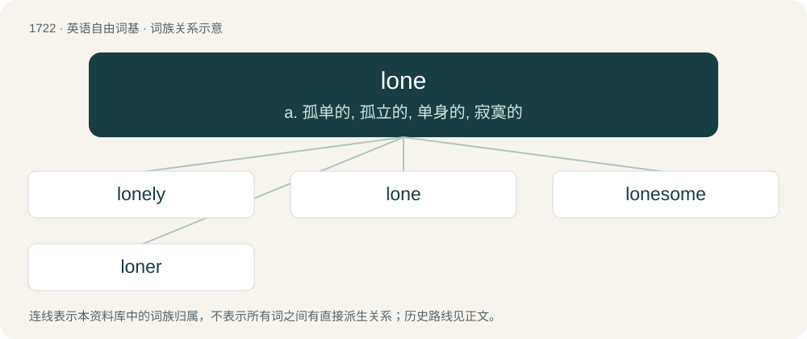

# 1822 · lone — a. 孤单的, 孤立的, 单身的, 寂寞的

[总目录](../00_总目录_按常用程度.md)

**类型**：英语自由词基　｜　**来源语言**：见词源记录

## 核心含义与来源

- 核心含义：a. 孤单的, 孤立的, 单身的, 寂寞的
- 英文含义：Solitary; having no companion.
- 词形：lone

**来源记录 1**（形容词；Solitary; having no companion.）

Shortened from alone.

## 词族图

## 单词速览（常用到不常用）

| 单词 | 音标 | 释义 |
|---|---|---|
| [lonely](#w-1) | 英 /ˈləʊnli/；美 /ˈloʊnli/ | a. 孤单的, 孤寂的, 荒凉的 |
| [lone](#w-2) | 英 /ləʊn/；美 /loʊn/ | a. 孤单的, 孤立的, 单身的, 寂寞的 |
| [lonesome](#w-3) | 英 /ˈləʊnsəm/；美 /ˈloʊnsəm/ | a. 寂寞的 |
| [loner](#w-4) | 英 /ˈləʊ.nə/；美 /ˈloʊ.nəɹ/ | n. 喜孤独的人, 不合群的动物 |

## 逐词详解

### 1. lonely

**词性**：形容词　｜　**音标**：英 /ˈləʊnli/；美 /ˈloʊnli/

**中文释义**：a. 孤单的, 孤寂的, 荒凉的

**英文义项**：Unhappy due to feeling isolated from contact with other people. / Unfrequented by people; desolate.

**构词拆分**：lone + -ly

**词源与演化**：

From lone + -ly, or from an apheretic shortening of alonely. See lone.

**例句**：

> Felt sad and lonely.

该用例对应义项：marked by dejection from being alone

### 2. lone

**词性**：形容词　｜　**音标**：英 /ləʊn/；美 /loʊn/

**中文释义**：a. 孤单的, 孤立的, 单身的, 寂寞的

**英文义项**：Solitary; having no companion. / Isolated or lonely; lacking companionship.

**词源与演化**：

Shortened from alone.

**用法示例／搭配（非完整句）**：

> the lone male audience member at the concert

该用例对应义项：Sole; being the only one of a type.

### 3. lonesome

**词性**：名词　｜　**音标**：英 /ˈləʊnsəm/；美 /ˈloʊnsəm/

**中文释义**：a. 寂寞的

**英文义项**：Oneself alone.

**构词拆分**：lone + -some

**词源与演化**：

From lone + -some, mid-17th century.

**例句**：

> I sat and watched the cars pass all by my lonesome.

该用例对应义项：Oneself alone.

### 4. loner

**词性**：名词　｜　**音标**：英 /ˈləʊ.nə/；美 /ˈloʊ.nəɹ/

**中文释义**：n. 喜孤独的人, 不合群的动物

**英文义项**：One who is alone, lacking or avoiding the company of others.

**构词拆分**：lone + -er

**词源与演化**：

From lone + -er.

**例句**：

> I actually enjoy being a loner.

该用例对应义项：One who is alone, lacking or avoiding the company of others.
