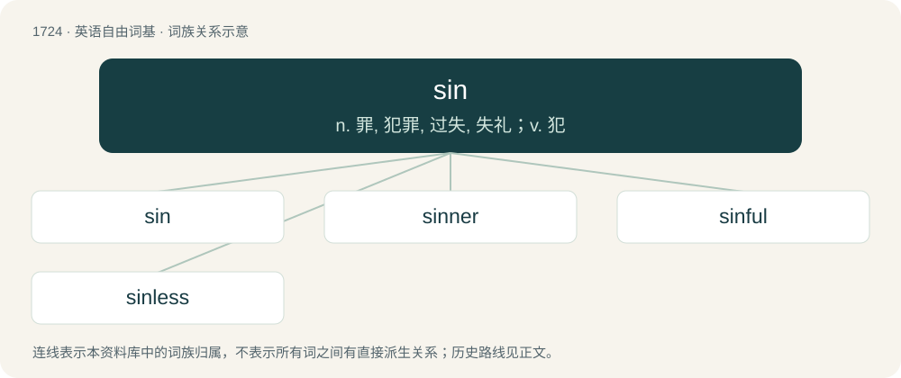

# 1824 · sin — n. 罪, 犯罪, 过失, 失礼；v. 犯

[总目录](../00_总目录_按常用程度.md)

**类型**：英语自由词基　｜　**来源语言**：见词源记录

## 核心含义与来源

- 核心含义：n. 罪, 犯罪, 过失, 失礼；v. 犯
- 英文含义：A violation of divine will or religious law.
- 词形：sin

**多个词源／构词路径**：同一拼写可能有不同来源；以下按词性和含义分别列出。

**来源记录 1**（名词；A violation of divine will or religious law.）

From Middle English sinne, synne, sunne, zen, from Old English synn (“sin”), from Proto-West Germanic \*sunnju, from Proto-Germanic \*sunjō (“truth, excuse”) and \*sundī, \*sundijō (“sin”), from , from \*h₁sónts ("being, true", implying a verdict of "truly guilty" against an accusation or charge), from \*h₁es- (“to be”); compare Old English sōþ ("true"; see sooth). Doublet of suttee. Cognates Cognate with Saterland Frisian Sände, Säände (“sin”), West Frisian sûnde (“sin”), German Sünde (“sin”), Luxembourgish Sënd, Sënn (“sin”), Vilamovian zynd (“sin”) Yiddish זינד (zind, “sin”), Danish, Faroese, Icelandic, Norwegian Bokmål, Norwegian Nynorsk and Swedish synd (“sin”), Gothic 𐍃𐌿𐌽𐌾𐌰 (sunja, “truth”), Latin sont-, sons (“sinful, guilty, criminal”).

**来源记录 2**（名词；A letter of the Hebrew alphabet; שׂ）

Modification of shin.

## 词族图

## 单词速览（常用到不常用）

| 单词 | 音标 | 释义 |
|---|---|---|
| [sin](#w-1) | /ˈsɪn/ | n. 罪, 犯罪, 过失, 失礼；v. 犯 |
| [sinner](#w-2) | 英 /ˈsɪnəː/；美 /ˈsɪnɚ/ | n. 罪人, 不知礼仪的人, 无赖；\[法\] 罪人, 无赖 |
| [sinful](#w-3) | /ˈsɪnfl̩/ | a. 有罪的, 罪孽深重的；\[法\] 有罪, 充满罪恶的 |
| [sinless](#w-4) | /ˈsɪnləs/ | a. 无罪的, 清白的；\[法\] 无罪的, 无辜的, 清白的 |

## 逐词详解

### 1. sin

**词性**：名词　｜　**音标**：/ˈsɪn/

**中文释义**：n. 罪, 犯罪, 过失, 失礼；v. 犯

**英文义项**：A violation of divine will or religious law. / Sinfulness, depravity, iniquity.

**词源与演化**：

From Middle English sinne, synne, sunne, zen, from Old English synn (“sin”), from Proto-West Germanic \*sunnju, from Proto-Germanic \*sunjō (“truth, excuse”) and \*sundī, \*sundijō (“sin”), from , from \*h₁sónts ("being, true", implying a verdict of "truly guilty" against an accusation or charge), from \*h₁es- (“to be”); compare Old English sōþ ("true"; see sooth). Doublet of suttee. Cognates Cognate with Saterland Frisian Sände, Säände (“sin”), West Frisian sûnde (“sin”), German Sünde (“sin”), Luxembourgish Sënd, Sënn (“sin”), Vilamovian zynd (“sin”) Yiddish זינד (zind, “sin”), Danish, Faroese, Icelandic, Norwegian Bokmål, Norwegian Nynorsk and Swedish synd (“sin”), Gothic 𐍃𐌿𐌽𐌾𐌰 (sunja, “truth”), Latin sont-, sons (“sinful, guilty, criminal”).

**例句**：

> As a Christian, I think this is a sin against God.

该用例对应义项：A violation of divine will or religious law.

### 2. sinner

**词性**：名词　｜　**音标**：英 /ˈsɪnəː/；美 /ˈsɪnɚ/

**中文释义**：n. 罪人, 不知礼仪的人, 无赖；\[法\] 罪人, 无赖

**英文义项**：A person who, by one particular action, has sinned. / An unregenerate person.

**构词拆分**：sin + -er

**词源与演化**：

From Middle English synnere, equivalent to sin + -er. Compare Saterland Frisian Säänder (“sinner”), West Frisian sûnder (“sinner”), Dutch zondaar (“sinner”), German Low German Sünder, Sünner (“sinner”), German Sünder (“sinner”), Danish synder (“sinner”), Swedish syndare (“sinner”), Icelandic syndari (“sinner”).

**例句**：

> Lord Jesus Christ, Son of God, have mercy on me, a sinner.

### 3. sinful

**词性**：形容词　｜　**音标**：/ˈsɪnfl̩/

**中文释义**：a. 有罪的, 罪孽深重的；\[法\] 有罪, 充满罪恶的

**英文义项**：Having sinned; guilty of sin. / Constituting a sin; morally or religiously wrong; wicked; evil.

**构词拆分**：sin + -ful

**词源与演化**：

From Middle English synful, senful, sunful, from Old English synful (“sinful, guilty, wicked, corrupt”), equivalent to sin + -ful. Compare Dutch zondevol (“sinful”), German sündevoll (“sinful”), Danish syndefuld (“sinful”), Swedish syndfull (“sinful”), Icelandic syndfullur (“sinful”).

**例句**：

> He said it was sinful to wear lipstick.

该用例对应义项：characterized by iniquity; wicked because it is believed to be a sin

### 4. sinless

**词性**：形容词　｜　**音标**：/ˈsɪnləs/

**中文释义**：a. 无罪的, 清白的；\[法\] 无罪的, 无辜的, 清白的

**英文义项**：Without sin; never having sinned.

**构词拆分**：sin + -less

**词源与演化**：

From Middle English synneles, senneles, from Old English synlēas (“without sin; sinless”), equivalent to sin + -less. Compare Dutch zondeloos (“sinless”), German Low German sündelos, sündlos (“sinless”), German sündenlos (“sinless”), Icelandic syndlaus (“sinless”).

**例句**：

> Those whose sins are forgiven are deemed to be sinless that they may find the way to heaven.
