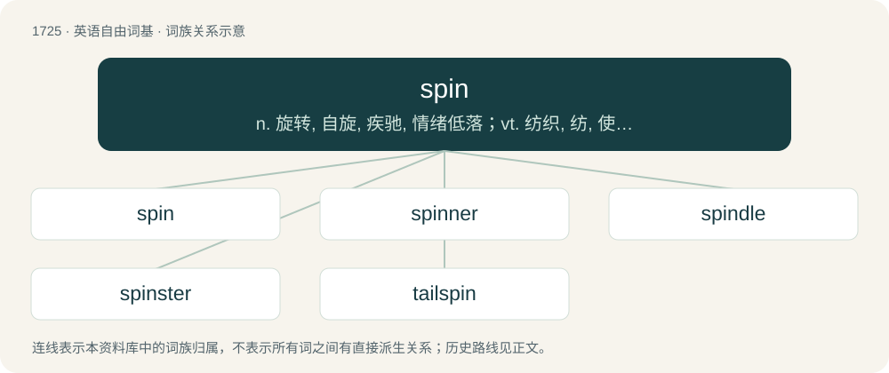

# 1825 · spin — n. 旋转, 自旋, 疾驰, 情绪低落；vt. 纺织, 纺, 使旋转, 编造；vi. 纺纱, 吐丝, 作茧, 结网, 旋转, 自旋, 疾驰

[总目录](../00_总目录_按常用程度.md)

**类型**：英语自由词基　｜　**来源语言**：见词源记录

## 核心含义与来源

- 核心含义：n. 旋转, 自旋, 疾驰, 情绪低落；vt. 纺织, 纺, 使旋转, 编造；vi. 纺纱, 吐丝, 作茧, 结网, 旋转, 自旋, 疾驰
- 英文含义：To rotate, revolve, gyrate (usually quickly); to partially or completely rotate to face another direction.
- 词形：spin

**多个词源／构词路径**：同一拼写可能有不同来源；以下按词性和含义分别列出。

**来源记录 1**（动词；To rotate, revolve, gyrate (usually quickly); to partially or completely rotate to face another direction.）

From Middle English spinnen, from Old English spinnan, from Proto-Germanic \*spinnaną, from Proto-Indo-European \*(s)penh₁-. Cognates Cognate with Dutch, German spinnen (“to spin”), Luxembourgish spannen (“to spin”), Yiddish שפּינען (shpinen, “spin”), Danish spinde (“to spin”), Faroese, Icelandic and Swedish spinna (“to spin”), Norwegian Bokmål, Norwegian Nynorsk spinne (“to spin”), Gothic 𐍃𐍀𐌹𐌽𐌽𐌰𐌽 (spinnan, “to spin”).

**来源记录 2**（名词；A special interest of an autistic person.）

Clipping of special interest.

## 词族图

## 单词速览（常用到不常用）

| 单词 | 音标 | 释义 |
|---|---|---|
| [spin](#w-1) | /spɪn/ | n. 旋转, 自旋, 疾驰, 情绪低落；vt. 纺织, 纺, 使旋转, 编造；vi. 纺纱, 吐丝, 作茧, 结网, 旋转, 自旋, 疾驰 |
| [spinner](#w-2) | 美 /ˈspɪnɚ/ | n. 纺纱工人, 旋床工人, 纺纱机, 机头罩, 旋转动作, (美)(非正式)卡车司机；\[计\] 微调控制项 |
| [spindle](#w-3) | /ˈspɪndəl/ | n. 纱锭, 纺锤, 轴, 心轴；vi. 变细长；vt. 装锭子于 |
| [spinster](#w-4) | 英 /ˈspɪnstə/；美 /ˈspɪnstɚ/ | n. 未婚女人, 老处女 |
| [tailspin](#w-5) | /ˈteilspin/ | n. 旋尾降落 |

## 逐词详解

### 1. spin

**词性**：动词　｜　**音标**：/spɪn/

**中文释义**：n. 旋转, 自旋, 疾驰, 情绪低落；vt. 纺织, 纺, 使旋转, 编造；vi. 纺纱, 吐丝, 作茧, 结网, 旋转, 自旋, 疾驰

**英文义项**：To rotate, revolve, gyrate (usually quickly); to partially or completely rotate to face another direction. / To enter, or remain in, a spin (abnormal stalled flight mode).

**词源与演化**：

From Middle English spinnen, from Old English spinnan, from Proto-Germanic \*spinnaną, from Proto-Indo-European \*(s)penh₁-. Cognates Cognate with Dutch, German spinnen (“to spin”), Luxembourgish spannen (“to spin”), Yiddish שפּינען (shpinen, “spin”), Danish spinde (“to spin”), Faroese, Icelandic and Swedish spinna (“to spin”), Norwegian Bokmål, Norwegian Nynorsk spinne (“to spin”), Gothic 𐍃𐍀𐌹𐌽𐌽𐌰𐌽 (spinnan, “to spin”).

**例句**：

> to spin along the road in a carriage, on a bicycle, etc.

该用例对应义项：To move swiftly.

### 2. spinner

**词性**：名词　｜　**音标**：美 /ˈspɪnɚ/

**中文释义**：n. 纺纱工人, 旋床工人, 纺纱机, 机头罩, 旋转动作, (美)(非正式)卡车司机；\[计\] 微调控制项

**英文义项**：Someone who or something that spins. / Someone who spins yarn from loose fiber.

**构词拆分**：spin + -er

**词源与演化**：

From Middle English spynnere; equivalent to spin + -er.

**例句**：

> I got a four on the spinner and moved my counter forward four spaces on the board.

该用例对应义项：A device that is spun in games to choose a number or symbol.

### 3. spindle

**词性**：名词　｜　**音标**：/ˈspɪndəl/

**中文释义**：n. 纱锭, 纺锤, 轴, 心轴；vi. 变细长；vt. 装锭子于

**英文义项**：A rod used for spinning and then winding fibres (especially wool), usually consisting of a shaft and a circular whorl positioned at either the upper or lower end of the shaft when suspended vertically from the forming thread. / A rod which turns, or on which something turns.

**构词拆分**：spin + -le

**词源与演化**：

From Middle English spyndel, spindle, spyndylle, from Old English spindle, spindel, alteration of earlier spinel, spinil, spinl (“spindle”), from Proto-West Germanic \*spinnilu (“spindle”), equivalent to spin + -le. Cognate with Scots spindil, spinnell (“spindle”), Dutch spindel ("spindle"; &lt; Middle Dutch spille, spinle), German Spindel (“spindle”), Danish spindel (“spindle”), Swedish spindel (“spindle”). The dragonfly sense (noun sense 14) is a calque of Swedish slända (dragonfly/spindle); this word was introduced by New Sweden settlers.

**用法示例／搭配（非完整句）**：

> the spindle of a vane

该用例对应义项：A rod which turns, or on which something turns.

### 4. spinster

**词性**：名词　｜　**音标**：英 /ˈspɪnstə/；美 /ˈspɪnstɚ/

**中文释义**：n. 未婚女人, 老处女

**英文义项**：A woman who has never been married, especially one past the typical marrying age according to social traditions. / One who spins (puts a spin on) a political media story so as to give something a favorable or advantageous appearance; a spin doctor, spin merchant or spinmeister.

**构词拆分**：spin + -ster

**词源与演化**：

From Middle English spynnestere (“woman who spins fibre”), from c. 1350; equivalent to spin + -ster. The semantic development is from a historical notion of unmarried women spinning thread for a living.

**例句**：

> His daughter remained spinster the rest of her life.

### 5. tailspin

**词性**：名词　｜　**音标**：/ˈteilspin/

**中文释义**：n. 旋尾降落

**英文义项**：The rapid, uncontrollable descent of an aircraft in a steep spiral. / A severe mental or emotional collapse; emotional breakdown.

**构词拆分**：tail + spin

**词源与演化**：

From tail + spin.

**例句**：

> Just hours after leaving the institution, she suffered another tailspin.

该用例对应义项：A severe mental or emotional collapse; emotional breakdown.
