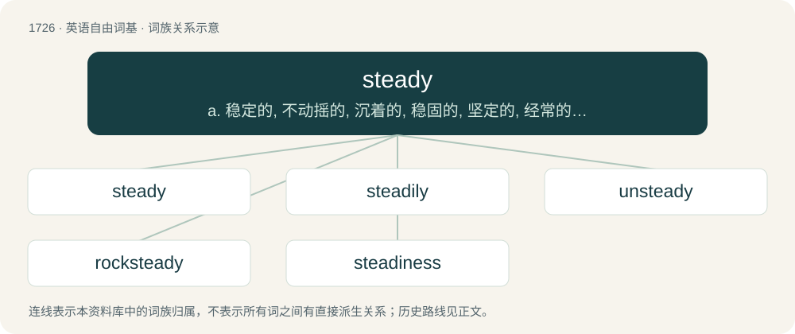

# 1826 · steady — a. 稳定的, 不动摇的, 沉着的, 稳固的, 坚定的, 经常的；vt. 使稳定, 使坚定；vi. 变为沉着, 稳固

[总目录](../00_总目录_按常用程度.md)

**类型**：英语自由词基　｜　**来源语言**：见词源记录

## 核心含义与来源

- 核心含义：a. 稳定的, 不动摇的, 沉着的, 稳固的, 坚定的, 经常的；vt. 使稳定, 使坚定；vi. 变为沉着, 稳固
- 英文含义：Firm in standing or position; not tottering or shaking; fixed; firm.
- 词形：steady

**来源记录 1**（形容词；Firm in standing or position; not tottering or shaking; fixed; firm.）

From Middle English stedy, studi, stidiȝ, perhaps continuing Old English stæþþiġ, ġestæþþiġ (“steadfast, stable, firm, staid”), equivalent to stead + -y; or calquing Middle Low German or Middle Dutch stēdig. Cognate with Saterland Frisian stoadig (“steady”), West Frisian stadich (“slow”), Danish stedig, stadig, steeg, Swedish stadig, Icelandic stöðugur, German stätig, stetig. Compare also Old English ġestedegian (“to bring to a standstill”) and Dutch steeds (“more and more”). Adjective sense 8 is a semantic loan from Singapore Hokkien 在 (chāi, “confident, skilled”, literally “steady”).

## 词族图

## 单词速览（常用到不常用）

| 单词 | 音标 | 释义 |
|---|---|---|
| [steady](#w-1) | /ˈstɛdi/ | a. 稳定的, 不动摇的, 沉着的, 稳固的, 坚定的, 经常的；vt. 使稳定, 使坚定；vi. 变为沉着, 稳固 |
| [steadily](#w-2) | /ˈstɛdɪli/ | adv. 稳定地, 无变化地, 有规则地 |
| [unsteady](#w-3) | /ʌnˈstɛdi/ | a. 不稳固的, 摇摆的, 不稳定的, 易变的, 不安定的, 不规则的, 古怪的, 无常的；vt. 使不稳定, 使不安定, 动摇 |
| [rocksteady](#w-4) | /ˈrɔk,stedi/ | n. (起源于牙买加的)慢拍摇滚乐, 慢拍摇滚舞 |
| [steadiness](#w-5) | /ˈstɛdinəs/ | n. 稳健, 坚定, 不变 |

## 逐词详解

### 1. steady

**词性**：形容词　｜　**音标**：/ˈstɛdi/

**中文释义**：a. 稳定的, 不动摇的, 沉着的, 稳固的, 坚定的, 经常的；vt. 使稳定, 使坚定；vi. 变为沉着, 稳固

**英文义项**：Firm in standing or position; not tottering or shaking; fixed; firm. / Constant in feeling, purpose, or pursuit; not fickle, changeable, or wavering; not easily moved or persuaded to alter a purpose; resolute.

**构词拆分**：stead + -y

**词源与演化**：

From Middle English stedy, studi, stidiȝ, perhaps continuing Old English stæþþiġ, ġestæþþiġ (“steadfast, stable, firm, staid”), equivalent to stead + -y; or calquing Middle Low German or Middle Dutch stēdig. Cognate with Saterland Frisian stoadig (“steady”), West Frisian stadich (“slow”), Danish stedig, stadig, steeg, Swedish stadig, Icelandic stöðugur, German stätig, stetig. Compare also Old English ġestedegian (“to bring to a standstill”) and Dutch steeds (“more and more”). Adjective sense 8 is a semantic loan from Singapore Hokkien 在 (chāi, “confident, skilled”, literally “steady”).

**例句**：

> Hold the ladder steady while I go up.

该用例对应义项：Firm in standing or position; not tottering or shaking; fixed; firm.

### 2. steadily

**词性**：副词　｜　**音标**：/ˈstɛdɪli/

**中文释义**：adv. 稳定地, 无变化地, 有规则地

**英文义项**：In a steady manner; with a steady progression.

**构词拆分**：steady + -ly

**词源与演化**：

From steady + -ly.

**例句**：

> He could still walk steadily.

该用例对应义项：in a steady manner

### 3. unsteady

**词性**：形容词　｜　**音标**：/ʌnˈstɛdi/

**中文释义**：a. 不稳固的, 摇摆的, 不稳定的, 易变的, 不安定的, 不规则的, 古怪的, 无常的；vt. 使不稳定, 使不安定, 动摇

**英文义项**：Not held firmly in position; physically unstable. / Lacking regularity or uniformity.

**构词拆分**：un- + steady

**词源与演化**：

From un- + steady. Like steady, the word first appeared in English around 1530. The word is comparable to Old Frisian onstedich, Low German unstadig, etc.

**例句**：

> A slightly unsteady item of furniture.

该用例对应义项：Not held firmly in position; physically unstable.

### 4. rocksteady

**词性**：名词　｜　**音标**：/ˈrɔk,stedi/

**中文释义**：n. (起源于牙买加的)慢拍摇滚乐, 慢拍摇滚舞

**英文义项**：A genre of Jamaican music somewhat slower than ska.

**构词拆分**：rock + steady

**词源与演化**：

From rock + steady.

### 5. steadiness

**词性**：名词　｜　**音标**：/ˈstɛdinəs/

**中文释义**：n. 稳健, 坚定, 不变

**英文义项**：The state of being steady. / The degree of stability.

**构词拆分**：steady + -ness

**词源与演化**：

From steady + -ness.

**例句**：

> Democratic presidential candidate Hillary Clinton says "steadiness" is the most important characteristic a president must have.
