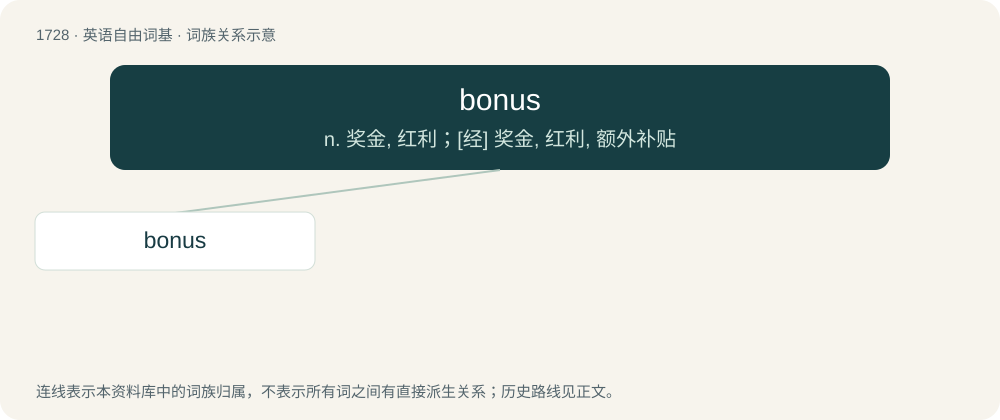

# 1829 · bonus — n. 奖金, 红利；\[经\] 奖金, 红利, 额外补贴

[总目录](../00_总目录_按常用程度.md)

**类型**：英语自由词基　｜　**来源语言**：见词源记录

## 核心含义与来源

- 核心含义：n. 奖金, 红利；\[经\] 奖金, 红利, 额外补贴
- 英文含义：Something extra that is good; an added benefit.
- 词形：bonus

**来源记录 1**（名词；Something extra that is good; an added benefit.）

Borrowed from Latin bonus (“good”). Doublet of bona.

## 词族图

## 单词速览（常用到不常用）

| 单词 | 音标 | 释义 |
|---|---|---|
| [bonus](#w-1) | 英 /ˈbəʊ.nəs/；美 /ˈboʊ.nəs/ | n. 奖金, 红利；\[经\] 奖金, 红利, 额外补贴 |

## 逐词详解

### 1. bonus

**词性**：名词　｜　**音标**：英 /ˈbəʊ.nəs/；美 /ˈboʊ.nəs/

**中文释义**：n. 奖金, 红利；\[经\] 奖金, 红利, 额外补贴

**英文义项**：Something extra that is good; an added benefit. / An extra sum given as a premium, e.g. to an employee or to a shareholder.

**词源与演化**：

Borrowed from Latin bonus (“good”). Doublet of bona.

**例句**：

> The employee of the week receives a bonus for his excellent work.

该用例对应义项：An extra sum given as a premium, e.g. to an employee or to a shareholder.
