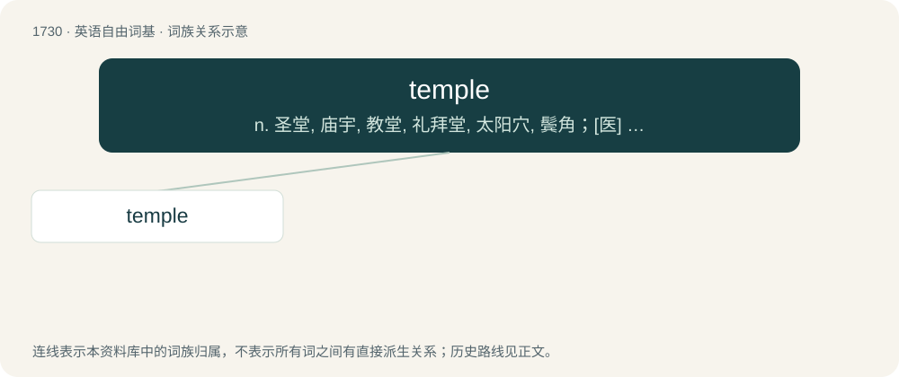

# 1831 · temple — n. 圣堂, 庙宇, 教堂, 礼拜堂, 太阳穴, 鬓角；\[医\] 颞颥, 颞部

[总目录](../00_总目录_按常用程度.md)

**类型**：英语自由词基　｜　**来源语言**：见词源记录

## 核心含义与来源

- 核心含义：n. 圣堂, 庙宇, 教堂, 礼拜堂, 太阳穴, 鬓角；\[医\] 颞颥, 颞部
- 英文含义：A house of worship dedicated to a polytheistic faith.
- 词形：temple

**多个词源／构词路径**：同一拼写可能有不同来源；以下按词性和含义分别列出。

**来源记录 1**（名词；A house of worship dedicated to a polytheistic faith.）

From Middle English temple, from Old English templ, tempel, borrowed from Latin templum (“shrine, temple, area for auspices”). Compare Old High German tempal (“temple”), also a borrowing from the Latin. Displaced native Old English ealh.

**来源记录 2**（名词；The slightly flatter region, on either side of the head of a vertebrate, including a human, behind the eye and forehead, above the zygomatic arch, and forward of the ear.）

From Middle English temple, from Old French temple, from Vulgar Latin \*temp(u)la, from Latin tempora (“the temples”), plural of tempus (“temple, head, face”). See temporal bone.

**来源记录 3**（名词；A contrivance used in a loom for keeping the web stretched transversely.）

Borrowed from Latin templum (“a small timber, a purlin”); compare templet and template.

## 词族图

## 单词速览（常用到不常用）

| 单词 | 音标 | 释义 |
|---|---|---|
| [temple](#w-1) | 美 /tɪm.pl̩/；/ˈtɛm.pl̩/ | n. 圣堂, 庙宇, 教堂, 礼拜堂, 太阳穴, 鬓角；\[医\] 颞颥, 颞部 |

## 逐词详解

### 1. temple

**词性**：名词　｜　**音标**：美 /tɪm.pl̩/；/ˈtɛm.pl̩/

**中文释义**：n. 圣堂, 庙宇, 教堂, 礼拜堂, 太阳穴, 鬓角；\[医\] 颞颥, 颞部

**英文义项**：A house of worship dedicated to a polytheistic faith. / Synonym of synagogue, especially a non-Orthodox synagogue.

**词源与演化**：

From Middle English temple, from Old English templ, tempel, borrowed from Latin templum (“shrine, temple, area for auspices”). Compare Old High German tempal (“temple”), also a borrowing from the Latin. Displaced native Old English ealh.

**例句**：

> The temple of Zeus was very large.

该用例对应义项：A house of worship dedicated to a polytheistic faith.
