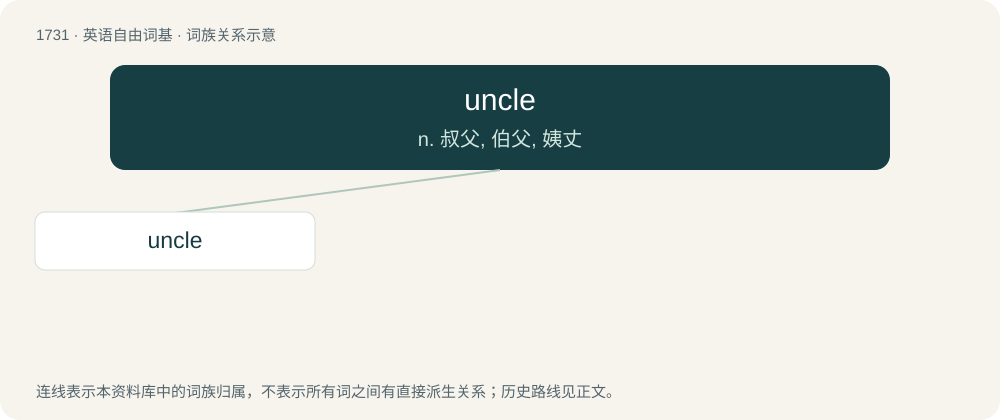

# 1832 · uncle — n. 叔父, 伯父, 姨丈

[总目录](../00_总目录_按常用程度.md)

**类型**：英语自由词基　｜　**来源语言**：见词源记录

## 核心含义与来源

- 核心含义：n. 叔父, 伯父, 姨丈
- 英文含义：The brother or brother-in-law of one’s parent.
- 词形：uncle

**来源记录 1**（名词；The brother or brother-in-law of one’s parent.）

From Middle English uncle, borrowed from Anglo-Norman uncle and Old French oncle, from Vulgar Latin \*aunclum, from Latin avunculus (“maternal uncle”, literally “little grandfather”), from Proto-Indo-European \*h₂euh₂-n-tlo- (“little grandfather”), a dialectal diminutive of \*h₂éwh₂ō (“grandfather, adult male relative other than one’s father”) (whence also Latin avus (“grandfather”)). Displaced native Middle English em (“uncle”) from Old English ēam (“maternal uncle”), containing the same Proto-Indo-European root, and Old English fædera (“paternal uncle”). Compare Saterland Frisian Unkel (“uncle”), Dutch nonkel (“uncle”), German Low German Unkel (“uncle”), German Onkel (“uncle”), Danish onkel (“uncle”). More at eam and eame.

## 词族图

## 单词速览（常用到不常用）

| 单词 | 音标 | 释义 |
|---|---|---|
| [uncle](#w-1) | /ˈʌŋ.kl̩/ | n. 叔父, 伯父, 姨丈 |

## 逐词详解

### 1. uncle

**词性**：名词　｜　**音标**：/ˈʌŋ.kl̩/

**中文释义**：n. 叔父, 伯父, 姨丈

**英文义项**：The brother or brother-in-law of one’s parent. / The male cousin of one’s parent.

**词源与演化**：

From Middle English uncle, borrowed from Anglo-Norman uncle and Old French oncle, from Vulgar Latin \*aunclum, from Latin avunculus (“maternal uncle”, literally “little grandfather”), from Proto-Indo-European \*h₂euh₂-n-tlo- (“little grandfather”), a dialectal diminutive of \*h₂éwh₂ō (“grandfather, adult male relative other than one’s father”) (whence also Latin avus (“grandfather”)). Displaced native Middle English em (“uncle”) from Old English ēam (“maternal uncle”), containing the same Proto-Indo-European root, and Old English fædera (“paternal uncle”). Compare Saterland Frisian Unkel (“uncle”), Dutch nonkel (“uncle”), German Low German Unkel (“uncle”), German Onkel (“uncle”), Danish onkel (“uncle”). More at eam and eame.

**例句**：

> This is the TV station where my uncle works as an announcer.
