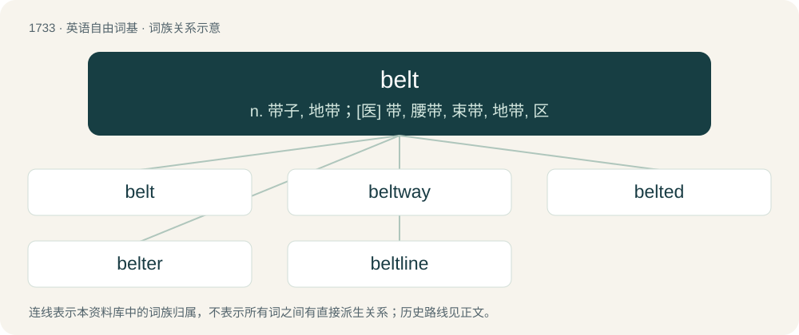

# 1834 · belt — n. 带子, 地带；\[医\] 带, 腰带, 束带, 地带, 区

[总目录](../00_总目录_按常用程度.md)

**类型**：英语自由词基　｜　**来源语言**：见词源记录

## 核心含义与来源

- 核心含义：n. 带子, 地带；\[医\] 带, 腰带, 束带, 地带, 区
- 英文含义：A band worn around the waist to hold clothing to one's body (usually pants), hold weapons (such as a gun or sword), or serve as a decorative piece of clothing.
- 词形：belt

**来源记录 1**（名词；A band worn around the waist to hold clothing to one's body (usually pants), hold weapons (such as a gun or sword), or serve as a decorative piece of clothing.）

From Middle English belt, from Old English belt (“belt, girdle”), from Proto-West Germanic \*baltī̆, from Proto-Germanic \*baltijaz (“girdle, belt”), from Latin balteus (“belt, sword-belt”), of Etruscan origin. Cognate with Scots belt (“belt”), Dutch belt, German Balz (“belt”), Danish bælte (“belt”), Norwegian Bokmål and Norwegian Nynorsk belte (“belt”), Swedish bälte (“belt, cincture, girdle, zone”), Faroese and Icelandic belti (“belt”).

## 词族图

## 单词速览（常用到不常用）

| 单词 | 音标 | 释义 |
|---|---|---|
| [belt](#w-1) | /ˈbɛlt/ | n. 带子, 地带；\[医\] 带, 腰带, 束带, 地带, 区 |
| [beltway](#w-2) | /ˈbɛltˌweɪ/ | n. &lt;美&gt;(环绕城市或某一地区的)环路,环形公路 |
| [belted](#w-3) | /ˈbɛltɪd/ | a. 束带的, 佩绶带的 |
| [belter](#w-4) | 英 /ˈbɛltə/；美 /ˈbɛltɚ/ | n. 了不起的人或事；嘹亮的歌 |
| [beltline](#w-5) | /ˈbeltlain/ | n. 一贯作业生产系统, 腰围 |

## 逐词详解

### 1. belt

**词性**：名词　｜　**音标**：/ˈbɛlt/

**中文释义**：n. 带子, 地带；\[医\] 带, 腰带, 束带, 地带, 区

**英文义项**：A band worn around the waist to hold clothing to one's body (usually pants), hold weapons (such as a gun or sword), or serve as a decorative piece of clothing. / A band used as a restraint for safety purposes, such as a seat belt.

**词源与演化**：

From Middle English belt, from Old English belt (“belt, girdle”), from Proto-West Germanic \*baltī̆, from Proto-Germanic \*baltijaz (“girdle, belt”), from Latin balteus (“belt, sword-belt”), of Etruscan origin. Cognate with Scots belt (“belt”), Dutch belt, German Balz (“belt”), Danish bælte (“belt”), Norwegian Bokmål and Norwegian Nynorsk belte (“belt”), Swedish bälte (“belt, cincture, girdle, zone”), Faroese and Icelandic belti (“belt”).

**例句**：

> The motor had a single belt that snaked its way back and forth around a variety of wheels.

该用例对应义项：A band that is used in a machine to help transfer motion or power.

### 2. beltway

**词性**：名词　｜　**音标**：/ˈbɛltˌweɪ/

**中文释义**：n. &lt;美&gt;(环绕城市或某一地区的)环路,环形公路

**英文义项**：A freeway that encircles a city.

**构词拆分**：belt + way

**词源与演化**：

From belt + way.

### 3. belted

**词性**：形容词　｜　**音标**：/ˈbɛltɪd/

**中文释义**：a. 束带的, 佩绶带的

**英文义项**：Fitted with a belt. / Wearing a belt.

**构词拆分**：belt + -ed

**词源与演化**：

From belt + -ed.

**用法示例／搭配（非完整句）**：

> the belted kingfisher

该用例对应义项：Characterized by a white band around the body.

### 4. belter

**词性**：名词　｜　**音标**：英 /ˈbɛltə/；美 /ˈbɛltɚ/

**中文释义**：n. 了不起的人或事；嘹亮的歌

**英文义项**：Anything that is particularly good of its class. / A very good-looking person.

**构词拆分**：belt + -er

**词源与演化**：

From belt (“hit”) + -er (agent noun suffix).

**例句**：

> I just first took notice about the Belter Creole from the television series The Expanse, on the 11th of May of 2024.

### 5. beltline

**词性**：名词　｜　**音标**：/ˈbeltlain/

**中文释义**：n. 一贯作业生产系统, 腰围

**英文义项**：The imaginary line marking the upper end of the lower body of an automobile, running just below the bottoms of the windows / A beltway: a circular expressway around a city

**构词拆分**：belt + line

**词源与演化**：

From belt + line.
