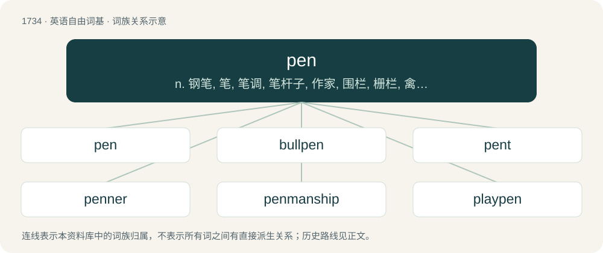

# 1835 · pen — n. 钢笔, 笔, 笔调, 笔杆子, 作家, 围栏, 栅栏, 禽畜；vt. 写, 关入栏中, 囚禁；vi. 动笔, 写作

[总目录](../00_总目录_按常用程度.md)

**类型**：英语自由词基　｜　**来源语言**：见词源记录

## 核心含义与来源

- 核心含义：n. 钢笔, 笔, 笔调, 笔杆子, 作家, 围栏, 栅栏, 禽畜；vt. 写, 关入栏中, 囚禁；vi. 动笔, 写作
- 英文含义：An enclosure (enclosed area) used to contain domesticated animals, especially sheep or cattle.
- 词形：pen

**多个词源／构词路径**：同一拼写可能有不同来源；以下按词性和含义分别列出。

**来源记录 1**（名词；An enclosure (enclosed area) used to contain domesticated animals, especially sheep or cattle.）

From Middle English pen, penne (“enclosure for animals”), from Old English penn (“enclosure, fold, pen”), from Proto-Germanic \*pennō, \*pannijō (“pin, bolt, nail, tack”), from Proto-Indo-European \*bend- (“pointed peg, nail, edge”). Related to pin. Sense “prison” originally figurative extension to “enclosure for persons” (1845), later influenced by penitentiary (“prison”), being analyzed as an abbreviation (1884).

**来源记录 2**（动词；To enclose in a pen.）

From Middle English pennen, from Old English \*pennian (“to close, lock, bolt”, attested in onpennian (“to open”)), derived from penn (see above). Akin to Low German pennen (“to secure a door with a bolt”).

**来源记录 3**（名词；A tool, originally made from a feather but now usually a small tubular instrument, containing ink used to write or make marks.）

From Middle English penne, from Anglo-Norman penne, from Old French penne, from Latin penna (“feather”), from Proto-Indo-European \*péth₂r̥ ~ pth₂én- (“feather, wing”), from \*peth₂- (“to rush, fly”, whence petition), root of \*petra-, whence Ancient Greek πτερόν (pterón, “wing”, whence pterodactyl), and also of Sanskrit पत्रम् (patram, “wing, feather”), Old Church Slavonic перо (pero, “pen”), Old Norse fjǫðr (“feather”), Old English feþer, feðer (Modern English feather); note the /p/ → /f/ Germanic sound change. Doublet of panne, penna, and pinna. See feather and πέτομαι (pétomai) for more. Not related to pencil.

**来源记录 4**（名词；A female swan.）

Origin uncertain. Compare hen.

**来源记录 5**（名词；Penalty.）

Clipping of penalty.

**来源记录 6**（名词；Penetration.）

Clipping of penetration.

## 词族图

## 单词速览（常用到不常用）

| 单词 | 音标 | 释义 |
|---|---|---|
| [pen](#w-1) | 英 /pɛn/；美 /pɪn/ | n. 钢笔, 笔, 笔调, 笔杆子, 作家, 围栏, 栅栏, 禽畜；vt. 写, 关入栏中, 囚禁；vi. 动笔, 写作 |
| [bullpen](#w-2) | /ˈbjlpen/ | n. &lt;美&gt;牛栏,&lt;口&gt;大房间(尤指候审犯人用的),\[棒球\]候补队员区 |
| [pent](#w-3) | /pɛnt/ | a. 被关禁的, 被关起来的；n. 单斜顶棚 |
| [penner](#w-4) | /ˈpɛnə(ɹ)/ | n. 执笔人, 写作人 |
| [penmanship](#w-5) | /ˈpenmənʃip/ | n. 书法, 笔法, 笔迹, 文体 |
| [playpen](#w-6) | /ˈpleipen/ | n. 游戏围栏 |
| [penman](#w-7) | /ˈpenmən/ | n. 笔者, 画家, 抄写员, 书法家 |
| [penknife](#w-8) | /ˈpennaif/ | n. 袖珍折刀 |

## 逐词详解

### 1. pen

**词性**：名词　｜　**音标**：英 /pɛn/；美 /pɪn/

**中文释义**：n. 钢笔, 笔, 笔调, 笔杆子, 作家, 围栏, 栅栏, 禽畜；vt. 写, 关入栏中, 囚禁；vi. 动笔, 写作

**英文义项**：An enclosure (enclosed area) used to contain domesticated animals, especially sheep or cattle. / A penitentiary, i.e. a state or federal prison for convicted felons.

**词源与演化**：

From Middle English pen, penne (“enclosure for animals”), from Old English penn (“enclosure, fold, pen”), from Proto-Germanic \*pennō, \*pannijō (“pin, bolt, nail, tack”), from Proto-Indo-European \*bend- (“pointed peg, nail, edge”). Related to pin. Sense “prison” originally figurative extension to “enclosure for persons” (1845), later influenced by penitentiary (“prison”), being analyzed as an abbreviation (1884).

**例句**：

> They caught him with a stolen horse, and he wound up in the pen again.

该用例对应义项：A penitentiary, i.e. a state or federal prison for convicted felons.

### 2. bullpen

**词性**：名词　｜　**音标**：/ˈbjlpen/

**中文释义**：n. &lt;美&gt;牛栏,&lt;口&gt;大房间(尤指候审犯人用的),\[棒球\]候补队员区

**英文义项**：An enclosed area used to hold bulls. / An enclosed area for pitchers to warm up in during a game.

**构词拆分**：From bull + pen.

**词源与演化**：

From bull + pen.

**例句**：

> Their bullpen is worn out after yesterday's doubleheader where both games went 12 innings.

该用例对应义项：The relief pitchers of a team collectively.

### 3. pent

**词性**：名词　｜　**音标**：/pɛnt/

**中文释义**：a. 被关禁的, 被关起来的；n. 单斜顶棚

**英文义项**：Confinement; concealment.

**构词拆分**：From pen + -t.

**词源与演化**：

From pen + -t.

**例句**：

> This is the result of many years of pent up anger and frustration.

### 4. penner

**词性**：名词　｜　**音标**：/ˈpɛnə(ɹ)/

**中文释义**：n. 执笔人, 写作人

**英文义项**：One who pens; a writer.

**构词拆分**：From pen + -er.

**词源与演化**：

From pen + -er.

### 5. penmanship

**词性**：名词　｜　**音标**：/ˈpenmənʃip/

**中文释义**：n. 书法, 笔法, 笔迹, 文体

**英文义项**：Synonym of handwriting or chirography, one's own style of writing. / Synonym of calligraphy, the art of beautiful writing.

**构词拆分**：pen + -manship

**词源与演化**：

From pen + -manship.

**例句**：

> A student's penmanship used to be graded, but the digital age has done away with that.

### 6. playpen

**词性**：名词　｜　**音标**：/ˈpleipen/

**中文释义**：n. 游戏围栏

**英文义项**：An enclosure in which babies or small children can play. / An area or domain in which a person can exercise their activities or endeavors freely.

**构词拆分**：play + pen

**词源与演化**：

From play + pen.

**例句**：

> Can you put the baby in the playpen?

### 7. penman

**词性**：名词　｜　**音标**：/ˈpenmən/

**中文释义**：n. 笔者, 画家, 抄写员, 书法家

**英文义项**：A scribe, or a person who copies texts. / A person with writing skills; a journalist or other author.

**构词拆分**：From pen + -man.

**词源与演化**：

From pen + -man.

### 8. penknife

**词性**：名词　｜　**音标**：/ˈpennaif/

**中文释义**：n. 袖珍折刀

**英文义项**：A small pocketknife; (loosely) any pocketknife. / A small knife designed for safe and convenient storage, typically in the form of a miniature clasp-knife, or with blade retractable into the handle.

**构词拆分**：pen + knife

**词源与演化**：

From Middle English penne knyfe; equivalent to pen + knife. In the original sense, named for its purpose: aiding the use of a (traditional) ink pen through the following tasks: trimming the tip of a quill pen, trimming a reed for a nib, and (in some cases) allowing erasure by scraping away some ink.

**例句**：

> He cut off a branch of the tree with his penknife.
