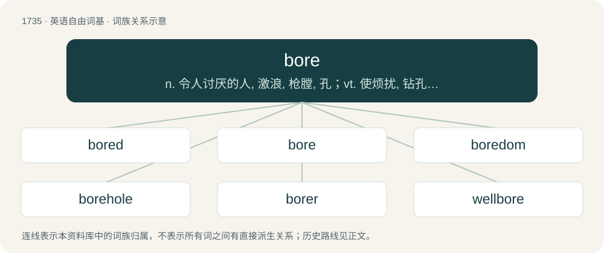

# 1836 · bore — n. 令人讨厌的人, 激浪, 枪膛, 孔；vt. 使烦扰, 钻孔；vi. 钻孔

[总目录](../00_总目录_按常用程度.md)

**类型**：英语自由词基　｜　**来源语言**：见词源记录

## 核心含义与来源

- 核心含义：n. 令人讨厌的人, 激浪, 枪膛, 孔；vt. 使烦扰, 钻孔；vi. 钻孔
- 英文含义：To inspire boredom in somebody.
- 词形：bore

**多个词源／构词路径**：同一拼写可能有不同来源；以下按词性和含义分别列出。

**来源记录 1**（动词；To inspire boredom in somebody.）

From Middle English boren, from Old English borian (“to pierce”), from Proto-West Germanic \*borōn, from Proto-Germanic \*burōną. Compare Danish bore, Norwegian Bokmål bore, Dutch boren, German bohren, Old Norse bora. Cognate with Latin forō (“to bore, to pierce”), Latin feriō (“strike, cut”) and Albanian birë (“hole”). Sense of wearying may come from a figurative use such as "to bore the ears"; compare German drillen.

**来源记录 2**（名词；A sudden and rapid flow of tide occurring in certain rivers and estuaries which rolls up as a wave.）

From Middle English \*bore, bare, a borrowing from Old Norse bára (“billow, wave”), from Proto-Germanic \*bērō (“that which bears or carries”), from Proto-Indo-European \*bʰer- (“to bear”). Cognate with Icelandic bára (“billow, wave”), Faroese bára (“billow, wave”). Doublet of bier.

## 词族图

## 单词速览（常用到不常用）

| 单词 | 音标 | 释义 |
|---|---|---|
| [bored](#w-1) | 英 /bɔːd/；美 /bɔɹd/ | a. 无聊的；烦人的；无趣的 |
| [bore](#w-2) | 英 /bɔː/；美 /boɹ/ | n. 令人讨厌的人, 激浪, 枪膛, 孔；vt. 使烦扰, 钻孔；vi. 钻孔 |
| [boredom](#w-3) | 英 /ˈbɔː.dəm/；美 /ˈbɔɹ.dəm/ | n. 厌烦, 厌倦, 令人厌烦的事物 |
| [borehole](#w-4) | /ˈbɔːhəul/ | n. 地上凿洞 |
| [borer](#w-5) | 英 /ˈbɔːɹə/；美 /ˈbɔːɹɚ/ | n. 穿孔者, 钻孔器, 钻孔虫；\[医\] 钻孔器, 钻蛀虫 |
| [wellbore](#w-6) | /ˈwelbɔː/ | 井眼 |

## 逐词详解

### 1. bored

**词性**：形容词　｜　**音标**：英 /bɔːd/；美 /bɔɹd/

**中文释义**：a. 无聊的；烦人的；无趣的

**英文义项**：Suffering from boredom; mildly annoyed and restless through having nothing to do. / Perforated by a hole or holes.

**构词拆分**：bore + -ed

**词源与演化**：

From bore + -ed.

**例句**：

> He was feeling bored so he decided to play Minecraft.

该用例对应义项：Suffering from boredom; mildly annoyed and restless through having nothing to do.

### 2. bore

**词性**：动词　｜　**音标**：英 /bɔː/；美 /boɹ/

**中文释义**：n. 令人讨厌的人, 激浪, 枪膛, 孔；vt. 使烦扰, 钻孔；vi. 钻孔

**英文义项**：To inspire boredom in somebody. / To make a hole through something.

**词源与演化**：

From Middle English boren, from Old English borian (“to pierce”), from Proto-West Germanic \*borōn, from Proto-Germanic \*burōną. Compare Danish bore, Norwegian Bokmål bore, Dutch boren, German bohren, Old Norse bora. Cognate with Latin forō (“to bore, to pierce”), Latin feriō (“strike, cut”) and Albanian birë (“hole”). Sense of wearying may come from a figurative use such as "to bore the ears"; compare German drillen.

**例句**：

> Reading books really bores me; films are much more exciting.

该用例对应义项：To inspire boredom in somebody.

### 3. boredom

**词性**：名词　｜　**音标**：英 /ˈbɔː.dəm/；美 /ˈbɔɹ.dəm/

**中文释义**：n. 厌烦, 厌倦, 令人厌烦的事物

**英文义项**：The state of being bored. / An instance or period of being bored; a bored state.

**构词拆分**：bore + -dom

**词源与演化**：

From bore + -dom.

**例句**：

> Mark kept switching tasks at work to avoid the pain of boredom.

### 4. borehole

**词性**：名词　｜　**音标**：/ˈbɔːhəul/

**中文释义**：n. 地上凿洞

**英文义项**：A hole bored into the ground to collect samples for analysis or to extract oil or water. / Any other hole that has been bored into something.

**构词拆分**：bore + hole

**词源与演化**：

From bore + hole.

**例句**：

> There were little boreholes in the oak beam, indicating that insects had once taken some interest in it.

该用例对应义项：Any other hole that has been bored into something.

### 5. borer

**词性**：名词　｜　**音标**：英 /ˈbɔːɹə/；美 /ˈbɔːɹɚ/

**中文释义**：n. 穿孔者, 钻孔器, 钻孔虫；\[医\] 钻孔器, 钻蛀虫

**英文义项**：A tool used for drilling. / A knife fit for a stabbing.

**构词拆分**：bore + -er

**词源与演化**：

From bore + -er.

**例句**：

> The emerald ash borer has killed more than a hundred million ash trees across North America.

### 6. wellbore

**词性**：名词　｜　**音标**：/ˈwelbɔː/

**中文释义**：井眼

**英文义项**：The hole produced when drilling an oil or gas well.

**构词拆分**：well + bore

**词源与演化**：

From well + bore.
